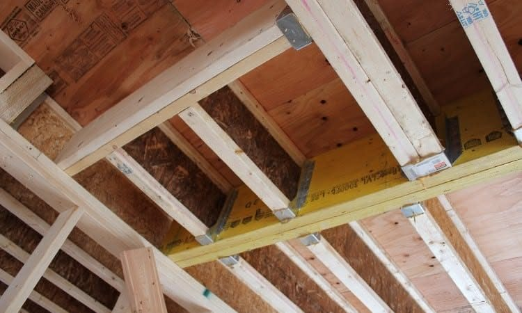

# Beam (балка)

<figure markdown>
  
  <figcaption markdown="span">Инструмент Beam: две точки по балке от опоры до опоры, программа округляет длину и создаёт Count-позицию `FB1 8` с первой меткой. Вторая балка той же марки и длины идёт в ту же позицию второй точкой.</figcaption>
</figure>

<figure markdown>
  { width="520" }
  <figcaption markdown="span">Flush beam из LVL в уровне joists: joists с обеих сторон висят на face-mount hangers. Балка идёт одной Count-позицией с длиной в имени, hangers считаются по числу концов joists на ней. Фото: plasticinehouse.com, [источник](https://plasticinehouse.com/how-far-can-a-lvl-beam-span-without-support/), найдено через Pinterest.</figcaption>
</figure>

## Что это

Beam - балка перекрытия или крыши, на которую опираются joists, rafters или посты: `(2) 2x10`, `(3) 1 3/4 x 11 7/8 LVL`, `5 1/4 x 11 7/8 PSL`, `5 1/2 x 14 GL`. Стальная балка by others, но деревянный nailer на ней наш: [Steel Beam Web Fillers](details/steelbeams.md). Перемычка над проёмом - [Headers](../../vertical/openings/headers.md); балка между усиленными rafters в крыше - [Roof Header](../roof-framing/header.md). Flush (в уровне joists, на hangers) и Dropped (ниже joists) пишутся в Label.

## Где искать на чертежах

| Лист | Что взять |
| --- | --- |
| S framing plan этажа | марки (`FB1`, `B2`, `H5`), положение, пролёт, опоры с обеих сторон |
| Beam schedule (S5xx, S6xx) | сечение, plies, материал по марке. Нет schedule - собери легенду сам по подписям на плане |
| Sections, details | flush или dropped, опирание, hangers, PSL и squash blocks под концами |
| General notes | EWP by others, nailer на стальных балках, сорт древесины |

## Размер, если beam schedule нет { #default-sizes }

Марка и сечение со S-листа всегда главнее. Если их нет, для flush-балок и центральной балки гаража бери дефолты E-Wood по пролёту:

| Балка | 6'-9' | 9'-12' | 12'-14' | 14'-16' | 16'-18' |
| --- | --- | --- | --- | --- | --- |
| Flush под перекрытием | `(2) LVL` высотой joists | `(2) LVL` высотой joists | `(3) LVL` высотой joists | `(3) LVL` высотой joists | `(3) 14" LVL` |
| Flush под перекрытием и крышей (под наружной стеной) | `(3) 9-1/2" LVL` | `(3) 11-7/8" LVL` | `(3) 14" LVL` | `(3) 16" LVL` | `(3) 18" LVL` |

| Центральная балка гаража | 22' | 24' | 26' |
| --- | --- | --- | --- |
| Сверху перекрытие | `(3) 16" LVL` | `(3) 18" LVL` | `(3) 24" LVL` |
| Только потолок | `(3) 14" LVL` | `(3) 16" LVL` | `(3) 18" LVL` |

До 6' и headers в стенах: [полная таблица на странице Headers](../../vertical/openings/headers.md#default-sizes).

## Как мерить в OurPlanCore

Инструмент Beam (B), лист framing с точкой F. Тяни линию по оси балки от грани опоры до грани опоры; длина в имени появляется сама.

- Округление делает программа: до 8' включительно вверх до целого фута, длиннее - вверх до чётного (9.2' даёт 10, 12.1' даёт 14). Не прибавляй футы сам.
- Один built-up beam = одна точка с `(n)` в имени. Не ставь n точек и `(n)` одновременно.
- Рисуй все балки, которые не часть панелей стены. Каждую марку на каждом этаже, где она показана.
- Марка с буквой H (`H5`) может быть балкой по роли; не уноси в `headers` только по букве.
- Ledger, rim, blocking, nailer - отдельные Line в `details`, не точки балки.
- Repeat Beam (кнопка рядом с Beam) чертит несколько отдельных балок подряд без повторного выбора инструмента.

## Как назвать в дереве и строка DFL

Путь: `framing/<этаж> framing/beams/<марка или сечение> <длина>`. Размер по марке берётся из легенды LG (`B2 - (3) 2x10`) при экспорте.

| Имя в дереве | A (Label) | B (материал) | C | D | E |
| --- | --- | --- | --- | --- | --- |
| `beams/FB1 8` | `Beam (2) Flush` | `2x10` | точки | `8` | `FB1 per S601` |
| `beams/(3) 1 3/4 x 11 7/8 LVL 14` | `Beam (3)` | `1 3/4 x 11 7/8 LVL` | точки | `14` | |
| `beams/B2 14` + LG `B2 - (3) 2x10` | `Beam (3) Dropped` | `2x10` | точки | `14` | `B2` |
| `beams/int 4x10 4` | `Beam` | `4x10` | точки | `4` | |
| `beams/H5 8` | `Beam (2)` | по schedule | точки | `8` | `H5` |

Hangers к балкам: по ширине built-up и условию (face, top, concealed, skew), на каждый конец, который висит на другой балке или стене. Подбор - [Hangers](../../../reference/hangers.md), запись в B - [формат крепежа в DFL](../../../reference/hangers.md#dfl-format). Снаружи и на P.T. - `Zmax` отдельным словом.

Экспорт: кнопка BM полосы XL заменяет только строки балок в листе этажа, шаблонные строки остаются. Макрос `C_BeamsSort` сортирует по марке и длине.

??? note "Built-up LVL: фактическая ширина"
    | Запись | Фактический размер |
    | --- | --- |
    | `(2) 1 3/4 x 9 1/2 LVL` | `3 1/2 x 9 1/2` |
    | `(3) 1 3/4 x 9 1/2 LVL` | `5 1/4 x 9 1/2` |
    | `(4) 1 3/4 x 9 1/2 LVL` | `7 x 9 1/2` |

    Ширина пакета задаёт hanger (`HU412` под `3 1/2 x 11 7/8`, `HGUS7.25/12` под `7 x 11 7/8`). На EWP-заказах (считаем только LVL, PSL, GL, I-joists) обычные 2x балки не входят: [EWP / Capital](../../../work-types/ewp-capital.md).

## Частые ошибки

- Марка пропущена на одном из этажей: та же `FB7` есть и на S102, и на S103.
- К длине инструмента прибавлены футы "на опирание" - округление уже сделано.
- Пакет из трёх LVL записан тремя точками и ещё `(3)` в имени: тройной счёт.
- PSL или squash blocks под концами балок по schedule не посчитаны (2 стало 4).
- Hangers не на оба конца или по закупочным доскам после раскроя; модель не по детали (`U210-2`, не `LUS210-2`).
- Балка внутри панели стены нарисована на panel-job.
- У балок Tri-Force и со стальными пластинами в B оставлены дроби дюймов: пиши ближайший фут.
- [Все ошибки по перекрытиям](../../../start/common-mistakes.md#floor)

## Пример

```text
framing/
  2nd floor framing/
    beams/
      FB1 8                        6 точек
      FB1 10                       2 точки
      (3) 1 3/4 x 11 7/8 LVL 14    3 точки
```

| A | B | C | D | E |
| --- | --- | --- | --- | --- |
| `Beam (2) Flush` | `2x10` | 6 | 8 | `FB1 per S601` |
| `Beam (2) Flush` | `2x10` | 2 | 10 | `FB1` |
| `Beam (3)` | `1 3/4 x 11 7/8 LVL` | 3 | 14 | `S102` |
| `Hangers` | `HU412` | 6 | pcs | `9/S501` |

## См. также

- [Post](post.md), [Joist](joist.md), [Steel Beam Web Fillers](details/steelbeams.md)
- [Hangers](../../../reference/hangers.md), [Quantity benchmarks](../../../reference/quantity-benchmarks.md)
- [Takeoff item labels](../../../reference/takeoff-items.md)
