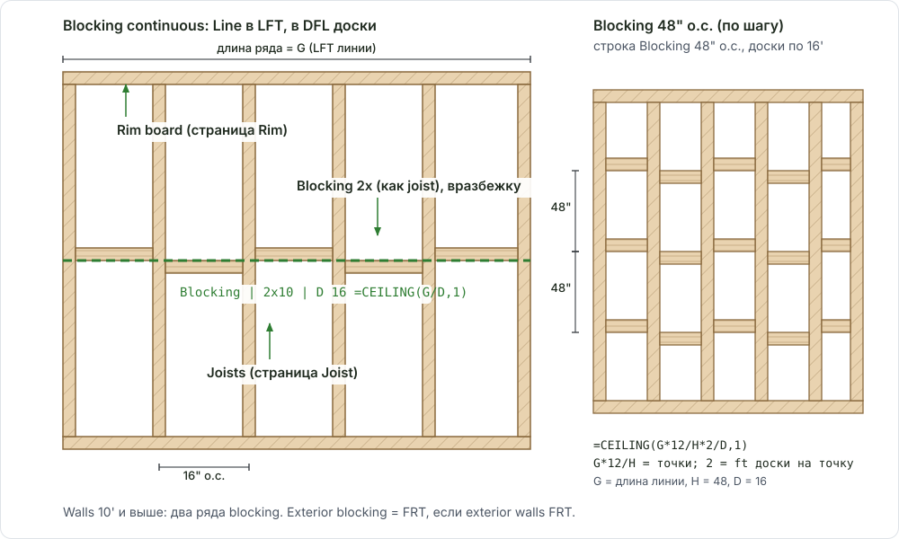
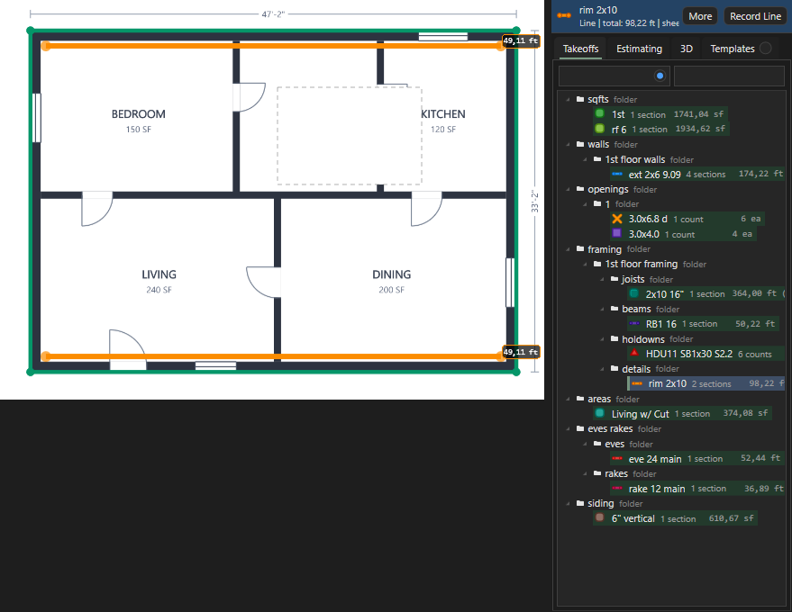

# Blocking

<figure markdown>
  
  <figcaption markdown="span">Blocking - short boards between joists or trusses. A solid row is measured as a Line along the row and goes into the DFL as 16' boards; rows at 48" o.c. are counted with the formula from the Blocking o.c. page.</figcaption>
</figure>

<figure markdown>
  { width="480" }
  <figcaption markdown="span">2x2 cross bridging between two joists under the subfloor. It is the same takeoff as blocking: one row across the span is counted in LFT by the row length; take the material and row spacing from the framing plan or details. Photo: gotknowhow.com, [source](http://gotknowhow.com/articles/how-to-cut-herringbone-joist-struts-for-14-half-spaced-2x10-joists), found via Pinterest.</figcaption>
</figure>

## What it is

Blocking is short boards between joists, trusses or studs: stiffness, support for panel edges, drywall backing, fireblocking. Kinds: joist blocking, blocking for drywall, bracing for trusses, blocking at eves, parapet blocking, blocking under the FRT subfloor strip, kitchen and bath blocking. Blocking inside wall panels is not counted on a panel job. Rows at a fixed spacing: [Blocking o.c.](blockingoc.md); drywall backing on a wall parallel to the joists: [Bracing for Drywall](bracingdrywall.md).

## Where to find it on the plans

| Sheet | What to take |
| --- | --- |
| Framing details, general notes | blocking rows between joists, size, spacing, FRT |
| Truss bracing note (`per 1/S5.00`) | bracing for trusses, 2x6 |
| Wall sections | blocking at eves, parapet blocking, blocking at the FRT subfloor strip |
| Kitchen and bath elevations | blocking for cabinets and grab bars |
| Steel beam details | LVL/LSL blocking at steel beams, even when EWP is by others |

## How to measure in OurPlanCore

Line (L) along the blocking row on the framing sheet with the F point; line length = row length. Takeoff `framing/<floor> framing/details/<name>`: `blocking for trusses`, `bd` (drywall), `bft`, `blocking 48`, detail number `12/S401`. A detail called out on several plans is traced on each one.

<figure markdown>
  
  <figcaption markdown="span">Line along where the detail applies: the line length goes to G of the DFL row, the detail name gives the M flag on export.</figcaption>
</figure>

## Tree name and DFL row

Export: the DT button puts details into J:L of the floor; the names `bft` and `bd` give flags in M (`bd bd` when doubled), the `C_RimBoardBlockingHangers` macro lays out the rows. All rows in LFT, D = board length 16.

| Tree name | A (Label) | B (material) | C | D | E |
| --- | --- | --- | --- | --- | --- |
| `details/blocking` | `Blocking` | joist size (`2x10`), `11 7/8 TJI` | `=CEILING(G*1.1/D,1)` | `16` | detail |
| `details/bd` | `Blocking for Drywall` | `2x4` | `=CEILING(G*1.1/D,1)` | `16` | details |
| `details/bft` | `Bracing for Trusses` | `2x6` by default; anything else only if the truss detail says so | by default 1 row for every 10' over the area under the trusses | `16` | truss detail or `assumed` |
| `details/blocking eves` | `Blocking at Eves` | `2x6` | `=CEILING(G*1.1/D,1)` | `16` | |
| `details/2x6 kitchen` | `Blocking` | `2x6` | 4 boards of 14' per kitchen, 1 per bath | `14` | |

- One factor for all rows: blocking, ribbon, ledger, drywall blocking = LFT x 1.1 once in the formula; rim 1.05 only on EWP, otherwise 1.1. The canonical numbers: [Formulas](../../../../reference/formulas.md#rim-ribbon-blocking-ledger).
- Bracing for trusses: by default `2x6` every 10' over the whole area under the roof, garage included. If the truss detail of this house gives another size or spacing, write it per the detail and add the sheet reference.
- Walls 10' and taller: two rows of blocking.
- Exterior blocking is FRT when the exterior wall is FRT. Parapet blocking FRT or P.T. per the detail.
- Kickers and braces are counted only when they are on a detail: firewall `(2) 2x6 @ 48`, gable kickers @ 5'.
- Cross bridging for I-joists `TB27`: `length x 2 x 12 / 16` pcs.
- `EWP by others`, but blocking at steel beams is shown: a `LVL`/`LSL` blocking row with a note and a measurement.

## Common mistakes

- Bracing for trusses not counted over the whole area under the roof (garage forgotten).
- Wall panel blocking counted separately on a panel job.
- Blocking under the edge of the FRT subfloor strip missed.
- 48" o.c. spacing counted as a solid row, or the other way around.
- Kickers added "out of habit" though the detail has none; or the detail gives three boards and one is written.
- Parapet blocking without FRT when the walls are FRT.
- [All floor framing mistakes](../../../../start/common-mistakes.md#floor)

## Example

| A | B | C | D | E |
| --- | --- | --- | --- | --- |
| `Blocking` | `11 7/8 TJI 230` | `=CEILING(G*1.1/D,1)` | 16 | `12/S401` |
| `Blocking for Drywall` | `2x4` | `=CEILING(G*1.1/D,1)` | 16 | `6/8/9/S400` |
| `Bracing for Trusses` | `2x6` | `=CEILING(G*1.1/D,1)` | 16 | `1/S5.00, template default, verify` |

## See also

- [Blocking o.c.](blockingoc.md), [Bracing for Drywall](bracingdrywall.md), [Ribbon Board](ribbon.md), [Rim Board](rim.md)
- [Formulas: Blocking](../../../../reference/formulas.md#blocking-formulas), [COM: Blocking in panelized](../../../../work-types/com.md)
