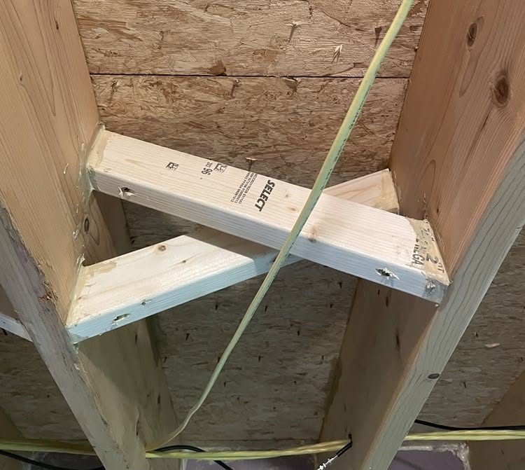

# Blocking

<figure markdown>
  
  <figcaption markdown="span">Blocking - short boards between joists or trusses. A solid row is measured as one Line by the row length, and in the DFL it is 16' boards; blocking at 48" o.c. is counted with the formula from the Blocking o.c. page.</figcaption>
</figure>

<figure markdown>
  { width="480" }
  <figcaption markdown="span">2x2 cross bridging between two joists under the subfloor. It is measured as a Line by the length of the bridging row; in the DFL it is its own row, `Cross Bridging` (wood 1x3, 16' boards) or `Cross Bridging for I Joists` (`TB27`, pcs). Take the material and row spacing from the framing plan or details. Photo: gotknowhow.com, [source](http://gotknowhow.com/articles/how-to-cut-herringbone-joist-struts-for-14-half-spaced-2x10-joists), found via Pinterest.</figcaption>
</figure>

## What it is

Blocking is short boards between joists, trusses or studs: stiffness, support for panel edges, drywall backing, fireblocking. Kinds: joist blocking, blocking for drywall, bracing for trusses, blocking at eves, parapet blocking, blocking under the FRT subfloor strip, kitchen and bath blocking. Blocking inside wall panels is not counted on a panel job. Pieces at a fixed spacing: [Blocking o.c.](blockingoc.md); drywall backing on a wall parallel to the joists and wall bracing: [Wall Bracing and Blocking for Drywall](bracingdrywall.md).

## Where to find it on the plans

| Sheet | What to take |
| --- | --- |
| Framing details, general notes | blocking rows between joists, size, spacing, FRT |
| Truss bracing note (`per 1/S5.00`) | bracing for trusses, 2x6 |
| Wall sections | blocking at eves, parapet blocking, blocking at the FRT subfloor strip |
| Kitchen and bath elevations | blocking for cabinets and grab bars |
| Steel beam details | LVL/LSL blocking at steel beams, even when EWP is by others |

## How to measure in OurPlanCore

Line (L) along the blocking row on the framing sheet with the F point; line length = row length. Takeoff `framing/<floor> framing/details/<name>`: `blocking for trusses`, `bd` (drywall), `bft`, `blocking 48`, detail number `12/S401`. A detail called out on several plans is traced on each one. One Line per row: do not cut it into 16' pieces, the formula counts the boards.

`bft` (bracing for trusses) is lines across the floor trusses, one line about every 10'. No line over bearing walls. Only where the floor trusses are by others: a floor of stick joists or TJI has no such row.

<figure markdown>
  
  <figcaption markdown="span">Line along where the detail applies: the line length goes to G of the DFL row, the detail name gives the M flag on export.</figcaption>
</figure>

## Tree name and DFL row

Export: the DT button puts details into J:L of the floor; the names `bft` and `bd` give flags in M (`bd bd` when doubled), the `C_RimBoardBlockingHangers` macro lays out the rows. The Line puts the length in LFT into G, and the formula divides it by D = 16: C holds 16' boards, not LFT.

| Tree name | A (Label) | B (material) | C | D | E |
| --- | --- | --- | --- | --- | --- |
| `details/blocking` | `Blocking` | per detail: joist size (`2x10`), `2x6`; `11 7/8 TJI` only if the detail shows I-joist blocking | `=CEILING(G/D,1)` | `16` | detail |
| `details/bd` | `Blocking for Drywall` | `2x4` | `=CEILING(G/D,1)` | `16` | details |
| `details/bft` | `Bracing for Trusses` | `2x6` | `=CEILING(G/D,1)` | `16` | `assumed` or truss detail |
| `details/blocking eves` | `Blocking at Eves` | `2x6` | `=CEILING(G/D*1.1,1)` | `16` | |
| `details/bridging` | `Cross Bridging` | `1x3` | `=CEILING(G*2.5/D,1)` | `16` | S sheet note |
| `details/bridging` | `Cross Bridging for I Joists` | `TB27` | `=CEILING(G*2*12/16,1)` | `pcs` | detail; `or solid blocking; verify` |
| `details/2x6 kitchen` | `Blocking` | `2x6` | 4 boards of 14' per kitchen, 1 per bath | `14` | |

`G` is the line length in LFT from OurPlanCore, `D` is the board length (16).

- In a framing book blocking, drywall blocking, ribbon, ledger and bracing for trusses are 16' boards: C = `G / D` rounded up, with no separate waste factor. On an EWP-only job continuous blocking stays in LFT with no factor. Summary: [Formulas](../../../../reference/formulas.md#rim-ribbon-blocking-ledger).
- Blocking inside walls (the `Blocking` row in the floor walls section and in Wall Materials) and parapet blocking stay in LFT: they are not framing list rows.
- `Bracing for Trusses` is a floor row: `2x6`, G = the sum of the `bft` lines across the floor trusses (one about every 10', not over bearing walls). Only where the floor trusses are by others; stick joists or TJI get no row. If the truss detail gives another size or spacing, write it per the detail and add the sheet reference.
- Roof truss bracing is another row, `Truss Bracing` on the [Roof Sheathing](../../roof-framing/roof-sheathing.md) page: `2x4`, from the area under the trusses. For the same trusses write one of the two rows, never both.
- Walls 10' and taller: two rows of blocking.
- Exterior blocking is FRT when the exterior wall is FRT. Parapet blocking FRT or P.T. per the detail.
- Kickers and braces are counted only when they are on a detail: firewall `(2) 2x6 @ 48`, gable kickers @ 5'.
- Cross bridging for sawn joists: `1x3`, 2.5 feet of board per foot of bridging row, 16' boards. Only when the S notes call for it; E holds the note sheet.
- Cross bridging for I-joists: `TB27` in pcs, 2 pieces for every joist space at 16" o.c. (`G x 2 x 12 / 16`). In E, after the detail, write `or solid blocking; verify`: the site may use solid blocking instead of the metal TB27.
- `EWP by others`, but blocking at steel beams is shown: a `LVL`/`LSL` blocking row with a note and a measurement.

## Common mistakes

- `Bracing for Trusses` (floor, `bft` lines) and `Truss Bracing` (roof, by area) mixed up, or both written for the same trusses.
- `bft` lines drawn over bearing walls, or on a floor of stick joists or TJI.
- `TB27` cross bridging written in LFT or as boards: it is pcs.
- Wall panel blocking counted separately on a panel job.
- Blocking under the edge of the FRT subfloor strip missed.
- 48" o.c. spacing counted as a solid row, or the other way around.
- Kickers added "out of habit" though the detail has none; or the detail gives three boards and one is written.
- Parapet blocking without FRT when the walls are FRT.
- [All floor framing mistakes](../../../../start/common-mistakes.md#floor)

## Example

| A | B | C | D | E | G |
| --- | --- | --- | --- | --- | --- |
| `Blocking` | `2x6` | `=CEILING(G/D,1)` | 16 | `12/S401` | 96 |
| `Blocking for Drywall` | `2x4` | `=CEILING(G/D,1)` | 16 | `6/8/9/S400` | 310 |
| `Bracing for Trusses` | `2x6` | `=CEILING(G/D,1)` | 16 | `assumed` | 252 |

96 / 16 = 6 boards; 310 / 16 = 19.4, so 20; 252 / 16 = 15.75, so 16.

## See also

- [Blocking o.c.](blockingoc.md), [Wall Bracing and Blocking for Drywall](bracingdrywall.md), [Ribbon Board](ribbon.md), [Rim Board](rim.md)
- [Formulas: Blocking](../../../../reference/formulas.md#blocking-formulas), [COM: Blocking in panelized](../../../../work-types/com.md)
