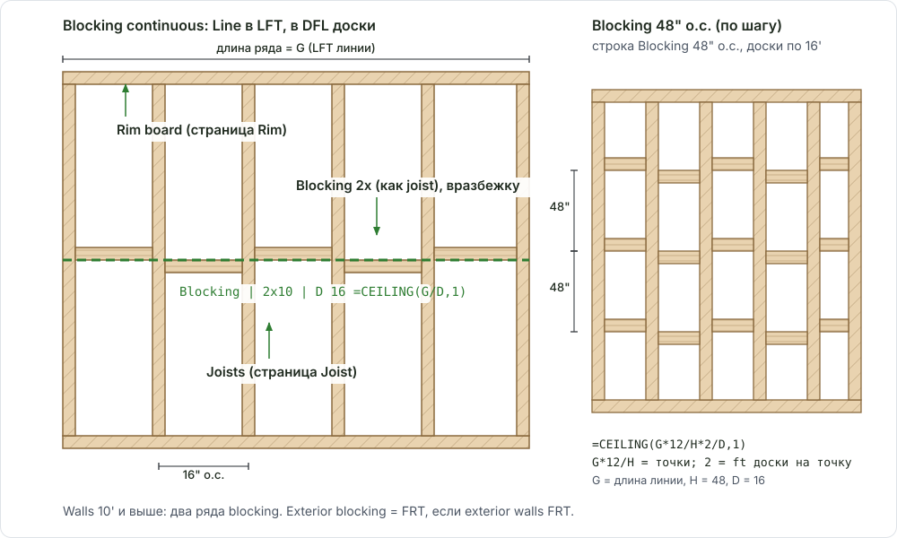
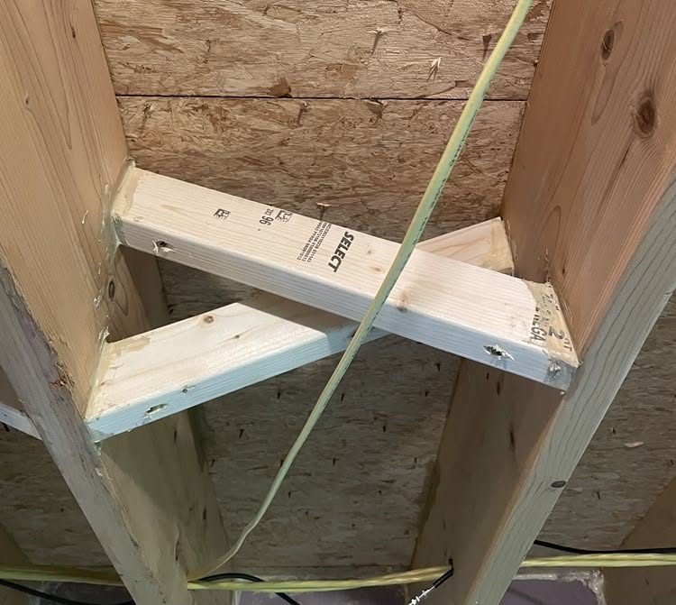

# Blocking (блокинг)

<figure markdown>
  
  <figcaption markdown="span">Blocking - короткие доски между joists или фермами. Сплошной ряд меряется одной Line по длине ряда, в DFL это доски по 16'; blocking с шагом 48" o.c. считается по формуле со страницы Blocking o.c.</figcaption>
</figure>

<figure markdown>
  { width="480" }
  <figcaption markdown="span">Bridging из 2x2 крестом между двумя joists под subfloor. Меряется Line по длине ряда bridging; в DFL это своя строка `Cross Bridging` (деревянный 1x3, доски по 16') или `Cross Bridging for I Joists` (`TB27`, pcs). Материал и шаг рядов берём с framing plan или деталей. Фото: gotknowhow.com, [источник](http://gotknowhow.com/articles/how-to-cut-herringbone-joist-struts-for-14-half-spaced-2x10-joists), найдено через Pinterest.</figcaption>
</figure>

## Что это

Blocking - короткие доски между joists, фермами или studs: жёсткость, опора кромок листов, опора гипса, противопожарный разрыв. Виды: joist blocking, blocking for drywall, bracing for trusses, blocking at eves, parapet blocking, blocking под FRT-полосой subfloor, kitchen и bath blocking. Blocking внутри панелей стен на panel-job не считается. Куски с фиксированным шагом - [Blocking o.c.](blockingoc.md); опора гипса на стене параллельно joists и bracing стен - [Wall Bracing и Blocking for Drywall](bracingdrywall.md).

## Где искать на чертежах

| Лист | Что взять |
| --- | --- |
| Framing details, general notes | ряды blocking между joists, сечение, шаг, FRT |
| Truss bracing note (`per 1/S5.00`) | bracing for trusses, 2x6 |
| Wall sections | blocking at eves, parapet blocking, blocking у FRT-полосы subfloor |
| Kitchen и bath elevations | blocking под шкафы и поручни |
| Steel beam details | LVL/LSL blocking у стальных балок, даже когда EWP by others |

## Как мерить в OurPlanCore

Line (L) по ряду blocking на листе framing с точкой F; длина линии = длина ряда. Позиция `framing/<этаж> framing/details/<имя>`: `blocking for trusses`, `bd` (drywall), `bft`, `blocking 48`, номер детали `12/S401`. Деталь, вызванная на нескольких планах, обводится на каждом. Одна Line на ряд: на куски по 16' её не режем, доски считает формула.

`bft` (bracing for trusses) - линии поперёк floor trusses, одна линия примерно каждые 10'. Над несущими стенами линию не ведём. Только там, где floor trusses by others: на перекрытии из stick joists или TJI строки нет.

<figure markdown>
  
  <figcaption markdown="span">Line по линии применения детали: длина линии уходит в G строки DFL, имя детали даёт флаг M при экспорте.</figcaption>
</figure>

## Как назвать в дереве и строка DFL

Экспорт: кнопка DT ставит детали в J:L этажа; имена `bft` и `bd` дают флаги в M (`bd bd` при двойном), макрос `C_RimBoardBlockingHangers` раскладывает строки. Line даёт в G длину в LFT, формула делит её на D = 16: в C стоят доски по 16', не LFT.

| Имя в дереве | A (Label) | B (материал) | C | D | E |
| --- | --- | --- | --- | --- | --- |
| `details/blocking` | `Blocking` | по детали: сечение joists (`2x10`), `2x6`; `11 7/8 TJI` только если деталь показывает I-joist blocking | `=ОКРВВЕРХ(G/D;1)` | `16` | деталь |
| `details/bd` | `Blocking for Drywall` | `2x4` | `=ОКРВВЕРХ(G/D;1)` | `16` | детали |
| `details/bft` | `Bracing for Trusses` | `2x6` | `=ОКРВВЕРХ(G/D;1)` | `16` | `assumed` или truss detail |
| `details/blocking eves` | `Blocking at Eves` | `2x6` | `=ОКРВВЕРХ(G/D*1.1;1)` | `16` | |
| `details/bridging` | `Cross Bridging` | `1x3` | `=ОКРВВЕРХ(G*2.5/D;1)` | `16` | нота S-листа |
| `details/bridging` | `Cross Bridging for I Joists` | `TB27` | `=ОКРВВЕРХ(G*2*12/16;1)` | `pcs` | деталь; `or solid blocking; verify` |
| `details/2x6 kitchen` | `Blocking` | `2x6` | 4 доски по 14' на кухню, 1 на ванную | `14` | |

`G` - длина линии в LFT из OurPlanCore, `D` - длина доски (16).

- В framing-книге blocking, drywall blocking, ribbon, ledger и bracing for trusses - доски по 16': C = `G / D` с округлением вверх, отдельного waste нет. На EWP-only заказе сплошной blocking остаётся в LFT без фактора. Сводка: [Формулы](../../../../reference/formulas.md#rim-ribbon-blocking-ledger).
- В LFT остаётся blocking внутри стен (строка `Blocking` в секции стен этажа и в Wall Materials) и parapet blocking: это не строки framing list.
- `Bracing for Trusses` - строка перекрытия: `2x6`, G = сумма линий `bft` поперёк floor trusses (одна примерно каждые 10', не над несущими стенами). Только где floor trusses by others; на stick joists или TJI строки нет. Если truss detail даёт другое сечение или шаг, пиши по детали и ставь ссылку на лист.
- Bracing ферм крыши - другая строка, `Truss Bracing` на странице [Roof Sheathing](../../roof-framing/roof-sheathing.md): `2x4`, от площади под фермами. Для одних и тех же ферм пишется одна из двух строк, не обе.
- Стены 10' и выше - два ряда blocking.
- Наружный blocking FRT, когда наружная стена FRT. Parapet blocking FRT или P.T. по детали.
- Kickers и braces считаются только когда они есть на детали: firewall `(2) 2x6 @ 48`, gable kickers @ 5'.
- Cross bridging деревянных joists: `1x3`, 2.5 фута доски на фут ряда bridging, доски по 16'. Только когда S-ноты его требуют; в E лист ноты.
- Cross bridging I-joists: `TB27` в pcs, 2 штуки на каждый пролёт между joists при шаге 16" (`G x 2 x 12 / 16`). В E после детали пишем `or solid blocking; verify`: вместо металлических TB27 на объекте могут поставить сплошной blocking.
- `EWP by others`, но blocking у стальных балок указан: строка `LVL`/`LSL` blocking с note и замером.

## Частые ошибки

- `Bracing for Trusses` (перекрытие, линии `bft`) и `Truss Bracing` (крыша, по площади) перепутаны или записаны оба для одних ферм.
- Линии `bft` проведены над несущими стенами или на перекрытии из stick joists или TJI.
- Cross bridging `TB27` записан в LFT или досками: это pcs.
- Blocking панели стены посчитан отдельно на panel-job.
- Blocking под кромкой FRT-полосы subfloor пропущен.
- Шаг 48" o.c. посчитан как сплошной ряд или наоборот.
- Kickers добавлены "по привычке", хотя на детали их нет; или деталь даёт три доски, а стоит одна.
- Parapet blocking без FRT при FRT-стенах.
- [Все ошибки по перекрытиям](../../../../start/common-mistakes.md#floor)

## Пример

| A | B | C | D | E | G |
| --- | --- | --- | --- | --- | --- |
| `Blocking` | `2x6` | `=ОКРВВЕРХ(G/D;1)` | 16 | `12/S401` | 96 |
| `Blocking for Drywall` | `2x4` | `=ОКРВВЕРХ(G/D;1)` | 16 | `6/8/9/S400` | 310 |
| `Bracing for Trusses` | `2x6` | `=ОКРВВЕРХ(G/D;1)` | 16 | `assumed` | 252 |

96 / 16 = 6 досок; 310 / 16 = 19.4, значит 20; 252 / 16 = 15.75, значит 16.

## См. также

- [Blocking o.c.](blockingoc.md), [Wall Bracing и Blocking for Drywall](bracingdrywall.md), [Ribbon Board](ribbon.md), [Rim Board](rim.md)
- [Формулы: Blocking](../../../../reference/formulas.md#blocking-formulas), [COM: Blocking в panelized](../../../../work-types/com.md)
