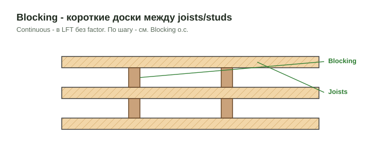

# Blocking (блокинг)

<figure markdown>
  
  <figcaption markdown="span">Blocking - короткие доски между joists или фермами. Сплошной ряд считается в LFT по длине ряда; ряды с шагом 48" o.c. считаются по формуле со страницы Blocking o.c.</figcaption>
</figure>

<!-- TODO-PHOTO: solid blocking between floor joists, EN query "floor joist blocking bridging" -->

## Что это

Blocking - короткие доски между joists, фермами или studs: жёсткость, опора кромок листов, опора гипса, противопожарный разрыв. Виды: joist blocking, blocking for drywall, bracing for trusses, blocking at eves, parapet blocking, blocking под FRT-полосой subfloor, kitchen и bath blocking. Blocking внутри панелей стен на panel-job не считается. Ряды с фиксированным шагом - [Blocking o.c.](blockingoc.md); опора гипса на стене параллельно joists - [Bracing for Drywall](bracingdrywall.md).

## Где искать на чертежах

| Лист | Что взять |
| --- | --- |
| Framing details, general notes | ряды blocking между joists, сечение, шаг, FRT |
| Truss bracing note (`per 1/S5.00`) | bracing for trusses, 2x6 |
| Wall sections | blocking at eves, parapet blocking, blocking у FRT-полосы subfloor |
| Kitchen и bath elevations | blocking под шкафы и поручни |
| Steel beam details | LVL/LSL blocking у стальных балок, даже когда EWP by others |

## Как мерить в OurPlanCore

Line (L) по ряду blocking на листе framing с точкой F; длина линии = длина ряда. Позиция `framing/<этаж> framing/details/<имя>`: `blocking for trusses`, `bd` (drywall), `bft`, `blocking 48`, номер детали `12/S401`. Деталь, вызванная на нескольких планах, обводится на каждом.

<figure markdown>
  
  <figcaption markdown="span">Line по линии применения детали: длина линии уходит в G строки DFL, имя детали даёт флаг M при экспорте.</figcaption>
</figure>

## Как назвать в дереве и строка DFL

Экспорт: кнопка DT ставит детали в J:L этажа; имена `bft` и `bd` дают флаги в M (`bd bd` при двойном), макрос `C_RimBoardBlockingHangers` раскладывает строки. Все строки в LFT, D = длина доски 16.

| Имя в дереве | A (Label) | B (материал) | C | D | E |
| --- | --- | --- | --- | --- | --- |
| `details/blocking` | `Blocking` | сечение joists (`2x10`), `11 7/8 TJI` | `=ОКРВВЕРХ(G*1.1/D;1)` | `16` | деталь |
| `details/bd` | `Blocking for Drywall` | `2x4` | `=ОКРВВЕРХ(G*1.1/D;1)` | `16` | детали |
| `details/bft` | `Bracing for Trusses` | по truss detail; в шаблоне по умолчанию `2x6` | ряды по площади под фермами, в шаблоне 1 ряд на каждые 10' | `16` | truss detail или `assumed` |
| `details/blocking eves` | `Blocking at Eves` | `2x6` | `=ОКРВВЕРХ(G*1.1/D;1)` | `16` | |
| `details/2x6 kitchen` | `Blocking` | `2x6` | 4 доски по 14' на кухню, 1 на ванную | `14` | |

- Фактор один на все строки: blocking, ribbon, ledger, drywall blocking = LFT x 1.1 один раз в формуле; rim 1.05 только на EWP, иначе 1.1. Канон цифр: [Формулы](../../../../reference/formulas.md#rim-ribbon-blocking-ledger).
- Bracing for trusses: сечение, шаг и материал по truss detail текущего дома; `2x6` каждые 10' - значение шаблона по умолчанию, а не правило. Если деталь даёт `2x4` или другой шаг, пиши по детали.
- Стены 10' и выше - два ряда blocking.
- Наружный blocking FRT, когда наружная стена FRT. Parapet blocking FRT или P.T. по детали.
- Kickers и braces считаются только когда они есть на детали: firewall `(2) 2x6 @ 48`, gable kickers @ 5'.
- Cross bridging I-joists `TB27`: `длина x 2 x 12 / 16` pcs.
- `EWP by others`, но blocking у стальных балок указан: строка `LVL`/`LSL` blocking с note и замером.

## Частые ошибки

- Bracing for trusses посчитан не на всю площадь под крышей (гараж забыт).
- Blocking панели стены посчитан отдельно на panel-job.
- Blocking под кромкой FRT-полосы subfloor пропущен.
- Шаг 48" o.c. посчитан как сплошной ряд или наоборот.
- Kickers добавлены "по привычке", хотя на детали их нет; или деталь даёт три доски, а стоит одна.
- Parapet blocking без FRT при FRT-стенах.
- [Все ошибки по перекрытиям](../../../../start/common-mistakes.md#floor)

## Пример

| A | B | C | D | E |
| --- | --- | --- | --- | --- |
| `Blocking` | `11 7/8 TJI 230` | `=ОКРВВЕРХ(G*1.1/D;1)` | 16 | `12/S401` |
| `Blocking for Drywall` | `2x4` | `=ОКРВВЕРХ(G*1.1/D;1)` | 16 | `6/8/9/S400` |
| `Bracing for Trusses` | `2x6` | `=ОКРВВЕРХ(G*1.1/D;1)` | 16 | `1/S5.00, template default, verify` |

## См. также

- [Blocking o.c.](blockingoc.md), [Bracing for Drywall](bracingdrywall.md), [Ribbon Board](ribbon.md), [Rim Board](rim.md)
- [Формулы: Blocking](../../../../reference/formulas.md#blocking-formulas), [COM: Blocking в panelized](../../../../work-types/com.md)
