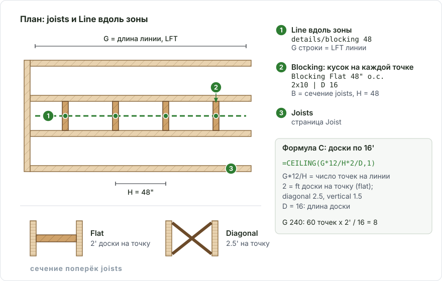

# Blocking o.c.

<figure markdown>
  
  <figcaption markdown="span">Blocking rows at 48" across the joists: the number of pieces is counted from the zone length and the spacing, not as a solid row.</figcaption>
</figure>

## What it is

Blocking o.c. is blocking laid out across the span at a fixed spacing, usually `48" o.c.`: flat (laid flat between joists), diagonal (crossed, bridging) or vertical (between studs). It is counted from the zone length and the spacing, not in LFT of a solid row. Solid blocking and all its kinds: [Blocking](blocking.md).

## Where to find it on the plans

| Sheet | What to take |
| --- | --- |
| Framing notes, typical details | row spacing (`48" o.c.`), type: flat, diagonal, vertical |
| Framing plan | zone length along the joists where the rows are needed |
| Wall details (shear, fire) | vertical blocking between studs at a spacing |

## How to measure in OurPlanCore

Line (L) along the joists through the zone (zone length across the rows) on the framing sheet with the F point. Takeoff `framing/<floor> framing/details/blocking 48` or with the detail number. The LFT of the line goes to G of the row.

## Tree name and DFL row

| A (Label) | B | C (formula, English Excel names) | D | H |
| --- | --- | --- | --- | --- |
| `Blocking Flat 48" o.c.` | joist size | `=CEILING(G*12/H*2*1.1/D,1)` | `16` | `48` |
| `Blocking Diagonal 48" o.c.` | `2x` | `=CEILING(G*12/H*2.5*1.1/D,1)` | `16` | `48` |
| `Vertical Blocking 16" o.c.` | `2x4` | `=CEILING(G*12/H*1.5/D,1)` | `16` | `16` |

What the letters mean: `G` - zone LFT (line length), `H` - spacing in inches, `D` - board length in feet (16), `1.1` - waste, the multiplier - blocking type.

| Type | Multiplier |
| --- | --- |
| Flat | `2` |
| Diagonal | `2.5` |
| Vertical | `1.5` |

The canonical multiplier table: [Formulas, Blocking formulas](../../../../reference/formulas.md#blocking-formulas).

## Common mistakes

- `1.1` added a second time though G already includes waste.
- Spacing taken from the template, not from the job note.
- The formula applied to in-panel blocking on a panel job.
- Plates and wall blocking converted to pcs though the template expects LFT.
- [All floor framing mistakes](../../../../start/common-mistakes.md#floor)

## Example

| A | B | C | D | E | G | H |
| --- | --- | --- | --- | --- | --- | --- |
| `Blocking Flat 48" o.c.` | `2x10` | `=CEILING(G*12/H*2*1.1/D,1)` | 16 | `note 7 per S001` | 240 | 48 |

With G = 240 LFT: 240 x 12 / 48 = 60 rows, x 2 = 120 pieces, x 1.1 = 132, / 16 = 9 boards of 16'.

## See also

- [Blocking](blocking.md), [Ribbon Board](ribbon.md), [Formulas](../../../../reference/formulas.md)
