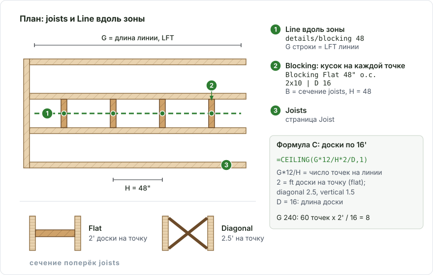

# Blocking o.c. (блокинг с шагом)

<figure markdown>
  
  <figcaption markdown="span">Blocking с шагом 48": куски стоят вдоль одной линии через каждые 48". Количество считается по длине этой линии и шагу, не как сплошной ряд.</figcaption>
</figure>

## Что это

Blocking o.c. - отдельные куски blocking, которые стоят не сплошным рядом, а через шаг вдоль одной линии: по верху перегородки под фермами (кусок между фермами каждые `48" o.c.`), вдоль несущей линии, между studs стены. Типы: flat (плашмя между двумя joists или фермами), diagonal (наискось), vertical (между studs). Считается по длине линии и шагу, а не как сплошной ряд. Сплошной blocking и все его виды - [Blocking](blocking.md).

## Где искать на чертежах

| Лист | Что взять |
| --- | --- |
| Framing notes, typical details | шаг (`48" o.c.`), тип (flat, diagonal, vertical), сечение, длина куска |
| Framing plan | линия, вдоль которой стоят куски: перегородка под фермами, несущая линия |
| Wall details (shear, fire) | vertical blocking между studs с шагом |

## Как мерить в OurPlanCore

Line (L) вдоль линии, по которой стоят куски blocking, на листе framing с точкой F: по перегородке, по несущей линии, по ряду. Правила:

1. Одна Line на каждый ряд blocking. Два параллельных ряда - две линии.
2. Линия идёт вдоль ряда, не поперёк и не через всю зону: формула считает точки вдоль линии.
3. Позиция `framing/<этаж> framing/details/blocking 48` или с номером детали; шаг в имени. В G строки уходит длина линии в LFT, без waste.

## Как назвать в дереве и строка DFL

Шаг стоит в колонке H и печатается в Label.

| A (Label) | B | C (формула, русская локаль Excel) | D | H |
| --- | --- | --- | --- | --- |
| `Blocking 48" o.c.` | по детали: `2x4` плашмя или сечение joists | `=ОКРВВЕРХ(G*12/H*2/D;1)` | `16` | `48` |
| `Diagonal Blocking 48" o.c.` | `2x4` | `=ОКРВВЕРХ(G*12/H*3/D;1)` | `16` | `48` |
| `Vertical Blocking 48" o.c.` | `2x4` | `=ОКРВВЕРХ(G*12/H*2/D;1)` | `16` | `48` |

Что значат буквы:

- `G` - длина линии в футах (LFT из OurPlanCore). Waste в ней нет.
- `H` - шаг в дюймах.
- `G*12/H` - число точек blocking вдоль линии.
- множитель (`2`, `3`) - сколько футов доски уходит на одну точку.
- `D` - длина доски в футах (16).

Точки x футы на точку = LFT доски; LFT / 16 = доски. Отдельного waste в формуле нет: запас даёт округление вверх до целой доски.

| Тип | Футов доски на точку |
| --- | --- |
| Flat (кусок плашмя между двумя элементами) | `2` |
| Diagonal | `3` |
| Vertical (между studs) | `2` |

Если деталь даёт другую длину куска или несколько кусков в одной точке, множитель берётся по детали: футы доски на одну точку. Сводка формул: [Формулы, Blocking formulas](../../../../reference/formulas.md#blocking-formulas).

## Частые ошибки

- Линия проведена поперёк рядов или через всю зону. `G` должна быть длиной линии, вдоль которой стоят куски.
- В формулу добавлен `1.1`. `G` - это длина линии, waste в ней нет; в формуле шаблона его тоже нет.
- Blocking с шагом посчитан как сплошной ряд: при 48" это вдвое больше досок.
- Шаг взят из шаблона, а не из ноты проекта.
- Формула применена к in-panel blocking на panel-job.
- Plates и wall blocking переведены в pcs, хотя шаблон ждёт LFT.
- [Все ошибки по перекрытиям](../../../../start/common-mistakes.md#floor)

## Пример

| A | B | C | D | E | G | H |
| --- | --- | --- | --- | --- | --- | --- |
| `Blocking 48" o.c.` | `2x4` | `=ОКРВВЕРХ(G*12/H*2/D;1)` | 16 | `note 7 per S001` | 240 | 48 |

Линия по перегородке 240 LFT, шаг 48": 240 x 12 / 48 = 60 точек; 60 x 2' = 120 LFT доски; 120 / 16 = 7.5, значит 8 досок по 16'.

## См. также

- [Blocking](blocking.md), [Ribbon Board](ribbon.md), [Формулы](../../../../reference/formulas.md)
