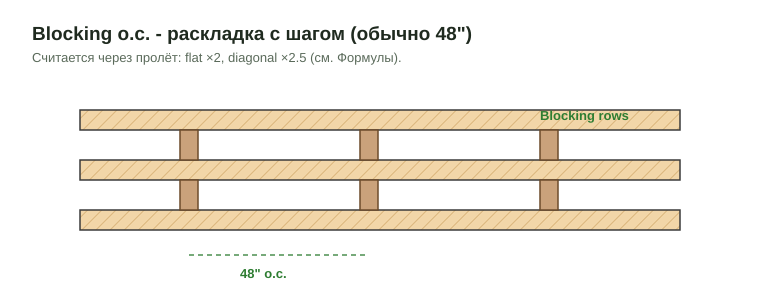

# Blocking o.c. (блокинг с шагом)

<figure markdown>
  
  <figcaption markdown="span">Ряды blocking с шагом 48" поперёк joists: количество кусков считается по длине зоны и шагу, не как сплошной ряд.</figcaption>
</figure>

## Что это

Blocking o.c. - раскладка блокинга поперёк пролёта с фиксированным шагом, обычно `48" o.c.`: flat (плашмя между joists), diagonal (крест-накрест, bridging) или vertical (между studs). Считается через длину зоны и шаг, не в LFT сплошного ряда. Сплошной blocking и все его виды - [Blocking](blocking.md).

## Где искать на чертежах

| Лист | Что взять |
| --- | --- |
| Framing notes, typical details | шаг рядов (`48" o.c.`), тип: flat, diagonal, vertical |
| Framing plan | длина зоны вдоль joists, где ряды нужны |
| Wall details (shear, fire) | vertical blocking между studs с шагом |

## Как мерить в OurPlanCore

Line (L) вдоль joists через зону (длина зоны поперёк рядов) на листе framing с точкой F. Позиция `framing/<этаж> framing/details/blocking 48` или с номером детали. В G строки уходит LFT линии.

## Как назвать в дереве и строка DFL

| A (Label) | B | C (формула, русская локаль Excel) | D | H |
| --- | --- | --- | --- | --- |
| `Blocking Flat 48" o.c.` | сечение joists | `=ОКРВВЕРХ(G*12/H*2*1.1/D;1)` | `16` | `48` |
| `Blocking Diagonal 48" o.c.` | `2x` | `=ОКРВВЕРХ(G*12/H*2.5*1.1/D;1)` | `16` | `48` |
| `Vertical Blocking 16" o.c.` | `2x4` | `=ОКРВВЕРХ(G*12/H*1.5/D;1)` | `16` | `16` |

Что значат буквы: `G` - LFT зоны (длина линии), `H` - шаг в дюймах, `D` - длина доски в футах (16), `1.1` - waste, множитель - тип блокинга.

| Тип | Множитель |
| --- | --- |
| Flat | `2` |
| Diagonal | `2.5` |
| Vertical | `1.5` |

Канон таблицы множителей: [Формулы, Blocking formulas](../../../../reference/formulas.md#blocking-formulas).

## Частые ошибки

- `1.1` поставлен второй раз, хотя G уже содержит waste.
- Шаг взят из шаблона, а не из ноты проекта.
- Формула применена к in-panel blocking на panel-job.
- Plates и wall blocking переведены в pcs, хотя шаблон ждёт LFT.
- [Все ошибки по перекрытиям](../../../../start/common-mistakes.md#floor)

## Пример

| A | B | C | D | E | G | H |
| --- | --- | --- | --- | --- | --- | --- |
| `Blocking Flat 48" o.c.` | `2x10` | `=ОКРВВЕРХ(G*12/H*2*1.1/D;1)` | 16 | `note 7 per S001` | 240 | 48 |

При G = 240 LFT: 240 x 12 / 48 = 60 рядов, x 2 = 120 кусков, x 1.1 = 132, / 16 = 9 досок по 16'.

## См. также

- [Blocking](blocking.md), [Ribbon Board](ribbon.md), [Формулы](../../../../reference/formulas.md)
