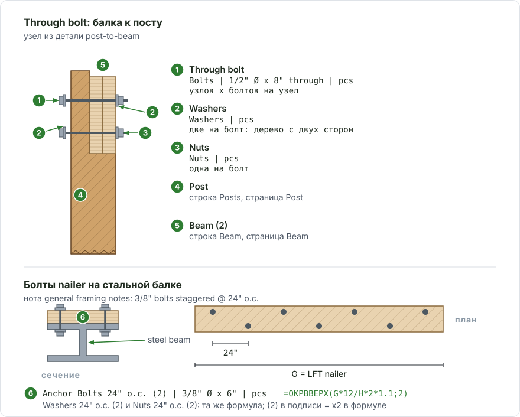

# Bolts

<figure markdown>
  
  <figcaption markdown="span">Top: through bolt beam to post, rows `Bolts`, `Washers` (two per bolt, wood on both sides) and `Nuts`. Bottom: nailer bolts on a steel beam staggered at 24" o.c.: three template rows with one formula.</figcaption>
</figure>

<!-- TODO-PHOTO: Simpson Titen HD anchor with plate washer in sill plate, EN query "Titen HD anchor washer sill plate" -->

## What it is

Bolts are the bolts from connection details: beam-to-post through bolts, nailer bolts to a steel beam, ledger bolts, holdown bolts. Every bolt row comes with `Washers` and `Nuts` rows. We do not count nails: they are bought by the box. Anchors to the foundation (Titen HD, wedge anchor, J-bolt per the SW schedule) have their canonical page at [Anchor Bolts](../../../deck/anchor-bolts.md); this page covers only connection bolts.

## Where to find it on the plans

| Sheet | What to take |
| --- | --- |
| Connection details (post-to-beam, ledger, steel beam nailer) | diameter, length, spacing, how many per connection, washer |
| General framing notes | typical nailer note: `3/8" bolts staggered @ 24" o.c.` |
| Holdown schedule | holdown bolts, if not included with the product |
| Scope, client notes | ATS rod system by others - do not count |

## How to measure in OurPlanCore

A separate measurement is rarely needed: the length comes from the detail Line (`details/2x10 ledger + screws`, `details/nailer`), the number of connections from the Count of posts or beams. Point bolts per details: Count (P) with the detail name.

## Tree name and DFL row

The `blt` macro (insert bolts) gives three rows at once. Formulas in pcs, rounded up to an even number (significance 2).

How to read the label `Anchor Bolts 24" o.c. (2)`: it is the template label, built by the macro. `24" o.c.` is the spacing from column H of the bolts row, `(2)` is the number of bolts at one point (in the book it sits in H of the `Washers` row). The word `Anchor` here does not mean an anchor into concrete: through bolts of a nailer or ledger carry the same label.

In the formula `G` is the length of the connection line in LFT (steel beam, ledger), `H` is the spacing in inches, `G*12/H` is the number of points, `2` is the bolts per point.

| A (Label) | B | C | D | E |
| --- | --- | --- | --- | --- |
| `Anchor Bolts 24" o.c. (2)` | `3/8" Ø x 6"` | `=CEILING(G*12/H*2,2)` | `pcs` | detail |
| `Washers 24" o.c. (2)` | `3/8" Washers` | same formula; x 2 when there are washers on both sides | `pcs` | |
| `Nuts 24" o.c. (2)` | `Nuts for 3/8" Ø` | same formula | `pcs` | |
| `Bolts` | `1/2" Ø x 8" through` | connections x bolts per connection | `pcs` | beam-to-post detail |

- One washer per bolt; two when there is wood on both sides (through bolt).
- The washer matches the bolt diameter: a 5/8" bolt does not get a 1/2" washer. A 3x3 plate washer only when the detail or the SW schedule calls for it; otherwise a regular washer.
- Bolts are written on their own floor, next to the beam or ledger they belong to.
- Screws need no washers or nuts: [Screws](screws.md).

## Common mistakes

- One Label for a detail with bolts and a detail with screws.
- Wrong washer diameter, or `3x3 Square` everywhere by default.
- The nuts or washers row missed.
- Steel beam nailer bolts missed, nailer counted as single: [Steel Beam Web Fillers](steelbeams.md).
- ATS rod counted when the scope is by others.
- Ledger bolts taken from another floor.
- [All floor framing mistakes](../../../../start/common-mistakes.md#floor)

## Example

| A | B | C | D | E | G | H |
| --- | --- | --- | --- | --- | --- | --- |
| `Anchor Bolts 24" o.c. (2)` | `3/8" Ø x 6"` | `=CEILING(G*12/H*2,2)` | pcs | `note II.B per S101` | 86 | 24 |
| `Washers 24" o.c. (2)` | `3/8" Washers` | `=CEILING(G*12/H*2,2)` | pcs | | | 2 |
| `Nuts 24" o.c. (2)` | `Nuts for 3/8" Ø` | `=CEILING(G*12/H*2,2)` | pcs | | | |

A nailer on an 86 LFT steel beam, 2 bolts per point at 24" o.c.: 86 x 12 / 24 = 43 points, x 2 = 86 bolts; the same number of washers and nuts. In the book G and the spacing sit only in the bolt row, and the `Washers` and `Nuts` formulas take them from there; H of the `Washers` row holds 2 (bolts per point), and that number prints in the `(2)` of the labels.

## See also

- [Anchor Bolts](../../../deck/anchor-bolts.md) - anchors to concrete, SW schedule
- [Screws](screws.md), [Steel Beam Web Fillers](steelbeams.md), [Hardware catalog](../../../../reference/hardware-catalog.md)
- [Holdowns](../../../vertical/sheathing/holdowns.md) - shear wall anchorage, 1 to concrete and 2 through the floor
