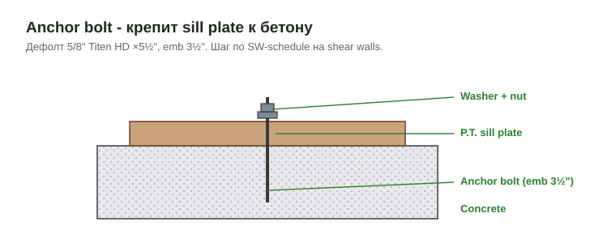

# Bolts (болты, шайбы, гайки)

<figure markdown>
  
  <figcaption markdown="span">Болт с шайбой и гайкой: три строки в DFL. Шаг и диаметр по детали, одна шайба на болт, две - когда дерево с обеих сторон.</figcaption>
</figure>

<!-- TODO-PHOTO: Simpson Titen HD anchor with plate washer in sill plate, EN query "Titen HD anchor washer sill plate" -->

## Что это

Bolts - болты из деталей соединений: through bolts балка-пост, болты nailer к стальной балке, ledger bolts, holdown bolts. К каждой строке болтов идут строки `Washers` и `Nuts`. Гвозди не считаем: их покупают коробками. Анкеры к фундаменту (Titen HD, wedge anchor, J-bolt по SW schedule) - канон на странице [Anchor Bolts](../../../deck/anchor-bolts.md); здесь только болты узлов.

## Где искать на чертежах

| Лист | Что взять |
| --- | --- |
| Details узлов (post-to-beam, ledger, steel beam nailer) | диаметр, длина, шаг, сколько на узел, шайба |
| General framing notes | типовая нота nailer: `3/8" bolts staggered @ 24" o.c.` |
| Holdown schedule | болты holdown, если не в комплекте изделия |
| Scope, notes клиента | ATS rod system by others - не считать |

## Как мерить в OurPlanCore

Отдельный замер нужен редко: длина берётся из Line детали (`details/2x10 ledger + screws`, `details/nailer`), количество узлов - из Count постов или балок. Точечные болты по деталям - Count (P) с именем детали.

## Как назвать в дереве и строка DFL

Макрос `blt` (вставка болтов) даёт сразу три строки. Формулы в pcs; результат меньше 50 округляется до чётного (значимость 2).

| A (Label) | B | C | D | E |
| --- | --- | --- | --- | --- |
| `Anchor Bolts 24" o.c. (2)` | `3/8" Ø x 6"` | `=ОКРВВЕРХ(G*12/H*2*1.1;2)` | `pcs` | деталь |
| `Washers 24" o.c. (2)` | `3/8" Washers` | та же формула | `pcs` | |
| `Nuts 24" o.c. (2)` | `Nuts for 3/8" Ø` | та же формула | `pcs` | |
| `Bolts` | `1/2" Ø x 8" through` | узлов x болтов на узел | `pcs` | деталь балка-пост |

- Одна шайба на болт; две - когда дерево с обеих сторон (through bolt).
- Шайба под диаметр болта: у 5/8" болта не 1/2" шайба. Plate washer 3x3 только когда деталь или SW schedule её требует; иначе обычная washer.
- Болты пишутся по своему этажу, рядом с балкой или ledger, к которым относятся.
- У screws шайбы и гайки не нужны: [Screws](screws.md).

## Частые ошибки

- Один Label на деталь с болтами и деталь со screws.
- Шайба не того диаметра или `3x3 Square` везде по умолчанию.
- Строка nuts или washers пропущена.
- Болты nailer стальной балки пропущены, nailer посчитан одинарным: [Steel Beam Web Fillers](steelbeams.md).
- ATS rod посчитан при scope by others.
- Болты ledger взяты с другого этажа.
- [Все ошибки по перекрытиям](../../../../start/common-mistakes.md#floor)

## Пример

| A | B | C | D | E | G | H |
| --- | --- | --- | --- | --- | --- | --- |
| `Anchor Bolts 24" o.c. (2)` | `3/8" Ø x 6"` | `=ОКРВВЕРХ(G*12/H*2*1.1;2)` | pcs | `note II.B per S101` | 86 | 24 |
| `Washers 24" o.c. (2)` | `3/8" Washers` | `=ОКРВВЕРХ(G*12/H*2*1.1;2)` | pcs | | 86 | 24 |
| `Nuts 24" o.c. (2)` | `Nuts for 3/8" Ø` | `=ОКРВВЕРХ(G*12/H*2*1.1;2)` | pcs | | 86 | 24 |

## См. также

- [Anchor Bolts](../../../deck/anchor-bolts.md) - анкеры к бетону, SW schedule
- [Screws](screws.md), [Steel Beam Web Fillers](steelbeams.md), [Hardware catalog](../../../../reference/hardware-catalog.md)
- [Holdowns](../../../vertical/sheathing/holdowns.md) - анкеровка shear walls, 1 к бетону и 2 через перекрытие
