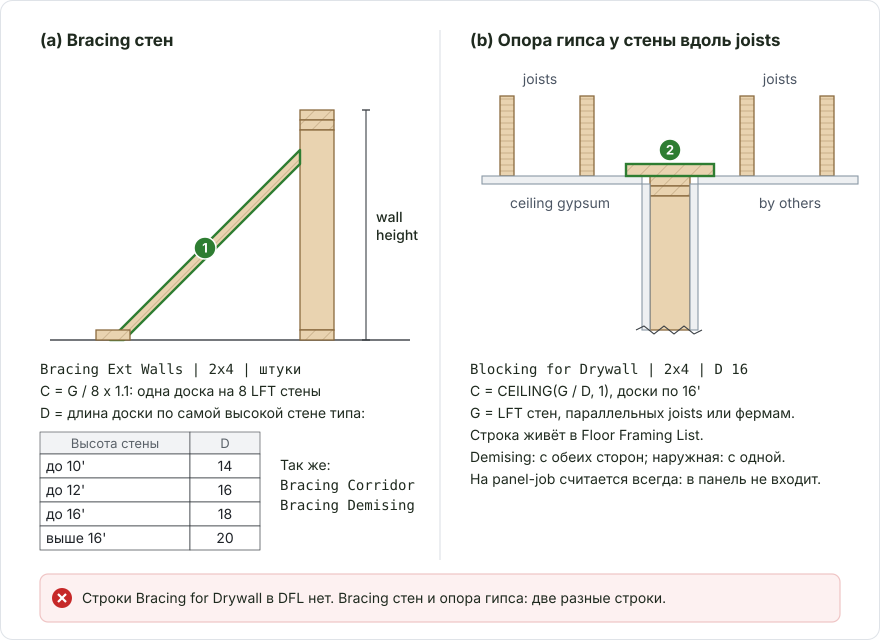

# Bracing for Drywall

<figure markdown>
  
  <figcaption markdown="span">Two different rows. (a) Wall bracing: 2x4 by the piece, one board per 8 LFT of wall, board length by wall height. (b) Backing for the ceiling drywall at a wall parallel to the joists: a board along the top of the wall, row `Blocking for Drywall`.</figcaption>
</figure>

<!-- TODO-PHOTO: 2x4 drywall backing / ledger on top plate of a wall parallel to joists, EN query "drywall backing blocking top plate parallel joists" -->

## What it is

Bracing (drywall bracing, drywall ledger) is `2x4` boards that back the drywall edge where a wall runs parallel to the joists or trusses: on exterior walls on one side, on demising walls on both sides, on corridor walls. These are wall rows, not floor rows, but the board length is picked by the wall height. On a panel job it is always counted, because it is not part of the panel. Blocking between joists: [Blocking](blocking.md); ribbon under the joists: [Ribbon Board](ribbon.md).

## Where to find it on the plans

| Sheet | What to take |
| --- | --- |
| Floor framing plan | which walls run parallel to the joists and trusses |
| Wall schedule, sections | wall heights by type: ext, corridor, demising |
| Ceiling details, RCP | drywall ledger, dropped soffit (a soffit is not bracing) |

## How to measure in OurPlanCore

No separate measurement is needed: the length comes from the floor walls (`walls/<floor> floor walls/ext ...`, `corr`, `dem`). If bracing is shown only on part of the walls, draw a Line (L) along those runs in `framing/<floor> framing/details/bracing`.

## Tree name and DFL row

Three rows per floor, by wall type. G = LFT of walls of that type, D = board length from the table, C = `G / 8 x 1.1`: one board for every 8 LFT of wall plus 10%.

| A (Label) | B | C | D | G |
| --- | --- | --- | --- | --- |
| `Bracing Ext Walls` | `2x4` | `=CEILING(G/8*1.1,1)` | by height | LFT of ext walls on the floor |
| `Bracing Corridor` | `2x4` | `=CEILING(G/8*1.1,1)` | by height | LFT of corridor walls |
| `Bracing Demising` | `2x4` | `=CEILING(G/8*1.1,1)` | by height | LFT of demising, two sides per the detail |

Board length by the tallest wall of the type on the floor (this is the canonical table; [COM](../../../../work-types/com.md) links here):

| Wall height | Bracing length |
| --- | --- |
| up to 10' inclusive | `14'` |
| over 10' up to 12' | `16'` |
| over 12' up to 16' | `18'` |
| over 16' | `20'` |

Export: the WL button on the XL strip moves the walls to `A3`; the bracing rows are filled from the same LFT. If the detail gives a ledger instead of bracing, Label `Blocking for Drywall` and the `bd` flag.

## Common mistakes

- Board length not by wall height: an 11' wall got 14' instead of 16'.
- Demising counted on one side; the detail gives both.
- A dropped soffit taken for bracing: soffits are counted on [Ceiling / Soffit Framing](../../ceiling-soffit-framing.md).
- On a panel job the bracing was thrown out with the panels, though it is not part of the panel.
- [All wall mistakes](../../../../start/common-mistakes.md#walls)

## Example

| A | B | C | D | E | G |
| --- | --- | --- | --- | --- | --- |
| `Bracing Ext Walls` | `2x4` | `=CEILING(G/8*1.1,1)` | 16 | `6/S400` | 412 |
| `Bracing Corridor` | `2x4` | `=CEILING(G/8*1.1,1)` | 16 | | 161 |
| `Bracing Demising` | `2x4` | `=CEILING(G/8*1.1,1)` | 16 | `both sides` | 648 |

## See also

- [Blocking](blocking.md), [Ribbon Board](ribbon.md)
- [Demising Walls](../../../vertical/walls/demising.md), [Exterior Walls](../../../vertical/walls/exterior.md), [COM](../../../../work-types/com.md)
