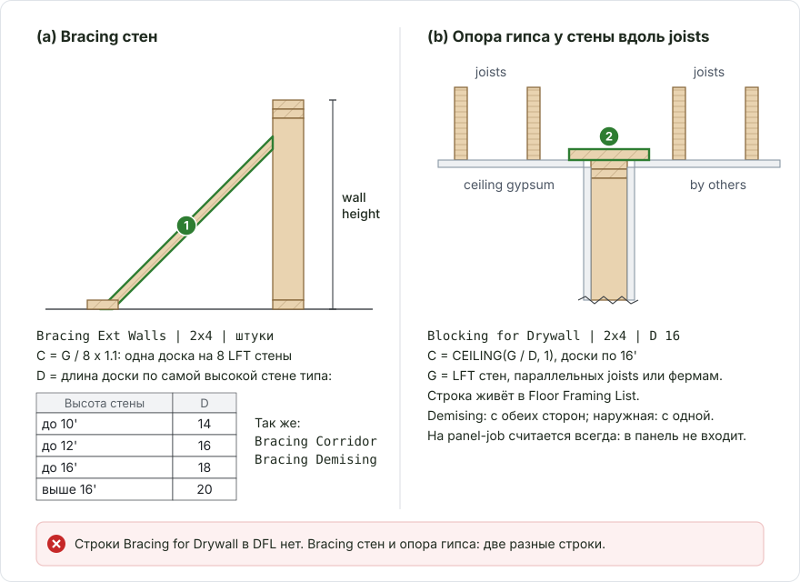

# Wall Bracing и Blocking for Drywall (bracing стен и опора гипса)

<figure markdown>
  
  <figcaption markdown="span">Две разные строки. (a) Bracing стен: 2x4 штуками, одна доска на 8 LFT стены, длина доски по высоте стены. (b) Опора гипса потолка у стены, параллельной joists: доска по верху стены, строка `Blocking for Drywall`.</figcaption>
</figure>

<!-- TODO-PHOTO: 2x4 drywall backing / ledger on top plate of a wall parallel to joists, EN query "drywall backing blocking top plate parallel joists" -->

## Что это

На странице две разные строки, которые часто путают. Строки `Bracing for Drywall` в DFL нет.

| | Wall bracing | Drywall backing |
| --- | --- | --- |
| Что это | временные раскосы `2x4`, которыми стену держат при монтаже | сплошной `2x4` по верху стены, опора кромки гипса потолка |
| Где нужно | все стены высотой 7' и больше | стены, параллельные joists или фермам |
| Label | `Bracing Ext Walls`, `Bracing Corridor`, `Bracing Demising` | `Blocking for Drywall` |
| Секция DFL | стены этажа (Floor Walls) | Floor Framing List |
| Единица | штуки, длина доски в D по высоте стены | доски по 16' |

Wall bracing считается на любом заказе, включая panel-job: в панель он не входит. Blocking между joists - [Blocking](blocking.md); ribbon под joists - [Ribbon Board](ribbon.md).

## Где искать на чертежах

| Лист | Что взять |
| --- | --- |
| Wall schedule, sections | высота стен по типам (ext, corridor, demising): по ней длина доски wall bracing |
| Framing plan этажа | какие стены параллельны joists и фермам: там нужен drywall backing |
| Details у потолка, RCP | drywall ledger или nailer по верху стены, с одной или с двух сторон; dropped soffit (soffit - не bracing) |

## Как мерить в OurPlanCore

- Wall bracing: отдельный замер не нужен, длина берётся из стен этажа (`walls/<этаж> floor walls/ext ...`, `corr`, `dem`).
- Drywall backing: Line (L) по стенам, где деталь показывает 2x4 по верху, в `framing/<этаж> framing/details/bd` или с номером детали. Одна Line на участок, на куски по 16' не режем. Деталь с 2x4 по обе стороны стены считается дважды.

## Как назвать в дереве и строка DFL

### Wall bracing

Три строки на этаж, по типу стены. `G` - LFT стен этого типа на этаже, C = `G / 8 x 1.1`: одна доска на каждые 8 LFT стены плюс 10%. C - штуки, не LFT.

| A (Label) | B | C | D | G |
| --- | --- | --- | --- | --- |
| `Bracing Ext Walls` | `2x4` | `=G/8*1.1` | по высоте | LFT ext стен этажа |
| `Bracing Corridor` | `2x4` | `=G/8*1.1` | по высоте | LFT corridor стен |
| `Bracing Demising` | `2x4` | `=G/8*1.1` | по высоте | LFT demising стен |

Длина доски в D - по самой высокой стене этого типа на этаже. Это лестница шаблона DFL: в книге D считается формулой ([COM](../../../../work-types/com.md) ссылается сюда):

| Высота стены | D (длина доски) |
| --- | --- |
| до 10' включительно | `14` |
| больше 10' до 12' | `16` |
| больше 12' до 16' | `18` |
| больше 16' | `20` |

- Стены ниже 7' (parapet, knee wall, curb, mech screen) bracing не получают.
- Gable: D `14`.

### Drywall backing

| Имя в дереве | A (Label) | B | C | D | E |
| --- | --- | --- | --- | --- | --- |
| `details/bd` | `Blocking for Drywall` | `2x4` | `=ОКРВВЕРХ(G/D;1)` | `16` | все детали строки |

`G` - сумма длин линий в LFT, `D` - длина доски (16). Одна строка на этаж, детали перечислены в E. Отдельного waste нет: запас даёт округление до целой доски.

Экспорт: кнопка WL полосы XL переносит стены в `A3`, строки wall bracing заполняются из тех же LFT. Линии `bd` переносит кнопка DT, флаг `bd` даёт строку `Blocking for Drywall`.

## Частые ошибки

- Wall bracing записан в `LFT`. Это штуки: одна доска на 8 LFT стены, длина доски в D.
- Длина доски не по высоте стены: стена 11' получила 14 вместо 16.
- Опора гипса записана как `Bracing for Drywall` или в строки wall bracing. Её строка - `Blocking for Drywall`, доски по 16'.
- У drywall backing посчитана одна сторона стены; деталь даёт обе.
- Dropped soffit принят за bracing: soffit считается на [Ceiling / Soffit Framing](../../ceiling-soffit-framing.md).
- На panel-job wall bracing выброшен вместе с панелями, хотя в панель он не входит.
- [Все ошибки по стенам](../../../../start/common-mistakes.md#walls)

## Пример

Стены этажа высотой 11': D = 16.

| A | B | C | D | E | G |
| --- | --- | --- | --- | --- | --- |
| `Bracing Ext Walls` | `2x4` | `=G/8*1.1` | 16 | | 412 |
| `Bracing Corridor` | `2x4` | `=G/8*1.1` | 16 | | 161 |
| `Bracing Demising` | `2x4` | `=G/8*1.1` | 16 | | 648 |
| `Blocking for Drywall` | `2x4` | `=ОКРВВЕРХ(G/D;1)` | 16 | `6/S400` | 310 |

Проверка: 412 / 8 x 1.1 = 56.7 доски; 161 / 8 x 1.1 = 22.1; 648 / 8 x 1.1 = 89.1; 310 / 16 = 19.4, значит 20 досок.

## См. также

- [Blocking](blocking.md), [Ribbon Board](ribbon.md)
- [Demising Walls](../../../vertical/walls/demising.md), [Exterior Walls](../../../vertical/walls/exterior.md), [COM](../../../../work-types/com.md)
