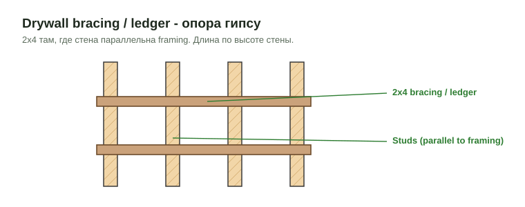

# Bracing for Drywall (опора гипса, bracing стен)

<figure markdown>
  
  <figcaption markdown="span">Стена идёт параллельно joists: над top plate нет joist, на который опереть гипс потолка. Опору даёт 2x4 bracing или ledger по верху стены. Длина доски зависит от высоты стены.</figcaption>
</figure>

<!-- TODO-PHOTO: 2x4 drywall backing / ledger on top plate of a wall parallel to joists, EN query "drywall backing blocking top plate parallel joists" -->

## Что это

Bracing (drywall bracing, drywall ledger) - доски `2x4`, которые дают опору кромке гипса там, где стена параллельна joists или фермам: на наружных стенах с одной стороны, на demising с двух сторон, на corridor. Это строки стен, не перекрытия, но длина доски выбирается по высоте стены. На panel-job считается всегда, потому что в панель не входит. Blocking между joists - [Blocking](blocking.md); ribbon под joists - [Ribbon Board](ribbon.md).

## Где искать на чертежах

| Лист | Что взять |
| --- | --- |
| Framing plan этажа | какие стены параллельны joists и фермам |
| Wall schedule, sections | высота стен по типам: ext, corridor, demising |
| Details у потолка, RCP | drywall ledger, dropped soffit (soffit - не bracing) |

## Как мерить в OurPlanCore

Отдельный замер не нужен: длина берётся из стен этажа (`walls/<этаж> floor walls/ext ...`, `corr`, `dem`). Если bracing показан только на части стен, Line (L) по этим участкам в `framing/<этаж> framing/details/bracing`.

## Как назвать в дереве и строка DFL

Три строки на этаж, по типу стены. G = LFT стен типа, D = длина доски по таблице, C = `G / 8 x 1.1`: одна доска на каждые 8 LFT стены плюс 10%.

| A (Label) | B | C | D | G |
| --- | --- | --- | --- | --- |
| `Bracing Ext Walls` | `2x4` | `=ОКРВВЕРХ(G/8*1.1;1)` | по высоте | LFT ext стен этажа |
| `Bracing Corridor` | `2x4` | `=ОКРВВЕРХ(G/8*1.1;1)` | по высоте | LFT corridor стен |
| `Bracing Demising` | `2x4` | `=ОКРВВЕРХ(G/8*1.1;1)` | по высоте | LFT demising, две стороны по детали |

Длина доски по самой высокой стене типа на этаже (канон таблицы здесь; [COM](../../../../work-types/com.md) ссылается сюда):

| Высота стены | Длина bracing |
| --- | --- |
| до 10' включительно | `14'` |
| больше 10' до 12' | `16'` |
| больше 12' до 16' | `18'` |
| больше 16' | `20'` |

Экспорт: кнопка WL полосы XL переносит стены в `A3`; строки bracing заполняются из тех же LFT. Если деталь даёт ledger вместо bracing, Label `Blocking for Drywall` и флаг `bd`.

## Частые ошибки

- Длина доски не по высоте стены: стена 11' получила 14' вместо 16'.
- Demising посчитана с одной стороны; деталь даёт обе.
- Dropped soffit принят за bracing: soffit считается на [Ceiling / Soffit Framing](../../ceiling-soffit-framing.md).
- На panel-job bracing выброшен вместе с панелями, хотя в панель он не входит.
- [Все ошибки по стенам](../../../../start/common-mistakes.md#walls)

## Пример

| A | B | C | D | E | G |
| --- | --- | --- | --- | --- | --- |
| `Bracing Ext Walls` | `2x4` | `=ОКРВВЕРХ(G/8*1.1;1)` | 16 | `6/S400` | 412 |
| `Bracing Corridor` | `2x4` | `=ОКРВВЕРХ(G/8*1.1;1)` | 16 | | 161 |
| `Bracing Demising` | `2x4` | `=ОКРВВЕРХ(G/8*1.1;1)` | 16 | `both sides` | 648 |

## См. также

- [Blocking](blocking.md), [Ribbon Board](ribbon.md)
- [Demising Walls](../../../vertical/walls/demising.md), [Exterior Walls](../../../vertical/walls/exterior.md), [COM](../../../../work-types/com.md)
