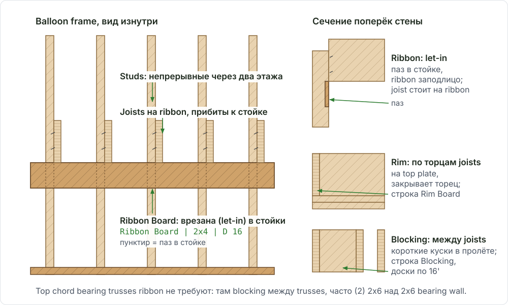
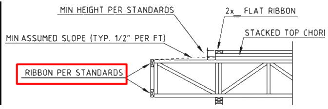

# Ribbon Board

<figure markdown>
  
  <figcaption markdown="span">The ribbon is let into the studs of a balloon wall and carries the joists. Rim sits at the joist ends, blocking between them: three different rows.</figcaption>
</figure>

<figure markdown>
  
  <figcaption markdown="span">Archived detail: "ribbon per standards" at the truss bottom chord and "2x flat ribbon" at the top chord. The ribbon size and location come from a detail like this; without it the row is not needed.</figcaption>
</figure>

## What it is

A ribbon (ribband, let-in ledger) is a horizontal board let into the studs that carries the joists or trusses in balloon framing and at top chord bearing. Do not confuse it with [Rim](rim.md) (joist ends) and [Blocking](blocking.md) (between joists). A drywall ledger on a wall parallel to the joists is the `Blocking for Drywall` row, see the [Wall Bracing and Blocking for Drywall](bracingdrywall.md) page.

## Where to find it on the plans

| Sheet | What to take |
| --- | --- |
| Wall section at the floor or roof | whether there is a ribbon, let-in, size, FRT |
| Truss bearing detail | top chord bearing: blocking between the trusses instead of a ribbon |
| Floor framing plan | length of the walls the ribbon runs along |

## How to measure in OurPlanCore

Line (L) along the wall where the detail shows a ribbon, on the framing sheet with the F point. Takeoff `framing/<floor> framing/details/ribbon` or `details/rb`. Length = the length where the detail applies, not the leader length. One Line for the whole run: do not cut it into 16' pieces, the formula counts the boards.

<figure markdown>
  
  <figcaption markdown="span">Line along where the detail applies: the line length goes to G of the DFL row, the detail name gives the M flag on export.</figcaption>
</figure>

## Tree name and DFL row

Export: the DT button; the name `ribbon` or `rb` gives the `rb` flag in M; the `C_RimBoardBlockingHangers` macro fills the `Ribbon Board` row.

| Tree name | A (Label) | B (material) | C | D | E |
| --- | --- | --- | --- | --- | --- |
| `details/ribbon` | `Ribbon Board` | per detail: `2x4` or `2x6` at trusses, joist size (`2x10`) under joists | `=CEILING(G/D,1)` | `16` | detail |
| `details/ribbon int` | `Ribbon Board` | per detail | `=CEILING(G/D,1)` | `16` | interior wall detail |
| `details/ribbon + bd` | two rows: `Ribbon Board` and `Blocking for Drywall` | per detail; `2x4` | `=CEILING(G/D,1)` in each | `16` | detail + drywall ledger |

`G` is the line length in LFT, `D` is the board length (16). In a framing book the ribbon is 16' boards: there is no separate waste factor in the formula, rounding up to a whole board is the allowance. One row per size, with the details listed in E. Summary: [Formulas](../../../../reference/formulas.md#rim-ribbon-blocking-ledger). Rule: top chord bearing trusses do not need a `2x4 ribbon`. There you count blocking between the trusses, often `(2) 2x6` over a 2x6 wall. The exterior ribbon is FRT if the exterior wall is FRT.

## Common mistakes

- A ribbon added out of habit at top chord bearing trusses: blocking is needed.
- Ribbon, rim and blocking written as one row or with mixed-up materials.
- The trusses bear over the wall and the material is called ribbon, though the detail gives blocking or a drywall ledger.
- Length taken from the detail leader, not from the walls where the detail applies.
- [All floor framing mistakes](../../../../start/common-mistakes.md#floor)

## Example

| A | B | C | D | E | G |
| --- | --- | --- | --- | --- | --- |
| `Ribbon Board` | `2x4` | `=CEILING(G/D,1)` | 16 | `11/S400` | 186 |
| `Blocking (2)` | `2x6` | `=CEILING(G*2/D,1)` | 16 | `top chord bearing per 13/S400` | 120 |

186 / 16 = 11.6, so 12 boards; 120 x 2 / 16 = 15 boards.

## See also

- [Rim Board](rim.md), [Blocking](blocking.md), [Wall Bracing and Blocking for Drywall](bracingdrywall.md), [Joist](../joist.md)
- [Tips: Blocking](../../../../reference/boss-feedback-rules.md#rim-board)
