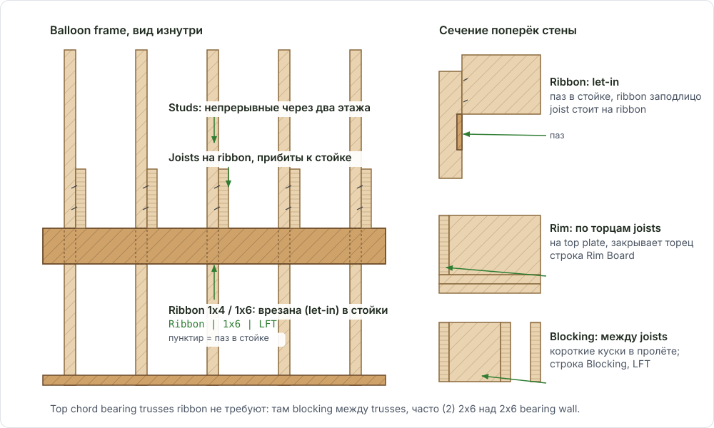

# Ribbon Board (врезная опорная доска)

<figure markdown>
  
  <figcaption markdown="span">Ribbon врезана (let-in) в стойки balloon-стены и несёт joists. Rim стоит по торцам joists, blocking между ними: три разных строки.</figcaption>
</figure>

<figure markdown>
  
  <figcaption markdown="span">Архивная деталь: "ribbon per standards" у нижнего пояса ферм и "2x flat ribbon" у верхнего. Из такой детали берётся сечение и место ribbon; без неё строка не нужна.</figcaption>
</figure>

## Что это

Ribbon (ribband, let-in ledger) - горизонтальная доска, врезанная в стойки, на которую опираются joists или фермы при balloon framing и у top chord bearing. Не путать с [Rim](rim.md) (торцы joists) и [Blocking](blocking.md) (между joists). Drywall ledger на стене параллельно joists - страница [Bracing for Drywall](bracingdrywall.md).

## Где искать на чертежах

| Лист | Что взять |
| --- | --- |
| Wall section у перекрытия или крыши | есть ли ribbon, let-in, сечение, FRT |
| Truss bearing detail | top chord bearing: вместо ribbon blocking между фермами |
| Framing plan этажа | длина стен, вдоль которых идёт ribbon |

## Как мерить в OurPlanCore

Line (L) по стене, где деталь показывает ribbon, на листе framing с точкой F. Позиция `framing/<этаж> framing/details/ribbon` или `details/rb`. Длина = длина применения детали, не длина выноски.

<figure markdown>
  
  <figcaption markdown="span">Line по линии применения детали: длина линии уходит в G строки DFL, имя детали даёт флаг M при экспорте.</figcaption>
</figure>

## Как назвать в дереве и строка DFL

Экспорт: кнопка DT, имя `ribbon` или `rb` даёт флаг `rb` в M; макрос `C_RimBoardBlockingHangers` заполняет строку `Ribbon Board`.

| Имя в дереве | A (Label) | B (материал) | C | D | E |
| --- | --- | --- | --- | --- | --- |
| `details/ribbon` | `Ribbon Board` | по детали: `2x4` у ферм, сечение joists (`2x10`) под joists | `=ОКРВВЕРХ(G*1.1/D;1)` | `16` | деталь |
| `details/ribbon int` | `Ribbon Board interior` | | | `16` | |
| `details/ribbon + bd` | `Ribbon Board interior + drywall` | `2x4` | | `16` | деталь + drywall ledger |

Фактор 1.1 один раз в формуле, как у blocking и ledger: [Формулы](../../../../reference/formulas.md#rim-ribbon-blocking-ledger). Правило: top chord bearing trusses не требуют `2x4 ribbon`. Там считается blocking между фермами, часто `(2) 2x6` над стеной 2x6. Ribbon снаружи FRT, если наружная стена FRT.

## Частые ошибки

- Ribbon добавлена по привычке у top chord bearing ферм: нужен blocking.
- Ribbon, rim и blocking записаны одной строкой или перепутаны материалами.
- Фермы висят над стеной, а материал назван ribbon, хотя деталь даёт blocking или drywall ledger.
- Длина взята по выноске детали, а не по стенам, где деталь применяется.
- [Все ошибки по перекрытиям](../../../../start/common-mistakes.md#floor)

## Пример

| A | B | C | D | E |
| --- | --- | --- | --- | --- |
| `Ribbon Board` | `2x4` | `=ОКРВВЕРХ(G*1.1/D;1)` | 16 | `11/S400` |
| `Blocking` | `(2) 2x6` | `=ОКРВВЕРХ(G*2*1.1/D;1)` | 16 | `top chord bearing per 13/S400` |

## См. также

- [Rim Board](rim.md), [Blocking](blocking.md), [Bracing for Drywall](bracingdrywall.md), [Joist](../joist.md)
- [Советы: Blocking](../../../../reference/boss-feedback-rules.md#rim-board)
