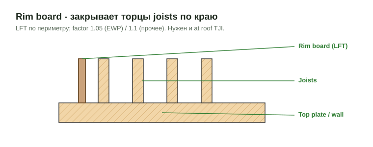
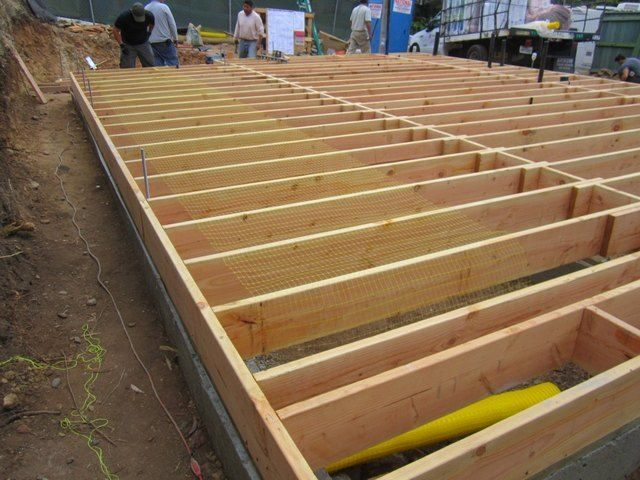

# Rim Board

<figure markdown>
  
  <figcaption markdown="span">The rim board closes the joist ends around the floor perimeter and carries the wall above. It is counted in LFT along the perimeter, not in 16' boards.</figcaption>
</figure>

<figure markdown>
  { width="520" }
  <figcaption markdown="span">First floor framing: rim around the whole perimeter on the sill plate, the joist ends butt into it. Count LFT along the building perimeter and along the edges of floor openings; with I-joists the rim material is engineered only. Photo: hunker.com, [source](https://www.hunker.com/13720287/what-is-a-rim-joist), found via Pinterest.</figcaption>
</figure>

## What it is

The rim is the board at the edge of the floor that the joist ends butt into: `1-1/8" OSB Rim`, `1-1/4" LSL Rim`, `1-3/4" LVL`. With I-joists, engineered rim only. A [Ribbon](ribbon.md) is let into the studs and carries the joists, [Blocking](blocking.md) sits between the joists: these are different rows. Rim around a deck or balcony is P.T. 2x in [Deck / Porch / Balcony Frame](../../../deck/deck-porch-balcony-frame.md).

## Where to find it on the plans

| Sheet | What to take |
| --- | --- |
| Joist schedule, general notes | rim product and thickness by joist depth |
| Wall sections, floor details | rim at the exterior wall, at demising on both sides, at roof TJI |
| Deck / corridor details | where the rim carries load and must be `1-3/4" LVL` |
| Floor framing plan | perimeter and interior lines where the joist direction changes |

## How to measure in OurPlanCore

Line (L) along the rim line on the framing sheet with the F point: the outside perimeter of the floor plus interior lines where the joists change direction or butt into a wall. Line length = the length where the detail applies. Takeoff `framing/<floor> framing/details/rim` or with the detail number `5/S400 rim`.

<figure markdown>
  
  <figcaption markdown="span">Line along where the detail applies: the line length goes to G of the DFL row, the detail name gives the M flag on export.</figcaption>
</figure>

## Tree name and DFL row

Export: the DT button puts details into J:L of the floor worksheet; a name with `rim` gets the `r` flag in M, and the `C_RimBoardBlockingHangers` macro moves the length to the `Rim Board` row.

| Tree name | A (Label) | B (material) | C | D | E |
| --- | --- | --- | --- | --- | --- |
| `details/rim` | `Rim Board` | `11-7/8" Rim` | `G x 1.05` (EWP) or `G x 1.1` | `LFT` | detail |
| `details/rim LSL` | `Rim Board` | `11-7/8" LSL Rim` | | `LFT` | |
| `details/rim corr LVL` | `Rim Board` | `1-3/4 x 11-7/8 LVL` | | `LFT` | corridor detail |
| `details/rim dem` | `Rim board dbl` | | `G x 2` | `LFT` | demising on both sides |

| Product | When |
| --- | --- |
| `1-1/8" OSB Rim` | common thin rim per schedule |
| `1-1/4"` or `1-1/2" LSL Rim` | LSL is specified or a heavier rim is needed |
| `1-3/4" LVL Rim` | a deck or corridor frame attaches to the rim, or the detail calls for it directly |

Factor once in the formula: `1.05` on EWP jobs, `1.1` on all others (residential, COM, reconstruction). The canonical numbers: [Formulas](../../../../reference/formulas.md#rim-ribbon-blocking-ledger), same in [Tips](../../../../reference/boss-feedback-rules.md#rim-board).

## Common mistakes

- Rim called `1-3/4 LVL` though LVL is not specified. Default is `11-7/8" Rim`; product unclear - `assumed` in the note.
- Rim split into 16' pieces. Keep LFT.
- Rim at roof TJI forgotten.
- At demising one side counted, the detail gives rim on both sides.
- On a panel job the rim counted with the wall length, not along the floor line.
- [All floor framing mistakes](../../../../start/common-mistakes.md#floor)

## Example

| A | B | C | D | E |
| --- | --- | --- | --- | --- |
| `Rim Board` | `11-7/8" LSL Rim` | `=CEILING(G*1.05,1)` | LFT | `5/S400` |
| `Rim board dbl` | `11-7/8" LSL Rim` | `=CEILING(G*2*1.05,1)` | LFT | `9/S400 demising` |

## See also

- [Ribbon Board](ribbon.md), [Blocking](blocking.md), [Joist](../joist.md)
- [Tips: Rim Board](../../../../reference/boss-feedback-rules.md#rim-board), [Formulas](../../../../reference/formulas.md)
