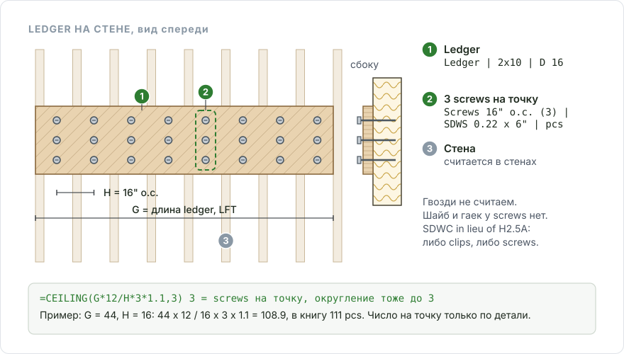
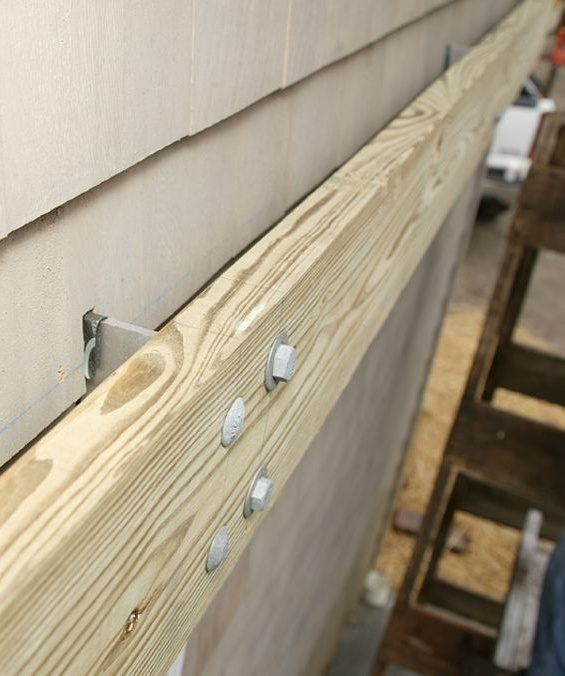

# Screws

<figure markdown>
  
  <figcaption markdown="span">Structural screws (SDS, SDWS, SDWC) per connection details: ledger to trusses, LVL packs, tie replacement. Counted in pcs by spacing or by the number per connection.</figcaption>
</figure>

<figure markdown>
  { width="360" }
  <figcaption markdown="span">P.T. deck ledger on a wall: hex-head structural screws in pairs at a spacing, a joist hanger at the top. Count screws in pieces per the ledger detail (number per point per spacing), with no washers or nuts. Photo: greenbuildingadvisor.com, [source](http://www.greenbuildingadvisor.com/homes/durable-deck-ties-home-landscape), found via Pinterest.</figcaption>
</figure>

## What it is

Screws are structural screws from the details: `SDS 1/4 x 4 1/2`, `SDWS 22" ledger screw`, `SDWC` (in lieu of H2.5A). They are counted only when the detail names them; we do not count nails. Screws need no washers or nuts. Bolts: [Bolts](bolts.md).

## Where to find it on the plans

| Sheet | What to take |
| --- | --- |
| Ledger details | screw type, spacing or number per truss end (for example, 3 per end @ 16") |
| Built-up beam, multi-ply LVL details | SDS per pack, spacing and rows |
| Roof-to-wall details | `6" SDWC in lieu of H2.5A`: either clips or screws, not both |
| Stair detail | screws for the stringer bottom bearing board |

## How to measure in OurPlanCore

Length from the detail Line (`details/2x10 ledger + screws`, `details/12/S401`), number of connections from the Count. No separate takeoff for screws is needed if they go with the ledger detail.

## Tree name and DFL row

The screws row sits next to its connection. Formula in pcs: `G` - ledger LFT, `H` - spacing, multiplier - number of screws per connection, rounding significance = number per connection (3 per truss end gives `,3`); round a result under 50 up to an even number.

| A (Label) | B | C | D | E |
| --- | --- | --- | --- | --- |
| `Screws 16" o.c. (3)` | `SDWS 0.22 x 6"` | `=CEILING(G*12/H*3*1.1,3)` | `pcs` | `ledger per 4/S401` |
| `Screws (2)` | `SDS 1/4 x 4 1/2` | connections x 2 | `pcs` | beam-to-post detail |
| `Screws` | `SDWS 1/4 x 4 1/4` | `=4*4*G` per stair | `pcs` | stair detail |
| `Screws 24" o.c.` | `SDWC 6"` | by truss spacing | `pcs` | `in lieu of H2.5A` |

## Common mistakes

- Ledger screws not per the detail: 1 per end instead of 3 (84 became 132).
- Screws taken from another floor, not from their own ledger.
- Details 1 and 3 look alike in the drawing, but the hardware is different.
- Both H2.5A clips and SDWC counted when the detail says "in lieu of".
- Nails counted in pieces.
- [All floor framing mistakes](../../../../start/common-mistakes.md#floor)

## Example

| A | B | C | D | E | G | H |
| --- | --- | --- | --- | --- | --- | --- |
| `Ledger` | `2x10` | `=CEILING(G*1.1/D,1)` | 16 | `4/S401` | 44 | |
| `Screws 16" o.c. (3)` | `SDWS 0.22 x 6"` | `=CEILING(G*12/H*3*1.1,3)` | pcs | `4/S401` | 44 | 16 |

## See also

- [Bolts](bolts.md), [Steel Beam Web Fillers](steelbeams.md), [Hardware catalog](../../../../reference/hardware-catalog.md)
- [Hangers](../../../../reference/hangers.md)
