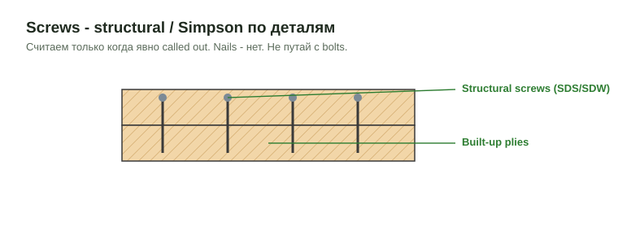
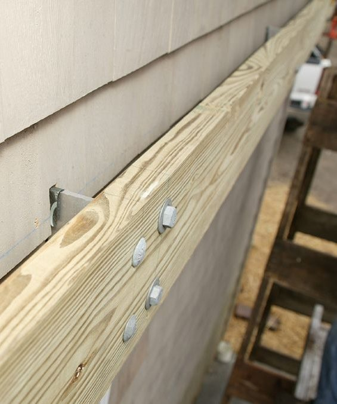

# Screws (структурные саморезы)

<figure markdown>
  
  <figcaption markdown="span">Structural screws (SDS, SDWS, SDWC) по деталям соединений: ledger к фермам, пакеты LVL, замена ties. Считаются в pcs по шагу или по числу на узел.</figcaption>
</figure>

<figure markdown>
  { width="360" }
  <figcaption markdown="span">P.T. ledger deck на стене: структурные саморезы с шестигранной головкой парами по шагу, вверху hanger под joist. Screws считаем штуками по детали ledger (число на точку на шаг), без шайб и гаек. Фото: greenbuildingadvisor.com, [источник](http://www.greenbuildingadvisor.com/homes/durable-deck-ties-home-landscape), найдено через Pinterest.</figcaption>
</figure>

## Что это

Screws - структурные саморезы из деталей: `SDS 1/4 x 4 1/2`, `SDWS 22" ledger screw`, `SDWC` (в замену H2.5A). Считаются только когда деталь их называет; гвозди не считаем. Шайбы и гайки у screws не нужны. Болты - [Bolts](bolts.md).

## Где искать на чертежах

| Лист | Что взять |
| --- | --- |
| Ledger details | тип screw, шаг или число на торец фермы (например, 3 на торец @ 16") |
| Built-up beam, multi-ply LVL details | SDS на пакет, шаг и ряды |
| Roof-to-wall details | `6" SDWC in lieu of H2.5A`: либо clips, либо screws, не оба |
| Stair detail | screws нижней опорной доски stringers |

## Как мерить в OurPlanCore

Длина из Line детали (`details/2x10 ledger + screws`, `details/12/S401`), количество узлов из Count. Отдельную позицию для screws создавать не нужно, если они идут вместе с деталью ledger.

## Как назвать в дереве и строка DFL

Строка screws стоит рядом со своим соединением. Формула в pcs: `G` - LFT ledger, `H` - шаг, множитель - число screws на узел, значимость округления = число на узел (3 на торец фермы дают `;3`); результат меньше 50 округлять до чётного.

| A (Label) | B | C | D | E |
| --- | --- | --- | --- | --- |
| `Screws 16" o.c. (3)` | `SDWS 0.22 x 6"` | `=ОКРВВЕРХ(G*12/H*3*1.1;3)` | `pcs` | `ledger per 4/S401` |
| `Screws (2)` | `SDS 1/4 x 4 1/2` | узлов x 2 | `pcs` | деталь балка-пост |
| `Screws` | `SDWS 1/4 x 4 1/4` | `=4*4*G` на лестницу | `pcs` | stair detail |
| `Screws 24" o.c.` | `SDWC 6"` | по шагу ферм | `pcs` | `in lieu of H2.5A` |

## Частые ошибки

- Screws ledger не по детали: 1 на торец вместо 3 (84 стало 132).
- Screws взяты с другого этажа, не со своего ledger.
- Детали 1 и 3 похожи на картинке, но крепёж разный.
- Clips H2.5A и SDWC посчитаны оба, когда деталь даёт "in lieu of".
- Гвозди посчитаны штуками.
- [Все ошибки по перекрытиям](../../../../start/common-mistakes.md#floor)

## Пример

| A | B | C | D | E | G | H |
| --- | --- | --- | --- | --- | --- | --- |
| `Ledger` | `2x10` | `=ОКРВВЕРХ(G*1.1/D;1)` | 16 | `4/S401` | 44 | |
| `Screws 16" o.c. (3)` | `SDWS 0.22 x 6"` | `=ОКРВВЕРХ(G*12/H*3*1.1;3)` | pcs | `4/S401` | 44 | 16 |

## См. также

- [Bolts](bolts.md), [Steel Beam Web Fillers](steelbeams.md), [Hardware catalog](../../../../reference/hardware-catalog.md)
- [Hangers](../../../../reference/hangers.md)
