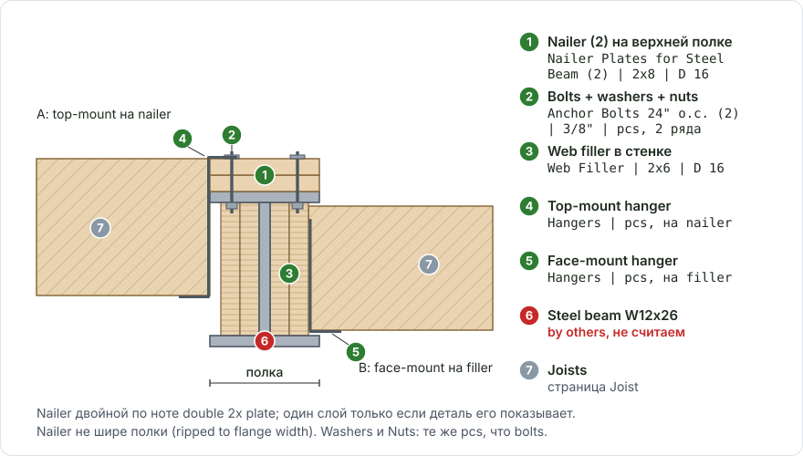
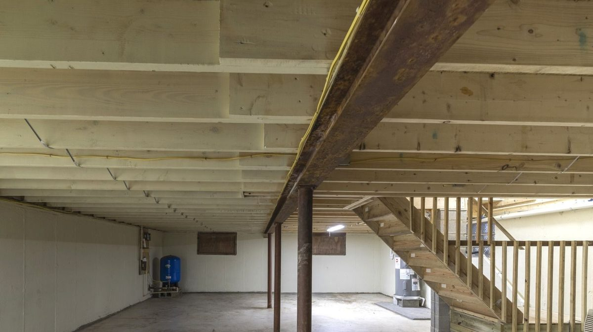

# Steel Beam Web Fillers

<figure markdown>
  
  <figcaption markdown="span">The steel beam is by others, but the wood nailer on the top flange, the filler in the web and their bolts are our rows. The top nailer sets the top-mount hanger for the joists.</figcaption>
</figure>

<figure markdown>
  
  <figcaption markdown="span">Basement: a steel W-beam on pipe columns carries wood joists. Steel and columns are by others; our rows are the nailer on the top flange, its bolts with washers and nuts, and hangers if the joists hang off the side. Photo: housedigest.com, [source](https://www.housedigest.com/1919599/diy-solution-turn-steel-ugly-basement-support-beam/), found via Pinterest.</figcaption>
</figure>

## What it is

A nailer (nailer plate) is a board on the top flange of a steel beam that the joist hangers are nailed into; a web filler is a board in the beam web between the flanges for face-mount hangers or attachment. The steel itself (W12x26, HSS) is by others. We count the wood, bolts, washers, nuts and hangers.

## Where to find it on the plans

| Sheet | What to take |
| --- | --- |
| S framing plan | lengths of the steel beams on this floor |
| General framing notes | typical note: `double 2x plate bolted to top flange, 3/8" bolts staggered @ 24" o.c.` |
| Steel beam details (S4xx, S5xx) | nailer on top and bottom, ripped to flange width, filler, hanger type |
| Hanger schedule | top-mount on the nailer or face-mount on the filler |

## How to measure in OurPlanCore

Line (L) along the steel beam centerline on the framing sheet with the F point: `framing/<floor> framing/details/nailer` or `details/W12 nailer`. Line length = beam length. Do not draw the steel as a Beam.

<figure markdown>
  
  <figcaption markdown="span">Line along where the detail applies: the line length goes to G of the DFL row, the detail name gives the M flag on export.</figcaption>
</figure>

## Tree name and DFL row

A block of four rows next to the beams of this floor. The nailer is double by default (note `double 2x plate`); single only if the detail clearly shows one layer. The bottom nailer under the flange and the filler are separate rows per the detail.

| A (Label) | B | C | D | E |
| --- | --- | --- | --- | --- |
| `Nailer Plates for Steel Beam (2)` | `2x8` (by flange width, `3x DF ripped`) | `=CEILING(G*2/D,1)` | `16` | `14/S400` |
| `Anchor Bolts 24" o.c. (2)` | `3/8" Ø` | `=CEILING(G*12/H*2*1.1,2)` | `pcs` | `note II.B` |
| `Washers 24" o.c. (2)` | `3/8" Washers` | same formula | `pcs` | |
| `Nuts 24" o.c. (2)` | `Nuts for 3/8" Ø` | same formula | `pcs` | |
| `Web Filler` | `2x6` | `=CEILING(G*2/D,1)` | `16` | detail |
| `Hangers` | top-mount on the nailer, face-mount on the filler | by joists | `pcs` | detail |

The washer for a nailer bolt is a regular washer; `3x3` only if the detail calls for it.

## Nailer and packing by W profile { #w-table }

When the detail does not give the nailer size or the number of layers in the web, take them by the beam profile (`W12x26`: W12 series, weight 26 lb/ft). Packing (web filler) is the boards in the beam web, the number of layers for both sides together. The detail on the S sheet always wins over the table.

| Series | Weight (lb/ft) | Nailer | Packing, layers for 2 sides |
| --- | --- | --- | --- |
| W6 | x9 | `2x6` | 2 |
| W6 | x12 | `2x6` | 4 |
| W6 | x15, x16, x20, x25 | `2x8` | 4 |
| W8 | x10, x13, x15, x18, x21 | `2x6` | 4 |
| W8 | x24, x28 | `2x8` | 6 |
| W8 | x31, x35, x40, x48, x58, x67 | `2x10` | 6 |
| W10 | x12, x15, x17, x19 | `2x6` | 4 |
| W10 | x22, x26, x30 | `2x8` | 4 |
| W10 | x33, x39, x45 | `2x10` | 6 |
| W10 | x49, x54, x60, x68, x77, x88, x100 | `2x12` | 8 |
| W12 | x14, x16, x19, x22 | `2x6` | 4 |
| W12 | x26, x30, x35 | `2x8` | 6 |
| W12 | x40, x45, x50 | `2x10` | 6 |
| W12 | x53, x58, x65, x72, x79, x87, x96 | `2x12` | 8 |
| W12 | x106, x136, x170, x230 | `(2) 2x8` | 8 |
| W14 | x22, x26 | `2x6` | 4 |
| W14 | x30, x34, x38 | `2x8` | 6 |
| W14 | x43, x48, x53 | `2x10` | 6 |
| W14 | x61, x68, x74, x82 | `2x12` | 8 |
| W14 | x90, x99, x109, x120, x132, x176, x193 | `(2) 2x8` | 10 |
| W16 | x26, x31 | `2x8` | 4 |
| W16 | x36, x40, x45, x50, x57 | `2x8` | 6 |
| W16 | x67, x77, x100 | `2x12` | 8 |
| W18 | x35, x40, x46 | `2x8` | 4 |
| W18 | x50 | `2x8` | 6 |
| W18 | x55, x60, x71 | `2x10` | 6 |
| W18 | x76, x86, x97, x106, x119, x130 | `2x12` | 8 |
| W21 | x44, x50, x57 | `2x8` | 6 |
| W21 | x73 | `2x10` | 6 |

`(2) 2x8` - two nailers side by side: the flange is wider than a 2x12.

## Common mistakes

- Nailer counted single without bolts, though the note gives double 2x with 3/8" bolts @ 24".
- Bolts taken from the beams of another floor.
- Face-mount hanger picked while the detail shows bearing on top of the nailer (top-mount), or the other way around.
- Filler steel anchors with a 3x3 washer that is not specified.
- `EWP by others`, and the LVL/LSL blocking at the steel beam per the detail not written.
- [All floor framing mistakes](../../../../start/common-mistakes.md#floor)

## Example

| A | B | C | D | E | G | H |
| --- | --- | --- | --- | --- | --- | --- |
| `Nailer Plates for Steel Beam (2)` | `2x8` | `=CEILING(G*2/D,1)` | 16 | `4/S5.6` | 86 | |
| `Anchor Bolts 24" o.c. (2)` | `3/8" Ø` | `=CEILING(G*12/H*2*1.1,2)` | pcs | `note II.B` | 86 | 24 |
| `Washers 24" o.c. (2)` | `3/8" Washers` | `=CEILING(G*12/H*2*1.1,2)` | pcs | | 86 | 24 |
| `Nuts 24" o.c. (2)` | `Nuts for 3/8" Ø` | `=CEILING(G*12/H*2*1.1,2)` | pcs | | 86 | 24 |

## See also

- [Beam](../beam.md), [Bolts](bolts.md), [Hangers](../../../../reference/hangers.md)
- [Metal tracks](../../../vertical/walls/metal-tracks.md) - walls under steel beams
