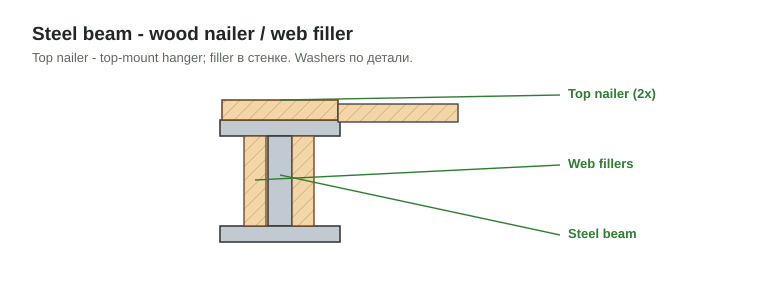
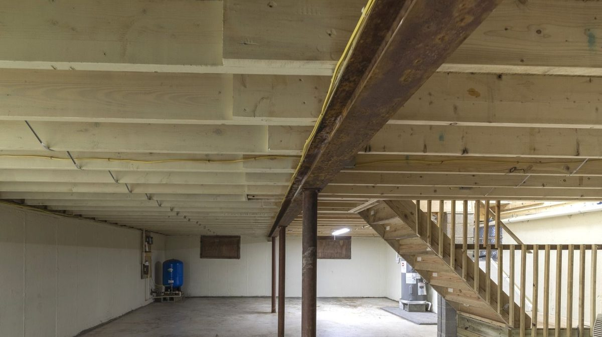
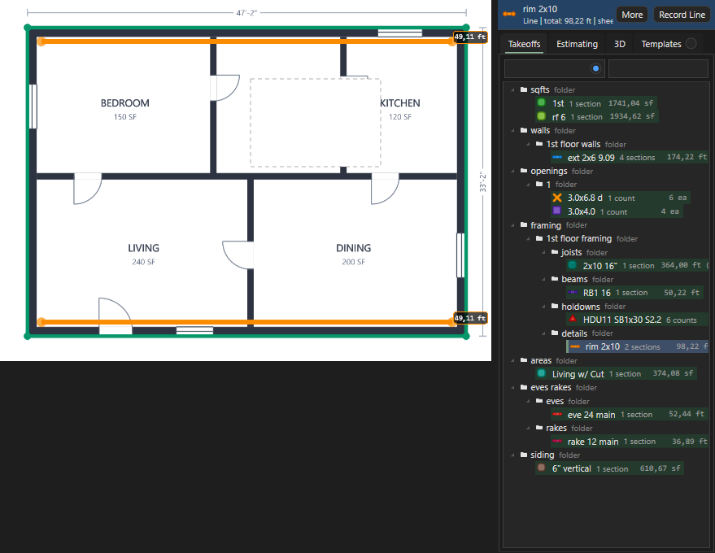

# Steel Beam Web Fillers (nailer и fillers на стальной балке)

<figure markdown>
  
  <figcaption markdown="span">Стальная балка by others, но деревянный nailer на верхней полке, filler в стенке и болты к ним - наши строки. Top nailer задаёт top-mount hanger для joists.</figcaption>
</figure>

<figure markdown>
  
  <figcaption markdown="span">Подвал: стальная W-балка на трубчатых колоннах несёт деревянные joists. Сталь и колонны by others; наши строки - nailer по верхней полке, болты к нему с шайбами и гайками, hangers, если joists висят сбоку. Фото: housedigest.com, [источник](https://www.housedigest.com/1919599/diy-solution-turn-steel-ugly-basement-support-beam/), найдено через Pinterest.</figcaption>
</figure>

## Что это

Nailer (nailer plate) - доска на верхней полке стальной балки, в которую бьют hangers joists; web filler - доска в стенке балки между полками для face-mount hangers или крепления. Сама сталь (W12x26, HSS) by others. Считаем дерево, болты, шайбы, гайки и hangers.

## Где искать на чертежах

| Лист | Что взять |
| --- | --- |
| S framing plan | длины стальных балок своего этажа |
| General framing notes | типовая нота: `double 2x plate bolted to top flange, 3/8" bolts staggered @ 24" o.c.` |
| Steel beam details (S4xx, S5xx) | nailer сверху и снизу, ripped to flange width, filler, тип hanger |
| Hanger schedule | top-mount на nailer или face-mount на filler |

## Как мерить в OurPlanCore

Line (L) по оси стальной балки на листе framing с точкой F: `framing/<этаж> framing/details/nailer` или `details/W12 nailer`. Длина линии = длина балки. Сталь как Beam не рисуем.

<figure markdown>
  
  <figcaption markdown="span">Line по линии применения детали: длина линии уходит в G строки DFL, имя детали даёт флаг M при экспорте.</figcaption>
</figure>

## Как назвать в дереве и строка DFL

Блок из четырёх строк рядом с балками своего этажа. Nailer по умолчанию двойной (нота `double 2x plate`); одинарный только если деталь прямо показывает один слой. Нижний nailer под полкой и filler - отдельные строки по детали.

| A (Label) | B | C | D | E |
| --- | --- | --- | --- | --- |
| `Nailer Plates for Steel Beam (2)` | `2x8` (по ширине полки, `3x DF ripped`) | `=ОКРВВЕРХ(G*2/D;1)` | `16` | `14/S400` |
| `Anchor Bolts 24" o.c. (2)` | `3/8" Ø` | `=ОКРВВЕРХ(G*12/H*2*1.1;2)` | `pcs` | `note II.B` |
| `Washers 24" o.c. (2)` | `3/8" Washers` | та же формула | `pcs` | |
| `Nuts 24" o.c. (2)` | `Nuts for 3/8" Ø` | та же формула | `pcs` | |
| `Web Filler` | `2x6` | `=ОКРВВЕРХ(G*2/D;1)` | `16` | деталь |
| `Hangers` | top-mount на nailer, face-mount на filler | по joists | `pcs` | деталь |

Шайба под болт nailer - обычная washer, `3x3` только если деталь требует.

## Частые ошибки

- Nailer посчитан одинарным без болтов, хотя нота даёт double 2x с болтами 3/8" @ 24".
- Болты взяты по балкам другого этажа.
- Hanger выбран face-mount, а деталь даёт опору сверху на nailer (top-mount), или наоборот.
- Filler steel anchors с шайбой 3x3 без указания.
- `EWP by others`, а LVL/LSL blocking у стальной балки по детали не записан.
- [Все ошибки по перекрытиям](../../../../start/common-mistakes.md#floor)

## Пример

| A | B | C | D | E | G | H |
| --- | --- | --- | --- | --- | --- | --- |
| `Nailer Plates for Steel Beam (2)` | `2x8` | `=ОКРВВЕРХ(G*2/D;1)` | 16 | `4/S5.6` | 86 | |
| `Anchor Bolts 24" o.c. (2)` | `3/8" Ø` | `=ОКРВВЕРХ(G*12/H*2*1.1;2)` | pcs | `note II.B` | 86 | 24 |
| `Washers 24" o.c. (2)` | `3/8" Washers` | `=ОКРВВЕРХ(G*12/H*2*1.1;2)` | pcs | | 86 | 24 |
| `Nuts 24" o.c. (2)` | `Nuts for 3/8" Ø` | `=ОКРВВЕРХ(G*12/H*2*1.1;2)` | pcs | | 86 | 24 |

## См. также

- [Beam](../beam.md), [Bolts](bolts.md), [Hangers](../../../../reference/hangers.md)
- [Metal tracks](../../../vertical/walls/metal-tracks.md) - стены под стальными балками
