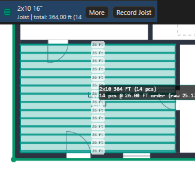
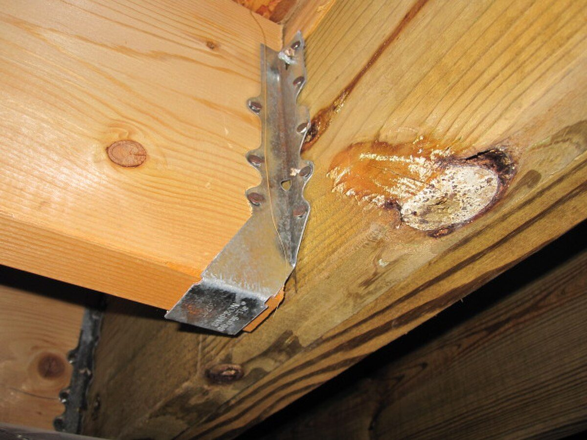
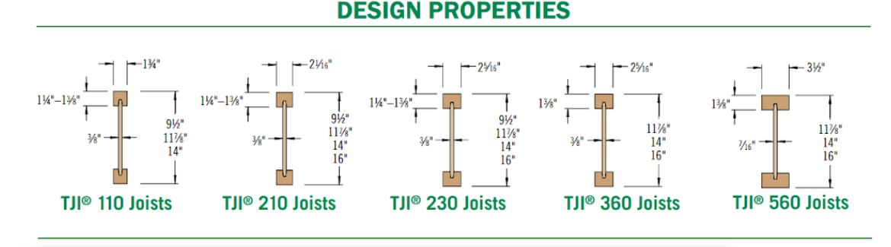
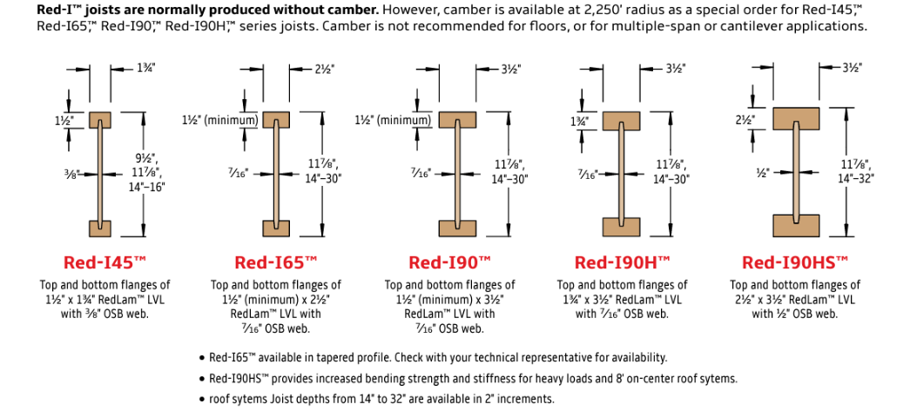
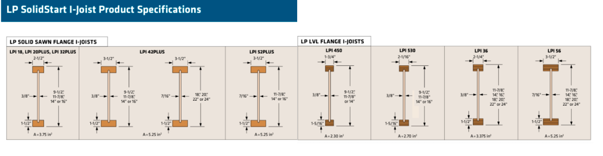
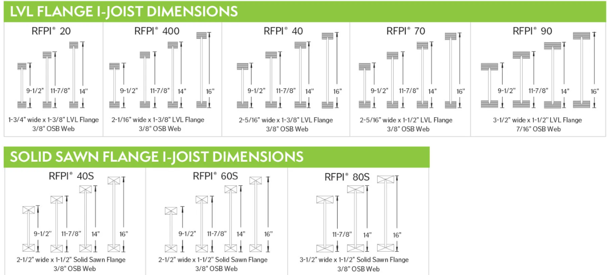
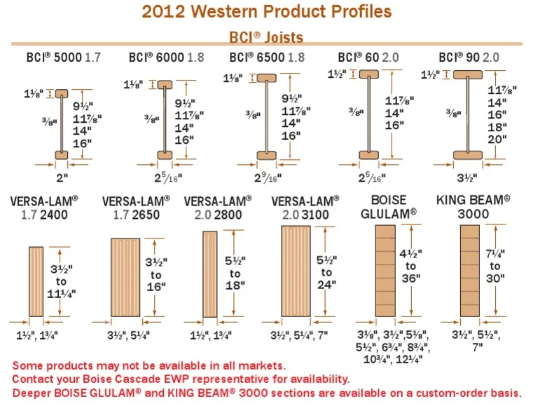
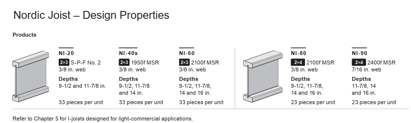
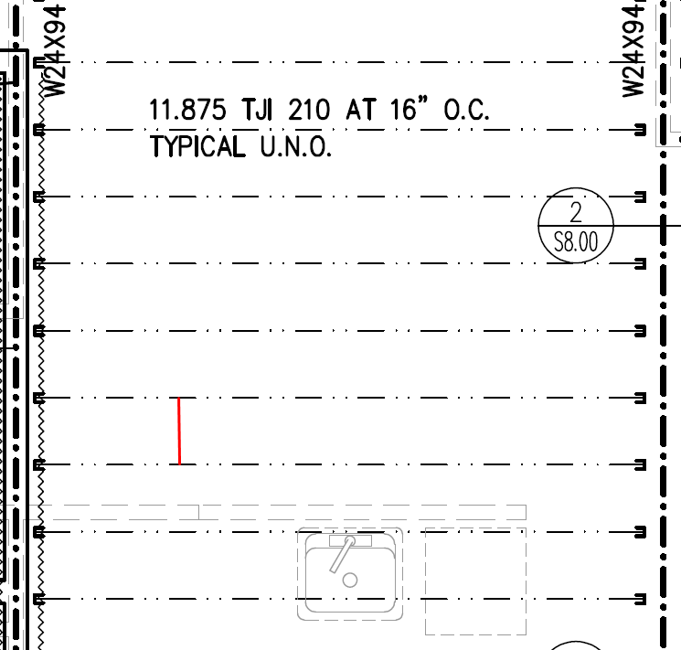

# Joist

<figure markdown>
  
  <figcaption markdown="span">J Area tool: zone outline, direction arrow, spacing. The app gives the joist count and lengths for the zone by itself. A plain Area named `2x8 16"` does not do that.</figcaption>
</figure>

## What it is

Joists are floor or flat roof members at a spacing: sawn `2x10`, I-joists (`11 7/8 TJI 230`, `LPI`, `BCI`, `RFPI`, `NI`), LVL. Floor trusses and roof trusses are by others and we do not count them, but we do count the rim, blocking, hangers and ties around them. Rafters of a pitched roof are measured with the same tool, see [Dbl / Trpl Rafters](../roof-framing/dbl-trpl-rafters.md).

## Where to find it on the plans

| Sheet | What to take |
| --- | --- |
| S framing plan of the floor | direction, spacing, size, zone boundaries, extra and double joists, openings |
| Joist schedule, general notes | I-joist series and depth, rim, web stiffeners, squash blocks, blocking rows |
| Beam schedule, details | bearing: on top of a beam, on hangers, top chord bearing |
| Firewall and stair details | DHU/DGU instead of ITS over stairs, elevators, shafts |

## How to measure in OurPlanCore

J Area tool (J), framing sheet with the F point. Outline the zone, set the direction (with Shift, strictly along the axes), spacing, end joists; extra joists are added to the selected zone with the D key.

1. Split the zone where the direction, spacing, material or bearing line changes. One arrow for the whole floor does not describe the floor framing.
2. In every zone check: direction, start and end boundary, include end joists, openings, extra and double joists.
3. Check the count and lengths on one simple zone first, then do the rest.
4. Do not draw rafters by others or trusses by others as joists.

## Tree name and DFL row

Path: `framing/<floor> framing/joists/<size series spacing use>`: `2x8 16"`, `11 7/8 TJI 230 16"`, `flat roof 11 7/8 TJI 16"`, `porch 16 TJI 560 24"`, `cant`.

Export: the JS button on the XL strip writes joists as "count / length" pairs into the floor worksheet. Layout follows the `C_JoistsSort` macro rule:

- a length over 8' that is odd gets +1 (11' becomes 12');
- equal lengths are added into one row;
- short ones (up to 7') go on a double-length board: `90 x 6'` becomes `45 x 12'`, and E gets `90 pcs 6'`;
- extra joists of the same length are added to the main row.

| A (Label) | B (material) | C | D | E |
| --- | --- | --- | --- | --- |
| `Joists 16" o.c.` | `11 7/8 TJI 230` | 36 | `20` | `S102` |
| `Joists 16" o.c.` | `11 7/8 TJI 230` | 45 | `12` | `90 pcs 6'` |
| `Dbl Joists` | `11 7/8 TJI 230` | 4 | `20` | `under wall per S102` |
| `Hangers` | `ITS2.37/11.88` | `=EVEN(G*12/16)` | `pcs` | |
| `Rim Board` | `11-7/8" LSL Rim` | LFT x 1.05 | `LFT` | |

Hangers: on both ends of every joist that hangs; count by assemblies, not by purchase boards after cutting. Model per the detail (`U210-2`, not `LUS210-2`). `ITS` is top-flange only up to 16" depth and with no skew; deeper - `HIT`. Exterior and on P.T.: `Zmax` as a separate word; `H2.5A` ties to trusses under the sheathing go without Zmax. Selection: [Hangers](../../../reference/hangers.md); how to write it in B: [hardware format in the DFL](../../../reference/hangers.md#dfl-format).

<figure markdown>
  
  <figcaption markdown="span">A face-mount hanger holds the joist end on a beam: one such connection for every end that hangs. Photo: ArmchairBuilder.com, CC BY 2.0, <a href="https://commons.wikimedia.org/wiki/File:Joist_Hanger.jpg">source</a>.</figcaption>
</figure>

Spacing factor if you count by hand: `pcs = zone width LFT x 12 / spacing` plus the end joist; 16" gives 0.75, 19.2" gives 0.625, 24" gives 0.5. This is geometry, not the 1.1 stud factor: [Formulas](../../../reference/formulas.md#joist-spacing-factors).

## Common mistakes

- A plain Area named `2x8 16"`: there is no count, the area goes to Excel.
- Spacing restarted from an interior beam, or a joist removed though it does not land on the beam (tolerance about 2").
- Hangers not on both ends; `ITS` on joists 18" and deeper; DHU where the drywall stops under the floor (ITS is needed).
- Rim split into 16' and called `1-3/4 LVL` though not specified: [Rim Board](details/rim.md).
- Rim at roof TJI forgotten.
- Series lost: `TJI` instead of `11 7/8 TJI 230`; RED rewritten as TJI; there is no `TJI 9 1/2` in the 360/560 series.
- Top chord bearing missed: there it is blocking instead of a ribbon, see [Ribbon Board](details/ribbon.md).
- Long 2x ceiling joists spliced over a support counted as one board.
- [All floor framing mistakes](../../../start/common-mistakes.md#floor)

## Example

```text
framing/
  2nd floor framing/
    joists/
      11 7/8 TJI 230 16"      J Area, 3 zones
      2x10 16"                J Area, porch
      cant                    J Area, cantilever
```

| A | B | C | D | E |
| --- | --- | --- | --- | --- |
| `Joists 16" o.c.` | `11 7/8 TJI 230` | 3 | 12 | `S102` |
| `Joists 16" o.c.` | `11 7/8 TJI 230` | 36 | 20 | |
| `Hangers` | `ITS2.37/11.88` | 42 | pcs | `9/S501` |

## I-joist profiles (manufacturer reference)

Write the series and depth as in the schedule. The images are archived, for checking the family name.

<details class="kb-figures kb-figures--rows">
  <summary>Show TJI, RED, LP, RFPI, BCI, Nordic profiles</summary>
  <figure class="kb-figure-row">
    <figcaption class="kb-figure-row__text">
      <div class="kb-figure-row__title">TJI</div>
      <div class="kb-figure-row__rule">Series 110, 210, 230, 360, 560. In the row <code>11 7/8 TJI 230</code>, not a generic <code>TJI</code>.</div>
    </figcaption>
    <a class="kb-figure-row__image" href="../../../../assets/images/confluence/confluence-007.png" target="_blank" rel="noopener"></a>
  </figure>
  <figure class="kb-figure-row">
    <figcaption class="kb-figure-row__text">
      <div class="kb-figure-row__title">RED / Red-I</div>
      <div class="kb-figure-row__rule">Do not rewrite as TJI; mark, depth and series as in the schedule.</div>
    </figcaption>
    <a class="kb-figure-row__image" href="../../../../assets/images/confluence/confluence-009.png" target="_blank" rel="noopener"></a>
  </figure>
  <figure class="kb-figure-row">
    <figcaption class="kb-figure-row__text">
      <div class="kb-figure-row__title">LP / LPI SolidStart</div>
      <div class="kb-figure-row__rule">LPI 20Plus, 32Plus, 36, 42Plus, 52Plus, 56. The flange affects the hanger (<code>ITS2.56</code> vs <code>ITS2.37</code>).</div>
    </figcaption>
    <a class="kb-figure-row__image" href="../../../../assets/images/confluence/confluence-006.png" target="_blank" rel="noopener"></a>
  </figure>
  <figure class="kb-figure-row">
    <figcaption class="kb-figure-row__text">
      <div class="kb-figure-row__title">RFPI</div>
      <div class="kb-figure-row__rule">LVL-flange and solid-sawn-flange versions; keep the series and depth visible.</div>
    </figcaption>
    <a class="kb-figure-row__image" href="../../../../assets/images/confluence/confluence-008.png" target="_blank" rel="noopener"></a>
  </figure>
  <figure class="kb-figure-row">
    <figcaption class="kb-figure-row__text">
      <div class="kb-figure-row__title">BCI / Boise</div>
      <div class="kb-figure-row__rule">BCI is not TJI; keep the <code>+ s</code> suffix in the mark.</div>
    </figcaption>
    <a class="kb-figure-row__image" href="../../../../assets/images/confluence/confluence-004.png" target="_blank" rel="noopener"></a>
  </figure>
  <figure class="kb-figure-row">
    <figcaption class="kb-figure-row__text">
      <div class="kb-figure-row__title">Nordic NI</div>
      <div class="kb-figure-row__rule">NI-20, NI-40x, NI-60, NI-80, NI-90; Nordic has its own hanger notes.</div>
    </figcaption>
    <a class="kb-figure-row__image" href="../../../../assets/images/confluence/confluence-002.png" target="_blank" rel="noopener"></a>
  </figure>
  <figure class="kb-figure-row">
    <figcaption class="kb-figure-row__text">
      <div class="kb-figure-row__title">Spacing o.c.</div>
      <div class="kb-figure-row__rule">Spacing is measured center to center; 12 / 16 / 19.2 / 24 only from the plan or notes.</div>
    </figcaption>
    <a class="kb-figure-row__image" href="../../../../assets/images/confluence/confluence-075.png" target="_blank" rel="noopener"></a>
  </figure>
</details>

Official guides for checking names: [TJI](https://www.weyerhaeuser.com/woodproducts/document-library/document_library_detail/tj-4000/), [LP SolidStart](https://www.pwtewp.com/wp-content/uploads/2022/09/SolidStart-IJ-Residential-Technical-Guide-US.pdf), [BCI](https://www.bc.com/ewp/bci-joists/), [RFPI](https://www.roseburg.com/Product/rfpi-joist/), [Nordic](https://www.nordic.ca/en/products/nordic-i-joist), [APA I-joist](https://www.apawood.org/i-joist).

## See also

- [Beam](beam.md), [Rim Board](details/rim.md), [Blocking](details/blocking.md), [Subfloor](subfloor.md)
- [Hangers](../../../reference/hangers.md), [Formulas](../../../reference/formulas.md), [EWP / Capital](../../../work-types/ewp-capital.md)
