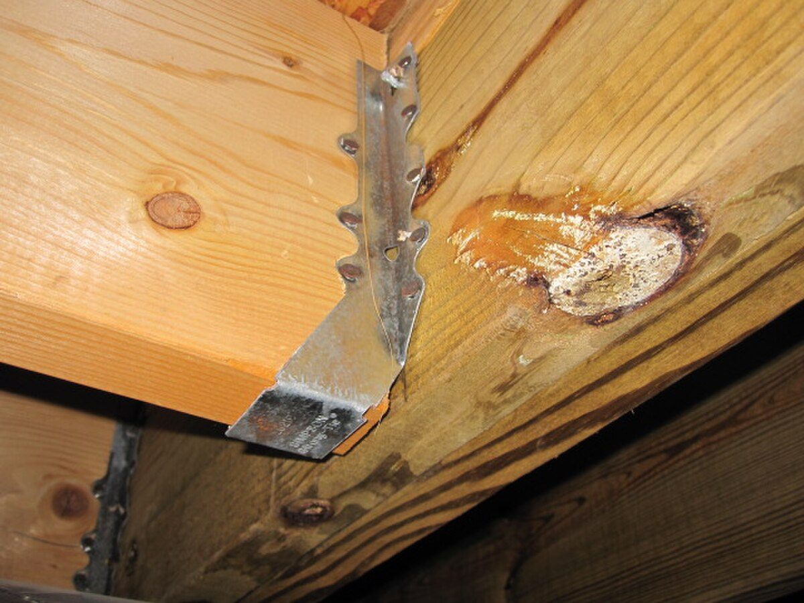
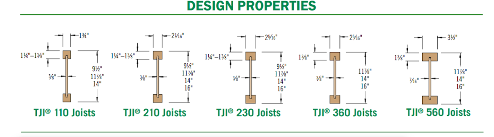
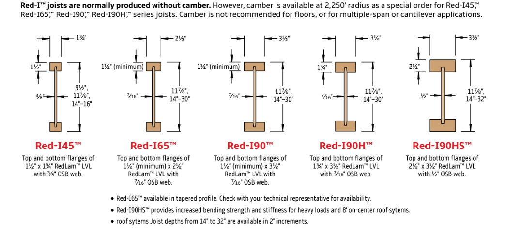
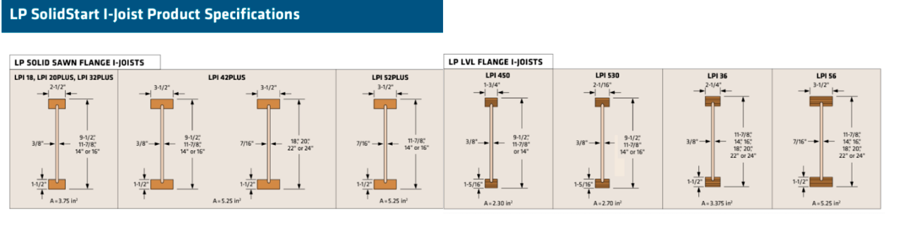
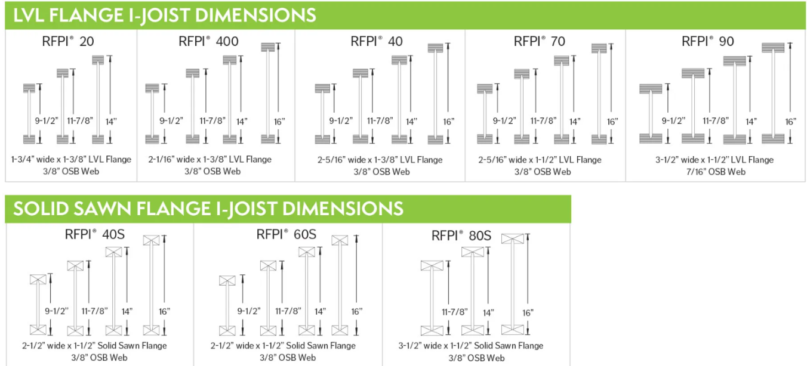
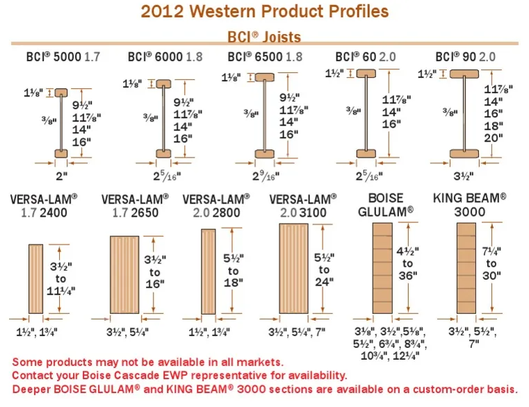
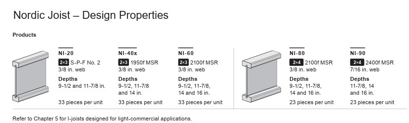
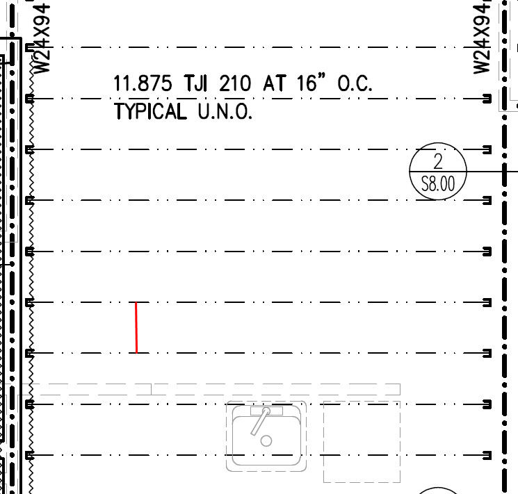

# Joist (балки перекрытия)

<figure markdown>
  
  <figcaption markdown="span">Инструмент J Area: контур зоны, стрелка направления, шаг. Программа сама даёт количество и длины joists по зоне. Обычная Area с именем `2x8 16"` этого не делает.</figcaption>
</figure>

## Что это

Joists - балки перекрытия или плоской крыши с шагом: пилёные `2x10`, I-joists (`11 7/8 TJI 230`, `LPI`, `BCI`, `RFPI`, `NI`), LVL. Floor trusses и roof trusses - by others, их не считаем, но считаем rim, blocking, hangers и ties вокруг них. Rafters скатной крыши мерятся тем же инструментом, см. [Dbl / Trpl Rafters](../roof-framing/dbl-trpl-rafters.md).

## Где искать на чертежах

| Лист | Что взять |
| --- | --- |
| S framing plan этажа | направление, шаг, сечение, границы зон, extra и double joists, отверстия |
| Joist schedule, general notes | серия и глубина I-joist, rim, web stiffeners, squash blocks, blocking rows |
| Beam schedule, details | опирание: на балке сверху, на hangers, top chord bearing |
| Firewall и stair details | DHU/DGU вместо ITS над лестницами, лифтами, шахтами |

## Как мерить в OurPlanCore

Инструмент J Area (J), лист framing с точкой F. Обведи зону, задай направление (с Shift строго по осям), шаг, end joists; extra joists добавляются к выделенной зоне клавишей D.

1. Разбивай зону при смене направления, шага, материала или линии опоры. Одна стрелка на весь этаж не описывает перекрытие.
2. В каждой зоне проверь: направление, начальную и конечную границу, include end joists, отверстия, extra и double joists.
3. Проверь на одной простой зоне количество и длины, потом остальные.
4. Rafters by others и trusses by others в joists не рисуй.

## Как назвать в дереве и строка DFL

Путь: `framing/<этаж> framing/joists/<сечение серия шаг назначение>`: `2x8 16"`, `11 7/8 TJI 230 16"`, `flat roof 11 7/8 TJI 16"`, `porch 16 TJI 560 24"`, `cant`.

Экспорт: кнопка JS полосы XL пишет joists парами "количество / длина" в лист этажа. Раскладка по правилу макроса `C_JoistsSort`:

- длина больше 8' и нечётная получает +1 (11' становится 12');
- одинаковые длины складываются в одну строку;
- короткие (до 7') идут на двойную доску: `90 x 6'` становится `45 x 12'`, в E пишется `90 pcs 6'`;
- extra joists той же длины прибавляются к основной строке.

| A (Label) | B (материал) | C | D | E |
| --- | --- | --- | --- | --- |
| `Joists 16" o.c.` | `11 7/8 TJI 230` | 36 | `20` | `S102` |
| `Joists 16" o.c.` | `11 7/8 TJI 230` | 45 | `12` | `90 pcs 6'` |
| `Dbl Joists` | `11 7/8 TJI 230` | 4 | `20` | `under wall per S102` |
| `Hangers` | `ITS2.37/11.88` | `=ЧЁТН(G*12/16)` | `pcs` | |
| `Rim Board` | `11-7/8" LSL Rim` | LFT x 1.05 | `LFT` | |

Hangers: на оба конца каждого joist, который висит; считать по сборкам, не по закупочным доскам после раскроя. Модель по детали (`U210-2`, не `LUS210-2`). `ITS` только top-flange до 16" глубины и без skew; глубже - `HIT`. Снаружи и на P.T. - `Zmax` отдельным словом; ties `H2.5A` к фермам под обшивкой без Zmax. Подбор: [Hangers](../../../reference/hangers.md), запись в B: [формат крепежа в DFL](../../../reference/hangers.md#dfl-format).

<figure markdown>
  
  <figcaption markdown="span">Face-mount hanger держит торец joist на балке: один такой узел на каждый конец, который висит. Фото: ArmchairBuilder.com, CC BY 2.0, <a href="https://commons.wikimedia.org/wiki/File:Joist_Hanger.jpg">источник</a>.</figcaption>
</figure>

Фактор по шагу, если считаешь вручную: `pcs = ширина зоны LFT x 12 / шаг` плюс торцевой joist; 16" даёт 0.75, 19.2" даёт 0.625, 24" даёт 0.5. Это геометрия, не stud-фактор 1.1: [Формулы](../../../reference/formulas.md#joist-spacing-factors).

## Частые ошибки

- Обычная Area названа `2x8 16"`: количества нет, в Excel уходит площадь.
- Шаг продолжен от внутренней балки заново или joist убран, хотя он не попадает на балку (допуск около 2").
- Hangers не на оба конца; `ITS` на joists 18" и глубже; DHU там, где гипс кончается под перекрытием (нужен ITS).
- Rim разбит на 16' и назван `1-3/4 LVL` без указания: [Rim Board](details/rim.md).
- Rim у roof TJI забыт.
- Серия потеряна: `TJI` вместо `11 7/8 TJI 230`; RED переписан в TJI; `TJI 9 1/2` не бывает серии 360/560.
- Top chord bearing не замечен: там blocking вместо ribbon, см. [Ribbon Board](details/ribbon.md).
- Длинные 2x ceiling joists со стыком на опоре посчитаны одной доской.
- [Все ошибки по перекрытиям](../../../start/common-mistakes.md#floor)

## Пример

```text
framing/
  2nd floor framing/
    joists/
      11 7/8 TJI 230 16"      J Area, 3 зоны
      2x10 16"                J Area, porch
      cant                    J Area, консоль
```

| A | B | C | D | E |
| --- | --- | --- | --- | --- |
| `Joists 16" o.c.` | `11 7/8 TJI 230` | 3 | 12 | `S102` |
| `Joists 16" o.c.` | `11 7/8 TJI 230` | 36 | 20 | |
| `Hangers` | `ITS2.37/11.88` | 42 | pcs | `9/S501` |

## Профили I-joist (справка по производителям)

Серию и глубину пиши как в schedule. Картинки архивные, для проверки названия семейства.

<details class="kb-figures kb-figures--rows">
  <summary>Показать профили TJI, RED, LP, RFPI, BCI, Nordic</summary>
  <figure class="kb-figure-row">
    <figcaption class="kb-figure-row__text">
      <div class="kb-figure-row__title">TJI</div>
      <div class="kb-figure-row__rule">Серии 110, 210, 230, 360, 560. В строке <code>11 7/8 TJI 230</code>, не общий <code>TJI</code>.</div>
    </figcaption>
    <a class="kb-figure-row__image" href="../../../../assets/images/confluence/confluence-007.png" target="_blank" rel="noopener"></a>
  </figure>
  <figure class="kb-figure-row">
    <figcaption class="kb-figure-row__text">
      <div class="kb-figure-row__title">RED / Red-I</div>
      <div class="kb-figure-row__rule">Не переписывать в TJI; марка, глубина и серия как в schedule.</div>
    </figcaption>
    <a class="kb-figure-row__image" href="../../../../assets/images/confluence/confluence-009.png" target="_blank" rel="noopener"></a>
  </figure>
  <figure class="kb-figure-row">
    <figcaption class="kb-figure-row__text">
      <div class="kb-figure-row__title">LP / LPI SolidStart</div>
      <div class="kb-figure-row__rule">LPI 20Plus, 32Plus, 36, 42Plus, 52Plus, 56. Flange влияет на hanger (<code>ITS2.56</code> против <code>ITS2.37</code>).</div>
    </figcaption>
    <a class="kb-figure-row__image" href="../../../../assets/images/confluence/confluence-006.png" target="_blank" rel="noopener"></a>
  </figure>
  <figure class="kb-figure-row">
    <figcaption class="kb-figure-row__text">
      <div class="kb-figure-row__title">RFPI</div>
      <div class="kb-figure-row__rule">LVL-flange и solid-sawn-flange варианты; серию и глубину держать видимыми.</div>
    </figcaption>
    <a class="kb-figure-row__image" href="../../../../assets/images/confluence/confluence-008.png" target="_blank" rel="noopener"></a>
  </figure>
  <figure class="kb-figure-row">
    <figcaption class="kb-figure-row__text">
      <div class="kb-figure-row__title">BCI / Boise</div>
      <div class="kb-figure-row__rule">BCI не равно TJI; суффикс <code>+ s</code> в марке сохранять.</div>
    </figcaption>
    <a class="kb-figure-row__image" href="../../../../assets/images/confluence/confluence-004.png" target="_blank" rel="noopener"></a>
  </figure>
  <figure class="kb-figure-row">
    <figcaption class="kb-figure-row__text">
      <div class="kb-figure-row__title">Nordic NI</div>
      <div class="kb-figure-row__rule">NI-20, NI-40x, NI-60, NI-80, NI-90; у Nordic свои hanger notes.</div>
    </figcaption>
    <a class="kb-figure-row__image" href="../../../../assets/images/confluence/confluence-002.png" target="_blank" rel="noopener"></a>
  </figure>
  <figure class="kb-figure-row">
    <figcaption class="kb-figure-row__text">
      <div class="kb-figure-row__title">Шаг o.c.</div>
      <div class="kb-figure-row__rule">Шаг считается от центра до центра; 12 / 16 / 19.2 / 24 только с плана или нот.</div>
    </figcaption>
    <a class="kb-figure-row__image" href="../../../../assets/images/confluence/confluence-075.png" target="_blank" rel="noopener"></a>
  </figure>
</details>

Официальные справочники для проверки названий: [TJI](https://www.weyerhaeuser.com/woodproducts/document-library/document_library_detail/tj-4000/), [LP SolidStart](https://www.pwtewp.com/wp-content/uploads/2022/09/SolidStart-IJ-Residential-Technical-Guide-US.pdf), [BCI](https://www.bc.com/ewp/bci-joists/), [RFPI](https://www.roseburg.com/Product/rfpi-joist/), [Nordic](https://www.nordic.ca/en/products/nordic-i-joist), [APA I-joist](https://www.apawood.org/i-joist).

## См. также

- [Beam](beam.md), [Rim Board](details/rim.md), [Blocking](details/blocking.md), [Subfloor](subfloor.md)
- [Hangers](../../../reference/hangers.md), [Формулы](../../../reference/formulas.md), [EWP / Capital](../../../work-types/ewp-capital.md)
