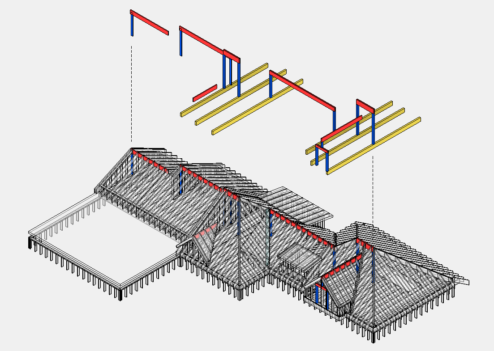
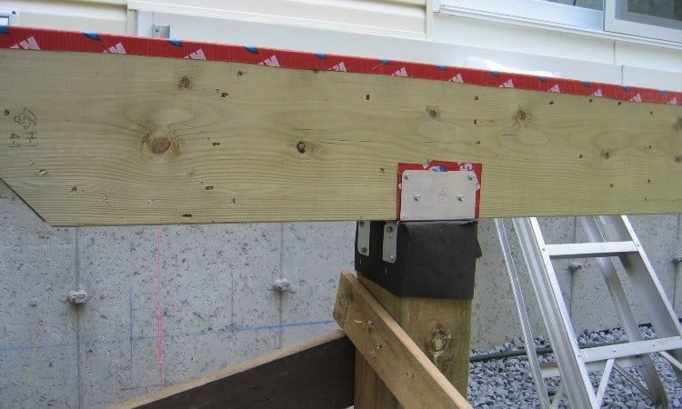
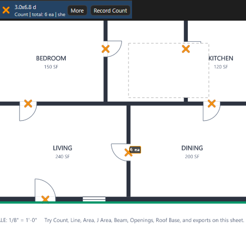
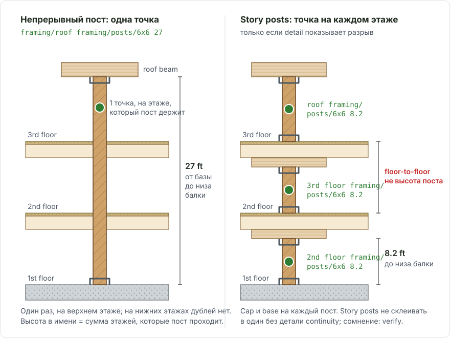

# Post

<figure markdown>
  
  <figcaption markdown="span">Archived 3D view of the frame: posts highlighted in blue, ridge in red, roof beams in yellow. A post is counted on the floor it supports, with the full height from the base to the bottom of the beam.</figcaption>
</figure>

<figure markdown>
  { width="520" }
  <figcaption markdown="span">6x6 post under a deck beam: a post cap on top holds the beam, the post runs down to the post base. In the DFL the post is one row with the full height, Post Cap and Post Base are separate rows by the number of posts. Photo: plasticinehouse.com, [source](https://plasticinehouse.com/joining-beams-over-posts/), found via Pinterest.</figcaption>
</figure>

## What it is

A post is a stand-alone column under a beam, not a wall stud: solid `6x6`, `4x4`, `5 1/4 x 5 1/4 PSL`, steel pipe, or a built-up `(2) 2x6`, `(4) 2x4`. A post comes with a Post Base at the bottom (to concrete or a beam) and a Post Cap at the top (to the beam). Studs inside a wall (jack, king, a pack under a header) belong to Walls, not here. Posts under the [Ridge](../roof-framing/ridge.md) and a [Roof Header](../roof-framing/header.md) are counted here too, in `roof framing`.

## Where to find it on the plans

| Sheet | What to take |
| --- | --- |
| S framing plan of every floor | post marks (`C4`, `P1`, `WP2`), location, which beam it sits under |
| Post / column schedule (S5xx, S6xx) | size, material, plies, cap and base by mark |
| Sections, elevations, datums | how many floors the post runs through, height from the base to the bottom of the beam |
| Post-to-beam, post-to-foundation details | cap and base model, anchor, blocking under the post |
| Roof framing plan | posts under the ridge and roof header |

## How to measure in OurPlanCore

Count tool (P), one point at the center of the post, on the framing sheet with the F point. Every mark and height is its own takeoff, with its own Color and CountSymbol.

1. A continuous post is counted once: on the top floor it supports. Remove duplicates on the lower floors. Height = sum of the floors it runs through.
2. Do not merge separate story posts on one axis into one without a continuity detail. A doubtful splice goes into the takeoff Notes as "verify".
3. Height is from the actual base to the bottom of the supported beam, by the section datums. Floor-to-floor is not the post height: under an 11 7/8" beam the post is taller than under an 18" beam.
4. Cap and base per the detail: a separate Count takeoff `CCQ66 S2.1` in `details`, or the model in the post Notes. One cap and one base per post.

<figure markdown>
  
  <figcaption markdown="span">Post Count takeoff: one point at the center of each post, the name has the mark, size and height.</figcaption>
</figure>

<figure markdown>
  
  <figcaption markdown="span">A post that runs through several floors is counted once on the top floor it supports. Height is from the base to the bottom of the beam, not floor-to-floor.</figcaption>
</figure>

## Tree name and DFL row

Path: `framing/<supported floor> framing/posts/<mark size height>`. Height in the name in feet.

| Tree name | A (Label) | B (material) | C (qty) | D | E |
| --- | --- | --- | --- | --- | --- |
| `posts/C53 - 5 1/4 x 7 PSL + 2x6` | `Posts` | `5 1/4 x 7 PSL` | points | order length, ft | `C53`, schedule sheet |
| `posts/6x6 SYP#1 P.T. 8.2` | `Posts` | `6x6 SYP#1 P.T.` | points | `10` | detail |
| `posts/C4 20` | `Posts` | per schedule | points | `20` | `C4` |
| `posts/(3) 2x6 9.1` | `Posts (3)` | `2x6` | points x 3 | `10` | |
| `details/ABU66 Zmax S2.1` | `Post Bases` | `ABU66 Zmax` | points | `pcs` | `5/S501` |
| in the post Notes | `Post Caps` | `CCQ66`, `BC46 Zmax` | = posts | `pcs` | `6/S501` |

Export to Excel: the PS button on the XL strip puts the posts into the worksheet of their floor. The size for a code (`C4 - 6x6`) comes from the LG legend: without a legend row, B gets the code instead of the size. The `C_PostsSort` macro lays out the rows. The order length in D is a standard board (8, 10, 12, 14, 16...).

## Common mistakes

- A post drawn on every floor it runs through and counted twice.
- Height taken as floor-to-floor, without the beam depth.
- Cap and base not on every post: 8 posts give 8 caps and 8 bases; 4 P1 posts are 4 sets, not 3.
- Posts and Post Caps created under every built-up beam. End studs are part of the wall; a post is counted when an explicit material is named: `4x4`, `6x6`, PSL, steel.
- Exterior posts (porch, balcony, railing) without P.T. Under a porch roof P.T. is not needed.
- An exterior base without `Zmax`. It is written as a separate word after the model: `ABU66 Zmax`, not `ABU66Z` ([hardware format in the DFL](../../../reference/hangers.md#dfl-format)).
- The post is not specified on the plan and the DFL has a made-up size. A note is needed: "post size not specified, assumed 6x6; verify".
- [All floor framing mistakes](../../../start/common-mistakes.md#floor)

## Example

```text
framing/
  2nd floor framing/
    posts/
      C4 - 6x6 10                 4 points
      C53 - 5 1/4 x 7 PSL + 2x6   2 points
  roof framing/
    posts/
      P1 4x4 8.2                  6 points
```

| A | B | C | D | E |
| --- | --- | --- | --- | --- |
| `Posts` | `6x6` | 4 | 10 | `C4 per S601` |
| `Post Bases` | `ABU66 Zmax` | 4 | pcs | `5/S501` |
| `Post Caps` | `CCQ66` | 4 | pcs | `6/S501` |

## See also

- [Beam](beam.md), [Ridge](../roof-framing/ridge.md), [Roof Header](../roof-framing/header.md)
- [Hangers](../../../reference/hangers.md), [Hardware catalog](../../../reference/hardware-catalog.md)
- [Deck / Porch / Balcony Frame](../../deck/deck-porch-balcony-frame.md) - exterior posts
