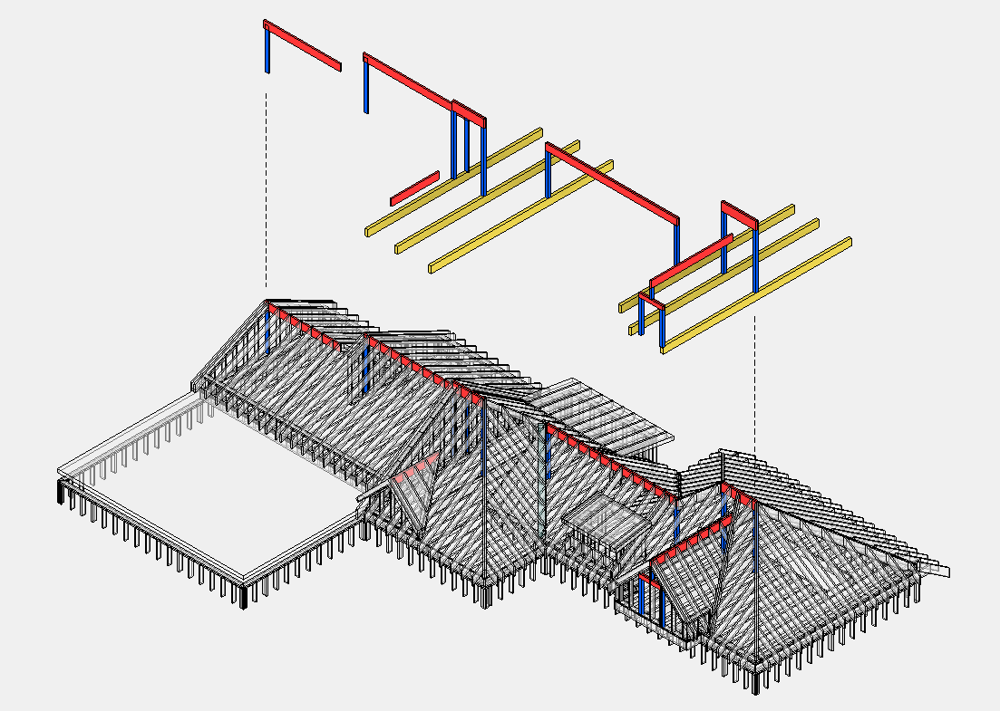
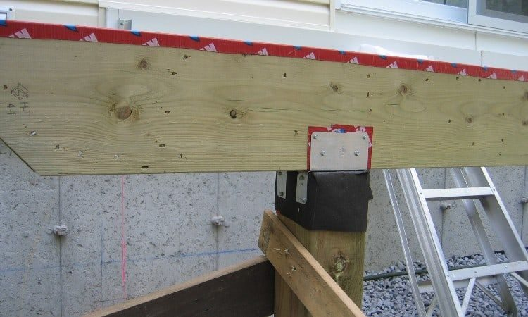
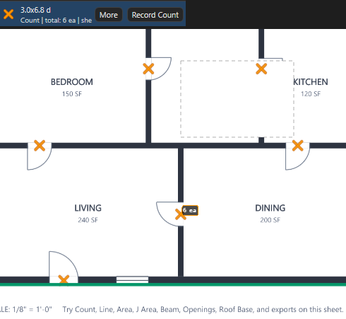
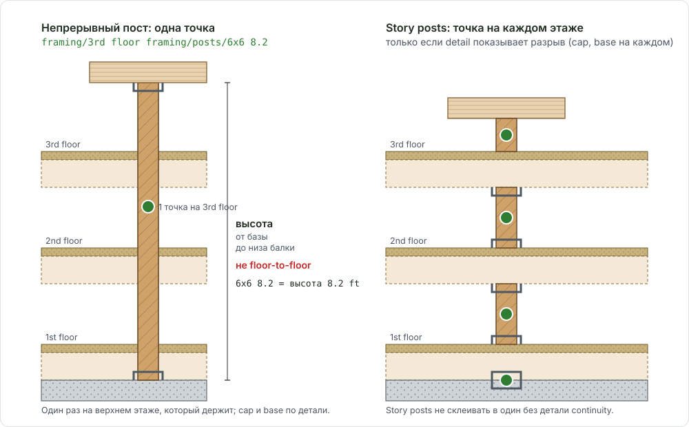

# Post (стойка, колонна)

<figure markdown>
  
  <figcaption markdown="span">Архивный 3D-вид каркаса: синим выделены posts, красным ridge, жёлтым балки крыши. Пост считается на том этаже, который он держит, с полной высотой от базы до низа балки.</figcaption>
</figure>

<figure markdown>
  { width="520" }
  <figcaption markdown="span">Пост 6x6 под балкой deck: сверху post cap, который держит балку, ниже стойка до post base. В DFL пост одной строкой с полной высотой, Post Cap и Post Base отдельными строками по числу постов. Фото: plasticinehouse.com, [источник](https://plasticinehouse.com/joining-beams-over-posts/), найдено через Pinterest.</figcaption>
</figure>

## Что это

Post - отдельная стойка под балкой, не stud стены: цельный `6x6`, `4x4`, `5 1/4 x 5 1/4 PSL`, стальная труба или пакет `(2) 2x6`, `(4) 2x4`. К посту идут Post Base снизу (к бетону или балке) и Post Cap сверху (к балке). Стойки внутри стены (jack, king, пакет под хедером) относятся к Walls, не сюда. Посты под [Ridge](../roof-framing/ridge.md) и [Roof Header](../roof-framing/header.md) считаются здесь же, в `roof framing`.

## Где искать на чертежах

| Лист | Что взять |
| --- | --- |
| S framing plan каждого этажа | метки постов (`C4`, `P1`, `WP2`), положение, под какой балкой стоит |
| Post / column schedule (S5xx, S6xx) | сечение, материал, plies, cap и base по марке |
| Sections, elevations, датумы | сколько этажей проходит пост, высота от базы до низа балки |
| Details post-to-beam, post-to-foundation | модель cap и base, анкер, blocking под постом |
| Roof framing plan | посты под ridge и roof header |

## Как мерить в OurPlanCore

Инструмент Count (P), одна точка в центре поста, на листе framing с точкой F. Каждая марка и высота - своя позиция, свой Color и CountSymbol.

1. Непрерывный пост считается один раз: на верхнем этаже, который он держит. Дубли на нижних этажах убрать. Высота = сумма этажей, которые он проходит.
2. Отдельные story posts на одной оси не склеивать в один без детали continuity. Сомнительный стык - в Notes позиции "verify".
3. Высота - от фактической базы до низа поддерживаемой балки по датумам разреза. Floor-to-floor не равно высоте поста: под балкой 11 7/8" пост выше, чем под балкой 18".
4. Cap и base - по узлу: отдельная Count-позиция `CCQ66 S2.1` в `details` или модель в Notes поста. На каждый пост один cap и одна base.

<figure markdown>
  
  <figcaption markdown="span">Count-позиция поста: одна точка в центре каждого поста, имя с маркой, сечением и высотой.</figcaption>
</figure>

<figure markdown>
  
  <figcaption markdown="span">Пост, который проходит через несколько этажей, считается один раз на верхнем этаже, который он держит. Высота от базы до низа балки, а не floor-to-floor.</figcaption>
</figure>

## Как назвать в дереве и строка DFL

Путь: `framing/<поддерживаемый этаж> framing/posts/<марка сечение высота>`. Высота в имени в футах.

| Имя в дереве | A (Label) | B (материал) | C (кол-во) | D | E |
| --- | --- | --- | --- | --- | --- |
| `posts/C53 - 5 1/4 x 7 PSL + 2x6` | `Posts` | `5 1/4 x 7 PSL` | точки | заказная длина, ft | `C53`, лист schedule |
| `posts/6x6 SYP#1 P.T. 8.2` | `Posts` | `6x6 SYP#1 P.T.` | точки | `10` | деталь |
| `posts/C4 20` | `Posts` | по schedule | точки | `20` | `C4` |
| `posts/(3) 2x6 9.1` | `Posts (3)` | `2x6` | точки x 3 | `10` | |
| `details/ABU66 Zmax S2.1` | `Post Bases` | `ABU66 Zmax` | точки | `pcs` | `5/S501` |
| в Notes поста | `Post Caps` | `CCQ66`, `BC46 Zmax` | = постов | `pcs` | `6/S501` |

Экспорт в Excel: кнопка PS полосы XL кладёт посты в лист своего этажа. Размер по коду (`C4 - 6x6`) берётся из легенды LG: без строки легенды в B попадёт код, а не сечение. Макрос `C_PostsSort` раскладывает строки. Заказная длина в D - стандартная доска (8, 10, 12, 14, 16...).

## Частые ошибки

- Пост нарисован на каждом этаже, который проходит, и посчитан два раза.
- Высота взята как floor-to-floor, без учёта глубины балки.
- Cap и base не на каждый пост: 8 постов дают 8 cap и 8 base; 4 поста P1 - 4 комплекта, не 3.
- Posts и Post Caps созданы под каждый built-up beam. Торцевые стойки из studs - часть стены; пост считается, когда назван явный материал `4x4`, `6x6`, PSL, steel.
- Посты на улице (porch, балкон, рейлинг) без P.T. Под крышей porch P.T. не нужен.
- Base снаружи без `Zmax`. Пишется отдельным словом после модели: `ABU66 Zmax`, не `ABU66Z` ([формат крепежа в DFL](../../../reference/hangers.md#dfl-format)).
- Пост не указан на плане, а в DFL стоит выдуманный размер. Нужна note "post size not specified, assumed 6x6; verify".
- [Все ошибки по перекрытиям](../../../start/common-mistakes.md#floor)

## Пример

```text
framing/
  2nd floor framing/
    posts/
      C4 - 6x6 10                 4 точки
      C53 - 5 1/4 x 7 PSL + 2x6   2 точки
  roof framing/
    posts/
      P1 4x4 8.2                  6 точек
```

| A | B | C | D | E |
| --- | --- | --- | --- | --- |
| `Posts` | `6x6` | 4 | 10 | `C4 per S601` |
| `Post Bases` | `ABU66 Zmax` | 4 | pcs | `5/S501` |
| `Post Caps` | `CCQ66` | 4 | pcs | `6/S501` |

## См. также

- [Beam](beam.md), [Ridge](../roof-framing/ridge.md), [Roof Header](../roof-framing/header.md)
- [Hangers](../../../reference/hangers.md), [Hardware catalog](../../../reference/hardware-catalog.md)
- [Deck / Porch / Balcony Frame](../../deck/deck-porch-balcony-frame.md) - посты на улице
