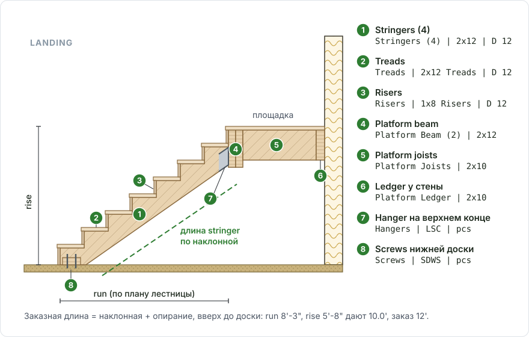
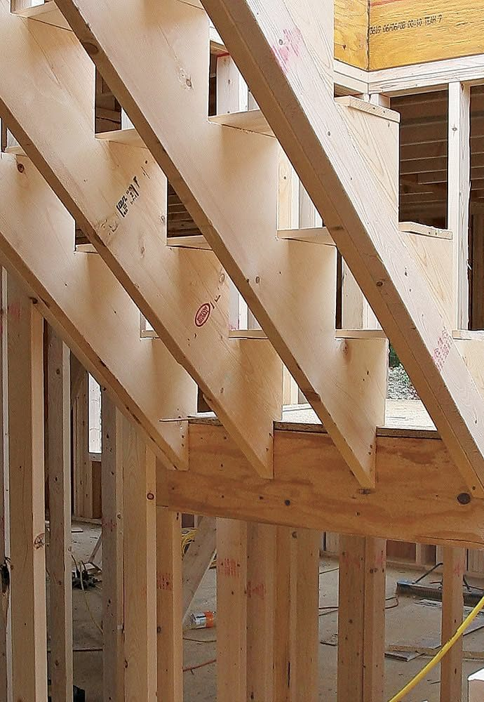

# Stair

<figure markdown>
  
  <figcaption markdown="span">Stair block: stringers carry treads and risers, the flight bears on the landing (platform beam, joists, ledger). Stair hangers go in the same block.</figcaption>
</figure>

<figure markdown>
  { width="360" }
  <figcaption markdown="span">A flight on site: four notched 2x12 stringers, temporary treads from offcuts, the bottom of the flight sits on the landing. In the DFL stringers are counted in pieces by flight length, treads and risers by the number of steps. Photo: finehomebuilding.com, [source](https://www.finehomebuilding.com/project-guides/framing/how-to-cut-stair-stringers), found via Pinterest.</figcaption>
</figure>

## What it is

Stair is the wood stair framing: stringers, treads, risers, landing (platform beam, platform joists, ledger, box), hangers and hardware. A metal lobby stair or a prefab stair by others is one note row, with no material. Stair railing and finish are not here.

## Where to find it on the plans

| Sheet | What to take |
| --- | --- |
| A stair plans and sections (A4xx, A5xx) | number of stairs and flights, flight width, number of risers, run and rise |
| S stair detail (for example, 2/S603) | stringer table by run: size, LVL or 2x12, stringer spacing |
| S floor framing plan | platform beam, platform joists, landing ledger, marks `Str FB5` |
| Hanger schedule, details | hangers at stringer ends (LSC), platform joists, balloon detail of the stair walls |

## How to measure in OurPlanCore

Path `framing/<floor> framing/stairs/<element>`. The tool type follows the physical object, not one tool for everything:

| Element | Tool | Name example |
| --- | --- | --- |
| Box, landing ledger | Line (L) | `box str`, `ledger str` |
| Platform joists | J Area (J) | `Stair 2x10 16"` |
| Platform beam, stringers by mark | Beam (B) or Count (P) | `Str FB5 10`, `Stair HP5 5` |

1. Assign the flight to a confirmed level: the stair is visible on two plans but is counted once.
2. Stringer order length = sloped length plus bearing, rounded up to a standard board: run 8'-3" and rise 5'-8" give 10.0' along the slope, we order 12'.
3. Step sizes from the stair plan, not scaled off a neighboring sheet.
4. Identical stairs - one block with a multiplier; different ones - separate blocks.

## Tree name and DFL row

Export: the ST button on the XL strip puts the stair takeoffs before Subfloor. The block in the DFL starts with a `Note: 2 Stairs` row, where G = number of stairs, and all quantities are multiplied by G.

| A (Label) | B (material) | C | D | Rule |
| --- | --- | --- | --- | --- |
| `Stringers (4)` | `2x12`, per table `1 3/4 x 11 7/8 LVL`, `1 3/4 x 14 LVL` | `=4*G` per flight | `10`, `12`, `14` | 4 stringers per flight; 2x12 by default, LVL per the detail table |
| `Treads` | `2x12 Treads` | number of treads / 3 per 12' board | `12` | treads = risers minus number of flights |
| `Risers` | `1x8 Risers` | number of risers / 3 | `12` | risers from the A plan |
| `Platform Beam (2)` | `2x12`, `(2) 1 3/4 x 11 1/4 LVL` | `=2*G` | `10` | size per the stringer end detail |
| `Platform Joists` | `2x10` | `=9*G` | `10` | from the landing J Area |
| `Platform Ledger` | `2x10`, at CMU `2x10 P.T.` | `=4*G` | `14` | |
| `Hangers` | `LSC`, `LUS210`, `HUCQ210-3` | by connections x G | `pcs` | one LSC per stringer top end |
| `Screws` | `SDWS 1/4 x 4 1/4` | `=4*4*G` | `pcs` | attachment of the stringer bottom board |

## Common mistakes

- The stair not multiplied by the number of stairs: 8 identical stairs, one counted.
- Stringers from the template `(4) 1 3/4 x 16 LVL` for a two-flight stair. Two flights - 8 pcs `2x12` at 10-12'; LVL only when the detail table calls for it.
- Stringer length taken off the plan (horizontal projection), not along the slope.
- A flight counted on both plans where it is visible.
- Stair hangers mixed with demising hangers. DHU/DGU at the stair firewall is a separate row, see [Tips](../../../reference/boss-feedback-rules.md#dhu-dgu-vs-its).
- LSC count taken from order boards after cutting, not from the physical stringers.
- [All floor framing mistakes](../../../start/common-mistakes.md#floor)

## Example

```text
framing/
  2nd floor framing/
    stairs/
      box str            Line, 24 LF
      ledger str         Line, 12 LF
      Stair 2x10 16"     landing J Area
      Str FB5 10         2 points
```

| A | B | C | D | E |
| --- | --- | --- | --- | --- |
| `Note: 2 Stairs` | | | | `2/S603` |
| `Stringers (4)` | `2x12` | `=4*G` | 12 | `2/S603` |
| `Treads` | `2x12 Treads` | `=6*G` | 12 | |
| `Risers` | `1x8 Risers` | `=6*G` | 12 | |
| `Platform Beam (2)` | `2x12` | `=2*G` | 10 | `Str FB5` |
| `Hangers` | `LSC` | `=8*G` | pcs | `2/S603` |

## See also

- [Beam](beam.md), [Joist](joist.md), [Post](post.md)
- [Hangers](../../../reference/hangers.md), [Hardware catalog](../../../reference/hardware-catalog.md)
- [Takeoff item labels](../../../reference/takeoff-items.md)
