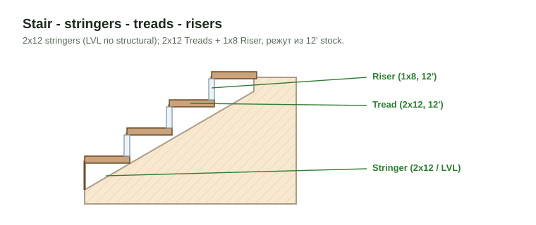
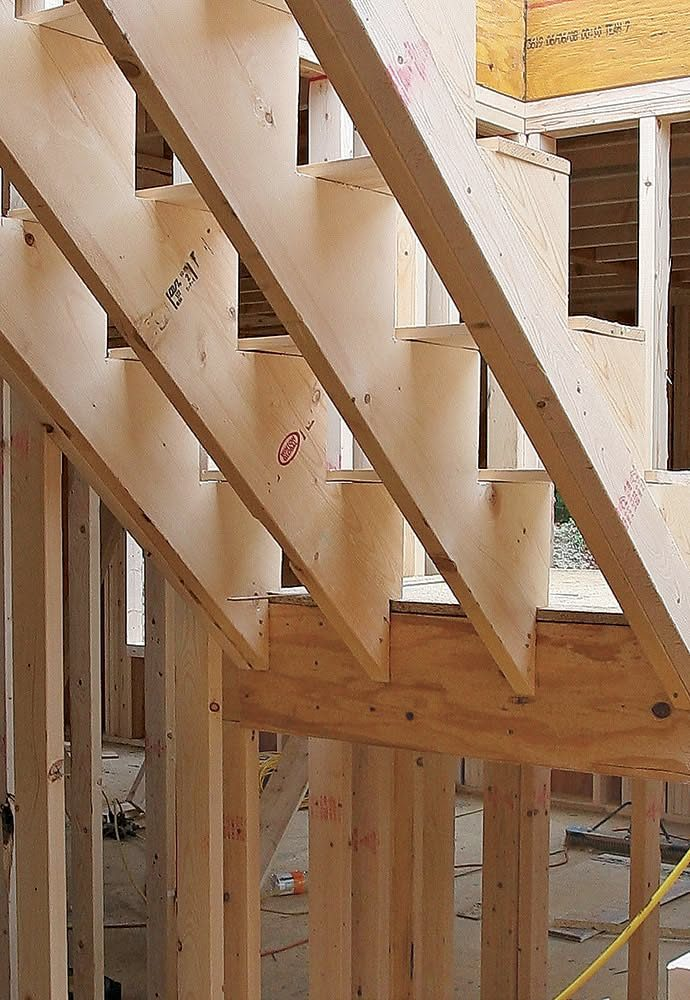

# Stair (лестничный каркас)

<figure markdown>
  
  <figcaption markdown="span">Stair-блок: stringers несут treads и risers, марш опирается на площадку (platform beam, joists, ledger). Hangers лестницы идут в этом же блоке.</figcaption>
</figure>

<figure markdown>
  { width="360" }
  <figcaption markdown="span">Марш на стройке: четыре stringers из 2x12 с вырезами под ступени, временные treads из обрезков, низ марша стоит на площадке. В DFL stringers штуками по длине марша, treads и risers по числу ступеней. Фото: finehomebuilding.com, [источник](https://www.finehomebuilding.com/project-guides/framing/how-to-cut-stair-stringers), найдено через Pinterest.</figcaption>
</figure>

## Что это

Stair - деревянный каркас лестницы: stringers (косоуры), treads (проступи), risers (подступенки), площадка (platform beam, platform joists, ledger, box), hangers и крепёж. Металлическая лестница lobby или сборная by others - одна строка-note, без материала. Ограждение лестницы и отделка - не здесь.

## Где искать на чертежах

| Лист | Что взять |
| --- | --- |
| A stair plans и sections (A4xx, A5xx) | число лестниц и маршей, ширина марша, число risers, run и rise |
| S stair detail (например, 2/S603) | таблица stringers по run: сечение, LVL или 2x12, шаг stringers |
| S framing plan этажа | platform beam, platform joists, ledger у площадки, марки `Str FB5` |
| Hanger schedule, details | hangers концов stringers (LSC), platform joists, balloon-деталь стен лестницы |

## Как мерить в OurPlanCore

Путь `framing/<этаж> framing/stairs/<элемент>`. Тип инструмента по физическому объекту, не один на всё:

| Элемент | Инструмент | Пример имени |
| --- | --- | --- |
| Box, ledger площадки | Line (L) | `box str`, `ledger str` |
| Platform joists | J Area (J) | `Stair 2x10 16"` |
| Platform beam, stringers по марке | Beam (B) или Count (P) | `Str FB5 10`, `Stair HP5 5` |

1. Марш относи к подтверждённому уровню: лестница видна на двух планах, но считается один раз.
2. Заказная длина stringer = наклонная длина плюс опирание, к стандартной доске: run 8'-3" и rise 5'-8" дают 10.0' по наклонной, заказываем 12'.
3. Размеры ступеней из плана лестницы, не с масштаба соседнего листа.
4. Одинаковые лестницы - один блок с множителем; разные - отдельные блоки.

## Как назвать в дереве и строка DFL

Экспорт: кнопка ST полосы XL ставит лестничные позиции перед Subfloor. Блок в DFL начинается строкой `Note: 2 Stairs`, где G = число лестниц, и все количества умножаются на G.

| A (Label) | B (материал) | C | D | Правило |
| --- | --- | --- | --- | --- |
| `Stringers (4)` | `2x12`, по таблице `1 3/4 x 11 7/8 LVL`, `1 3/4 x 14 LVL` | `=4*G` на марш | `10`, `12`, `14` | 4 stringers на марш; 2x12 по умолчанию, LVL по таблице детали |
| `Treads` | `2x12 Treads` | число treads / 3 на 12' доску | `12` | treads = risers минус число маршей |
| `Risers` | `1x8 Risers` | число risers / 3 | `12` | risers из A-плана |
| `Platform Beam (2)` | `2x12`, `(2) 1 3/4 x 11 1/4 LVL` | `=2*G` | `10` | сечение по детали концов stringers |
| `Platform Joists` | `2x10` | `=9*G` | `10` | по J Area площадки |
| `Platform Ledger` | `2x10`, у CMU `2x10 P.T.` | `=4*G` | `14` | |
| `Hangers` | `LSC`, `LUS210`, `HUCQ210-3` | по узлам x G | `pcs` | LSC один на верхний конец stringer |
| `Screws` | `SDWS 1/4 x 4 1/4` | `=4*4*G` | `pcs` | крепление нижней доски stringers |

## Частые ошибки

- Лестница не умножена на число лестниц: 8 одинаковых лестниц, посчитана одна.
- Stringers из шаблона `(4) 1 3/4 x 16 LVL` для двухмаршевой лестницы. Два марша - 8 шт `2x12` по 10-12', LVL только когда требует таблица детали.
- Длина stringer взята по плану (горизонтальная проекция), а не по наклонной.
- Марш посчитан на обоих планах, где он виден.
- Hangers лестницы смешаны с hangers demising. DHU/DGU у firewall лестницы - отдельная строка, см. [Советы](../../../reference/boss-feedback-rules.md#dhu-dgu-vs-its).
- Количество LSC взято по заказным доскам после раскроя, а не по физическим stringers.
- [Все ошибки по перекрытиям](../../../start/common-mistakes.md#floor)

## Пример

```text
framing/
  2nd floor framing/
    stairs/
      box str            Line, 24 LF
      ledger str         Line, 12 LF
      Stair 2x10 16"     J Area площадки
      Str FB5 10         2 точки
```

| A | B | C | D | E |
| --- | --- | --- | --- | --- |
| `Note: 2 Stairs` | | | | `2/S603` |
| `Stringers (4)` | `2x12` | `=4*G` | 12 | `2/S603` |
| `Treads` | `2x12 Treads` | `=6*G` | 12 | |
| `Risers` | `1x8 Risers` | `=6*G` | 12 | |
| `Platform Beam (2)` | `2x12` | `=2*G` | 10 | `Str FB5` |
| `Hangers` | `LSC` | `=8*G` | pcs | `2/S603` |

## См. также

- [Beam](beam.md), [Joist](joist.md), [Post](post.md)
- [Hangers](../../../reference/hangers.md), [Hardware catalog](../../../reference/hardware-catalog.md)
- [Takeoff item labels](../../../reference/takeoff-items.md)
