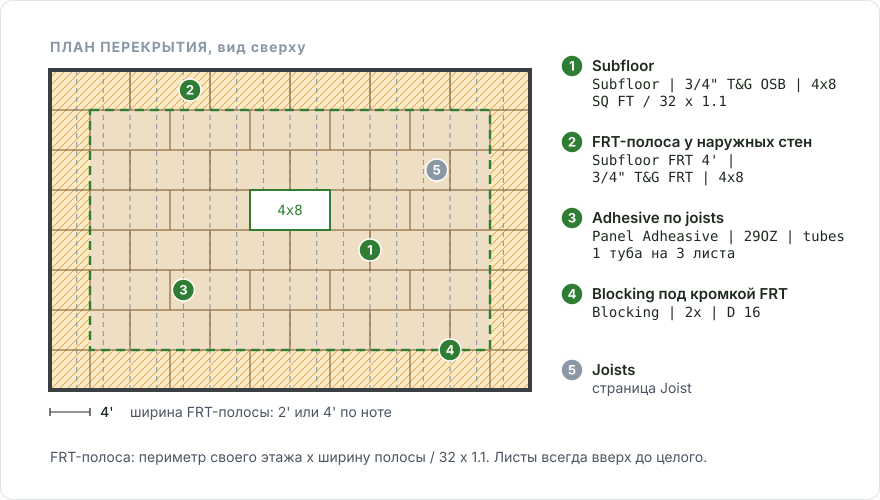
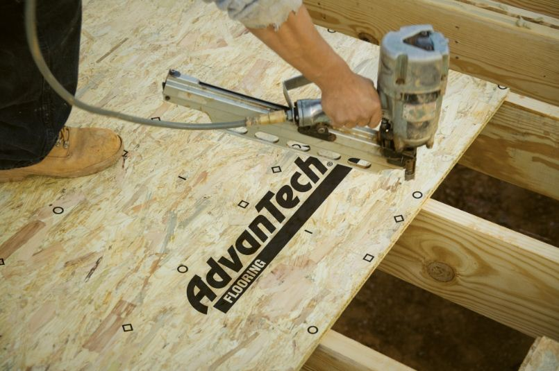

# Subfloor Sheathing

<figure markdown>
  
  <figcaption markdown="span">Subfloor by default is 3/4" T&G glued to the joists. The FRT strip at the exterior wall, underlayment, and subfloor over an existing floor are separate rows.</figcaption>
</figure>

## What it is

Subfloor is the panel decking over the joists: `3/4" T&G OSB` or `AdvanTech`, on panel adhesive. Counted separately: the FRT strip around the perimeter, underlayment under the finish, decking under tubs, and decking over an existing floor. The vertical sheathing strip at floor level is the [Floor-height Sheathing](../../vertical/sheathing/floor.md) page, not subfloor.

## Where to find it on the plans

| Sheet | What to take |
| --- | --- |
| Floor assembly (A5xx, A6xx), general notes | thickness and product, T&G, adhesive, layers on top |
| S general notes, FRT note | FRT strip 2' or 4' from the exterior wall; blocking under its edge |
| Finish schedule, bath details | 1/2" underlayment, 3/4" ply under tubs |
| Reconstruction details | new subfloor over the existing floor, if the detail calls for it |
| Deck and balcony sections | structural subfloor of balconies, separate material |

## How to measure in OurPlanCore

The area comes from `sqfts/<floor>` (the floor Area); no separate measurement is needed. For the FRT strip you need the exterior perimeter of that floor: a Line along the exterior walls or the sum of the `ext` walls of the floor.

- Sheets = SQ FT / 32 x 1.1, rounded up to a whole sheet (`4x8`).
- FRT strip: floor perimeter x strip width (2' or 4'), on its own floor. A 4' strip written as 10 sheets instead of 54 is a typical undercount.
- Panel adhesive: the `Panel Adheasive` `29OZ` row per the template rate; this row is often forgotten.

## Tree name and DFL row

There are usually no takeoffs in `framing`: the rows take the area from the SQFT worksheet. The SF button on the XL strip moves the areas to `A2_SQFT_calc`; the subfloor is calculated in each `Floor Framing List`.

| A (Label) | B (material) | C | D | E |
| --- | --- | --- | --- | --- |
| `Subfloor` | `3/4" T&G OSB` | `=CEILING(G/32*1.1,1)` | `4x8` | assembly sheet |
| `Subfloor FRT 4'` | `3/4" T&G FRT` | perimeter x 4 / 32 x 1.1 | `4x8` | FRT note |
| `Panel Adheasive` | `29OZ` | per template rate | `pcs` | |
| `Underlayment` | `1/2" Ply` | area / 32 x 1.1 | `4x8` | finish schedule |
| `Plywood at Tubs` | `3/4" Ply` | by number of tubs | `4x8` | `Addendum A` |
| `Blocking` | `2x` | FRT strip perimeter | `LFT` | under the FRT edge |

## Common mistakes

- The FRT strip not counted from the perimeter of its own floor, or missed entirely.
- Underlayment over the whole area, though the detail gives 3/4" ply only under tubs, not under showers.
- New subfloor over the existing floor not included, though the reconstruction detail calls for it.
- No panel adhesive row.
- Balcony and terrace decking counted as house subfloor: they have their own material per the section.
- [All floor framing mistakes](../../../start/common-mistakes.md#floor)

## Example

| A | B | C | D | E |
| --- | --- | --- | --- | --- |
| `Subfloor` | `3/4" T&G OSB` | 60 | 4x8 | `A501` |
| `Subfloor FRT 4'` | `3/4" T&G FRT` | 24 | 4x8 | `S001 note 12` |
| `Panel Adheasive` | `29OZ` | 84 | pcs | |

<figure markdown>
  
  <figcaption markdown="span">Archived photo: an AdvanTech sheet being nailed to the joists. Write the product as in the spec (`AdvanTech`, `3/4" T&G OSB`), not generically.</figcaption>
</figure>

## See also

- [Joist](joist.md), [Floor SQFT](../../sqfts/1st2nd.md), [Floor-height Sheathing](../../vertical/sheathing/floor.md)
- [Blocking](details/blocking.md), [Reconstruction](../../../work-types/reconstruction.md)
