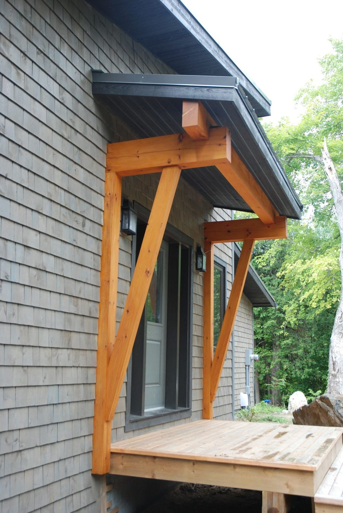
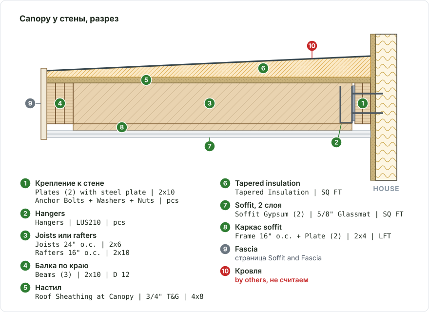

# Canopy

<figure markdown>
  
  <figcaption markdown="span">Archive 3D view: the canopy framing along the elevations is highlighted in red and lifted out. Its own joists or rafters, an edge beam, attachment to the wall and soffit underneath: a separate block, not part of the main roof.</figcaption>
</figure>

<figure markdown>
  { width="360" }
  <figcaption markdown="span">Entry canopy: a shed mini-roof on two timber brackets at the wall, soffit underneath, fascia at the edge. Count the canopy rafters or joists, the edge beam, brackets or posts, the wall attachment, soffit and fascia, all as a separate block. Photo: discoverydreamhomes.com, [source](https://www.discoverydreamhomes.com/), found via Pinterest.</figcaption>
</figure>

## What it is

A canopy is a small roof over an entry or along a facade: its own flat or sloped mini-roof, soffit underneath, attached to the wall with a ledger or a steel plate, sometimes on posts. It is a separate scope and a separate DFL worksheet, `Canopy Framing List`. A porch is bigger and usually on posts: [Deck / Porch / Balcony Frame](../../deck/deck-porch-balcony-frame.md). A canopy is not part of the main roof `eve` and `rake`.

## Where to find it on the plans

| Sheet | What to take |
| --- | --- |
| Elevations, roof plan (A) | where the canopy is, dimensions, slope or flat |
| Canopy details (A5xx, S5xx) | beams, rafters or joists, spacing, wall attachment, posts |
| RCP | canopy soffit: material, layers, soffit framing |
| Roof assembly notes | canopy deck: `3/4" T&G OSB`, tapered insulation, cover board |
| Steel details | steel plate and anchor bolts to the wall or column |

## How to measure in OurPlanCore

| Part | Tool | Branch and name |
| --- | --- | --- |
| Canopy area (deck and soffit) | Area (A) | `sqfts/canopy` or `sqfts/flat canopy` |
| Canopy joists or rafters | J Area (J) | `framing/<floor> framing/joists/flat canopy 2x6 24"` |
| Canopy beams | Beam (B) | `framing/<floor> framing/beams/FB30 12` |
| Ledger to the wall | Line (L) | `framing/<floor> framing/details/canopy ledger` |
| Posts | Count (P) | `framing/<floor> framing/posts/6x6 P.T. 9` |

The floor is the one whose floor framing the canopy attaches to. The canopy has its own slope; a flat canopy has no slope factor.

<figure markdown>
  
  <figcaption markdown="span">J Area: outline, direction and spacing; the app figures the count and the lengths.</figcaption>
</figure>

<figure markdown>
  
  <figcaption markdown="span">Canopy at the wall: ledger or steel plate with anchors, joists, edge beam, deck and soffit. The canopy is not part of eve/rake.</figcaption>
</figure>

## Takeoff name and DFL row

Export: the FR and JS buttons on the XL strip put the canopy takeoffs into `Canopy Framing List`; if the worksheet does not exist, it is created as a copy of the nearest floor. Block header: `<Location> Canopy Framing List <L>' x <W>' <G> unit<H>`, where G is the number of identical canopies. Block contents per detail:

| A (Label) | B | C | D | E |
| --- | --- | --- | --- | --- |
| `Beam (3)` | `2x10 P.T.` | points x 3 | `12` | `FB30` |
| `Plates (2) with steel plate` | `2x10 P.T.` | `=CEILING(G*2/D,1)` | `16` | attachment detail |
| `Rafters 16" o.c.` or `Joists 24" o.c.` | `2x10 P.T.`, `2x6 P.T.` | from J Area | lengths | |
| `Hangers` | `LUS210 Zmax`, `HUC210-2 Zmax` | per connection | `pcs` | |
| `Anchor Bolts` + `Washers` + `Nuts` | `3/4" Ø x 5"` | per detail | `pcs` | steel plate to the wall |

- `(n)` in the Label is the number of plies, and C counts every board: `Beam (3)` with three points gives C = 9.
- A canopy is outdoors: the beams, rafters, joists, plates and ledger of the block are `P.T.`, roofed or not, and hangers get `Zmax` as a separate word after the model.

Canopy rows in other sections:

| Section | A (Label) | B | C | D | E |
| --- | --- | --- | --- | --- | --- |
| Roof System Misc | `Roof Sheathing at Canopy Roofs` | `3/4" T&G OSB` | `=CEILING(G/32*1.1,1)` | `4x8` | canopy detail sheet |
| Roof System Misc | `Roof Insulation` | `Tapered Polyiso Insulation`, per spec | SQ FT x 1.1 | `SQ FT` | assembly sheet |
| Canopy Trims | `Soffit Gypsum (2)` | `5/8" Glassmat Gyp` or `5/8" Ext Gyp` | `=CEILING(G*2*1.1,2)` x number of canopies | `SQ FT` | RCP |
| Canopy Trims | `Frame 16" o.c.` + `Plate (2)` | `2x4`, no P.T. | soffit framing | `LFT` | RCP |

- A canopy deck with its own area (not part of the main roof `rf` lines) is the `Roof Sheathing at Canopy Roofs` row in Roof System Misc, with `Roof Insulation` under it when the canopy assembly shows insulation. Do not write the deck again in the canopy block. When the canopy roof is already in the `rf` lines, there is no separate row.
- Canopy finishes (soffit gypsum, soffit framing, fascia) are the `Canopy Trims` group right after the block, not rows in the general sections. The soffit framing is `2x4` without P.T., as for frame for soffits.
- Two layers of gypsum on the canopy ceiling are one row `Soffit Gypsum (2)`: `G` is the area of one canopy, the layers go in the Label and once as `x 2` in the formula, and the `1.1` allowance always applies.

Framing not shown: a note right under the block header: `Note: Canopy framing is not specified; all framing assumed; verify`.

## Common mistakes

- Canopy counted a second time in the main roof `eve` and `rake`.
- Canopy soffit counted as regular gypsum when it needs exterior grade (`5/8" Glassmat Gyp`, DensGlass), two layers per detail.
- Two gypsum layers written as two rows, without `x 2`, or without the `1.1` allowance.
- Soffit area left out of the sheathing and WRB when the detail calls for it.
- Canopy deck taken from the main roof spec when the detail calls for `3/4" T&G` + tapered insulation.
- Canopy deck written both in the block and in Roof System Misc: it is counted once.
- Canopy beams, rafters or joists without `P.T.`, hangers without `Zmax`.
- Wall attachment (steel plate, anchor bolts, washers, nuts) missed.
- Metal stud canopy joists counted as wood or not counted: follow the detail.
- [All roof mistakes](../../../start/common-mistakes.md#roof)

## Example

```text
sqfts/flat canopy                              Area, 96 SQ FT
framing/1st floor framing/joists/flat canopy 2x6 24"    J Area
framing/1st floor framing/beams/FB30 12        3 points
framing/1st floor framing/details/canopy ledger   Line, 24 LFT
```

Canopy block:

| A | B | C | D | E |
| --- | --- | --- | --- | --- |
| `Beam (3)` | `2x10 P.T.` | 9 | 12 | `FB30 per S601` |
| `Joists 24" o.c.` | `2x6 P.T.` | 7 | 8 | `11/A506` |

`Canopy Trims` group after the block:

| A | B | C | D | E |
| --- | --- | --- | --- | --- |
| `Soffit Gypsum (2)` | `5/8" Glassmat Gyp` | 212 | SQ FT | `11/A506` |

`Beam (3)`: 3 points x 3 plies = 9 boards. `Soffit Gypsum (2)`: 96 SQ FT x 2 layers x 1.1 = 211.2, up to an even number = 212, one canopy.

## See also

- [Porch SQFT](../../sqfts/porch.md), [Deck / Porch / Balcony Frame](../../deck/deck-porch-balcony-frame.md)
- [Eve / Eave](../../sheathing-and-misc/eve.md), [Soffit & Fascia](../../exterior-trims/soffit-fascia.md), [Roof Types](../../sheathing-and-misc/rooftype.md)
