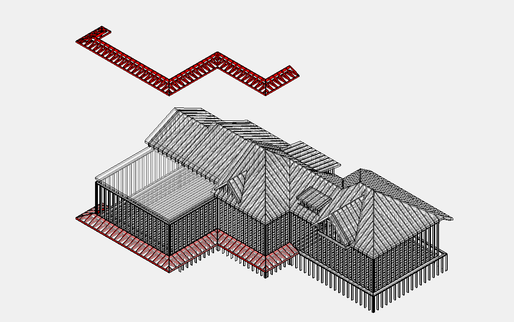
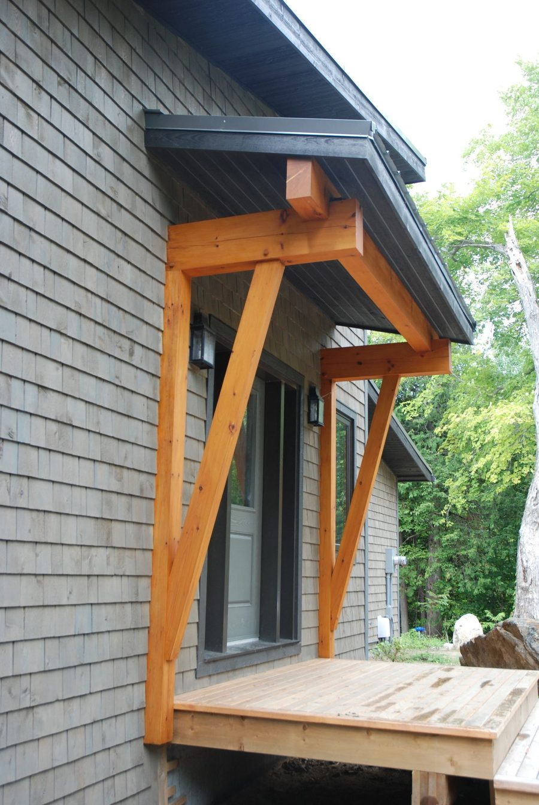
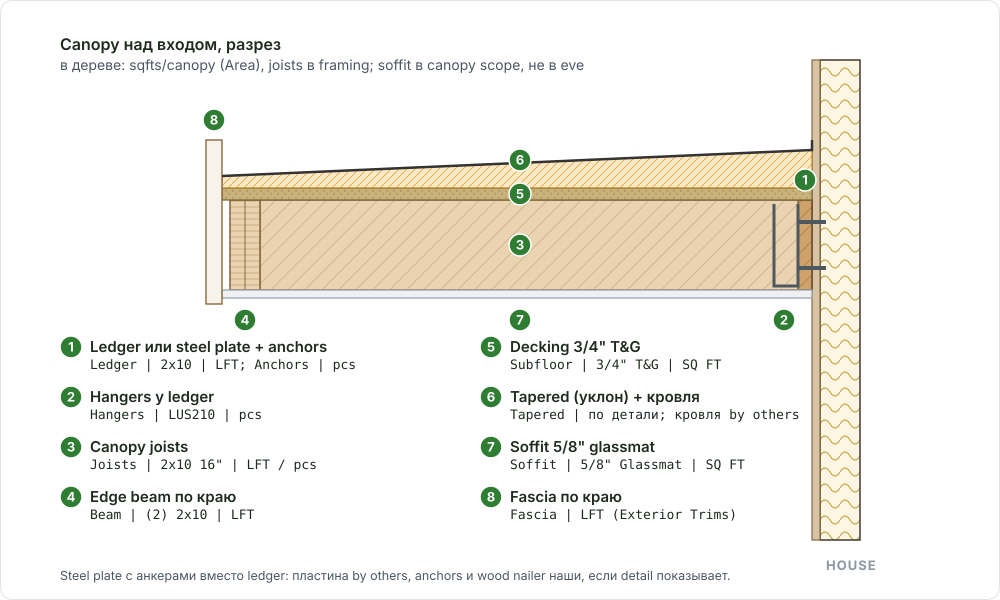

# Canopy (навес, козырёк)

<figure markdown>
  
  <figcaption markdown="span">Архивный 3D-вид: красным выделен каркас навеса по фасадам, вынесен вверх. Свои joists или rafters, балка по краю, крепление к стене и soffit снизу - отдельный блок, не часть main roof.</figcaption>
</figure>

<figure markdown>
  { width="360" }
  <figcaption markdown="span">Canopy над входом: односкатная мини-крыша на двух деревянных кронштейнах у стены, снизу подшивка soffit, по краю fascia. Считаются rafters или joists навеса, балка по краю, кронштейны или посты, крепление к стене, soffit и fascia - всё отдельным блоком. Фото: discoverydreamhomes.com, [источник](https://www.discoverydreamhomes.com/), найдено через Pinterest.</figcaption>
</figure>

## Что это

Canopy - небольшой навес над входом или вдоль фасада: своя плоская или скатная мини-крыша, soffit снизу, крепление к стене через ledger или стальную пластину, иногда посты. Отдельный scope и отдельный лист DFL `Canopy Framing List`. Porch больше и обычно на постах: [Deck / Porch / Balcony Frame](../../deck/deck-porch-balcony-frame.md). Canopy не входит в `eve` и `rake` основной крыши.

## Где искать на чертежах

| Лист | Что взять |
| --- | --- |
| Elevations, roof plan (A) | где canopy, размеры, уклон или flat |
| Canopy details (A5xx, S5xx) | balки, rafters или joists, шаг, крепление к стене, посты |
| RCP | soffit canopy: материал, слои, каркас soffit |
| Roof assembly notes | настил canopy: `3/4" T&G OSB`, tapered insulation, cover board |
| Steel details | стальная пластина и anchor bolts к стене или колонне |

## Как мерить в OurPlanCore

| Часть | Инструмент | Ветка и имя |
| --- | --- | --- |
| Площадь canopy (настил и soffit) | Area (A) | `sqfts/canopy` или `sqfts/flat canopy` |
| Joists или rafters canopy | J Area (J) | `framing/<этаж> framing/joists/flat canopy 2x6 24"` |
| Балки canopy | Beam (B) | `framing/<этаж> framing/beams/FB30 12` |
| Ledger к стене | Line (L) | `framing/<этаж> framing/details/canopy ledger` |
| Посты | Count (P) | `framing/<этаж> framing/posts/6x6 P.T. 9` |

Этаж - тот, к перекрытию которого canopy крепится. Уклон canopy свой; у flat canopy slope factor нет.

<figure markdown>
  
  <figcaption markdown="span">J Area: контур, направление и шаг; программа считает количество и длины.</figcaption>
</figure>

<figure markdown>
  
  <figcaption markdown="span">Canopy у стены: ledger или стальная пластина с анкерами, joists, балка по краю, настил и soffit. Canopy не входит в eve/rake.</figcaption>
</figure>

## Как назвать в дереве и строка DFL

Экспорт: кнопки FR и JS полосы XL кладут позиции canopy в `Canopy Framing List`; если листа нет, он создаётся копией ближайшего этажа. Состав блока по детали:

| A (Label) | B | C | D | E |
| --- | --- | --- | --- | --- |
| `Beams (3)` | `2x10` | точки | `12` | `FB30` |
| `Plates (2) with steel plate` | `2x10` | LFT / 16 | `16` | деталь крепления |
| `Rafters 16" o.c.` или `Joists 24" o.c.` | `2x10`, `2x6` | по J Area | длины | |
| `Hangers` | `LUS210`, `HUC210-2` | по узлам | `pcs` | |
| `Anchor Bolts` + `Washers` + `Nuts` | `3/4" Ø x 5"` | по детали | `pcs` | стальная пластина к стене |
| `Roof Sheathing at Canopy` | `3/4" T&G OSB` | SQ FT / 32 x 1.1 | `4x8` | |
| `Tapered Insulation` | по спецификации | SQ FT | `SQ FT` | |
| `Soffits at Canopy (2)` | `5/8" Glassmat` или `5/8" Ext Gyp` | SQ FT x слои | `SQ FT` | RCP |
| `Frame 16" o.c.` + `Plate (2)` | `2x4` | каркас soffit | `LFT` | RCP |

Каркас не показан - note сразу под заголовком блока: `Note: Canopy framing is not specified; all framing assumed; verify`.

## Частые ошибки

- Canopy посчитан в `eve` и `rake` основной крыши второй раз.
- Soffit canopy посчитан обычным гипсом, а нужен exterior-grade (`5/8" Glassmat`, DensGlass), по детали два слоя.
- Площадь soffit не попала в обшивку и WRB, если деталь так требует.
- Настил canopy по основной спецификации кровли, а деталь даёт `3/4" T&G` + tapered insulation.
- Крепление к стене (стальная пластина, anchor bolts, washers, nuts) пропущено.
- Metal stud joists canopy посчитаны деревом или не посчитаны: по детали.
- [Все ошибки по крыше](../../../start/common-mistakes.md#roof)

## Пример

```text
sqfts/flat canopy                              Area, 96 SF
framing/1st floor framing/joists/flat canopy 2x6 24"    J Area
framing/1st floor framing/beams/FB30 12        3 точки
framing/1st floor framing/details/canopy ledger   Line, 24 LF
```

| A | B | C | D | E |
| --- | --- | --- | --- | --- |
| `Beams (3)` | `2x10` | 3 | 12 | `FB30 per S601` |
| `Joists 24" o.c.` | `2x6` | 7 | 8 | `11/A506` |
| `Soffits at Canopy (2)` | `5/8" Glassmat` | 192 | SQ FT | `11/A506` |

## См. также

- [Porch SQFT](../../sqfts/porch.md), [Deck / Porch / Balcony Frame](../../deck/deck-porch-balcony-frame.md)
- [Eve / Eave](../../sheathing-and-misc/eve.md), [Soffit & Fascia](../../exterior-trims/soffit-fascia.md), [Roof Types](../../sheathing-and-misc/rooftype.md)
