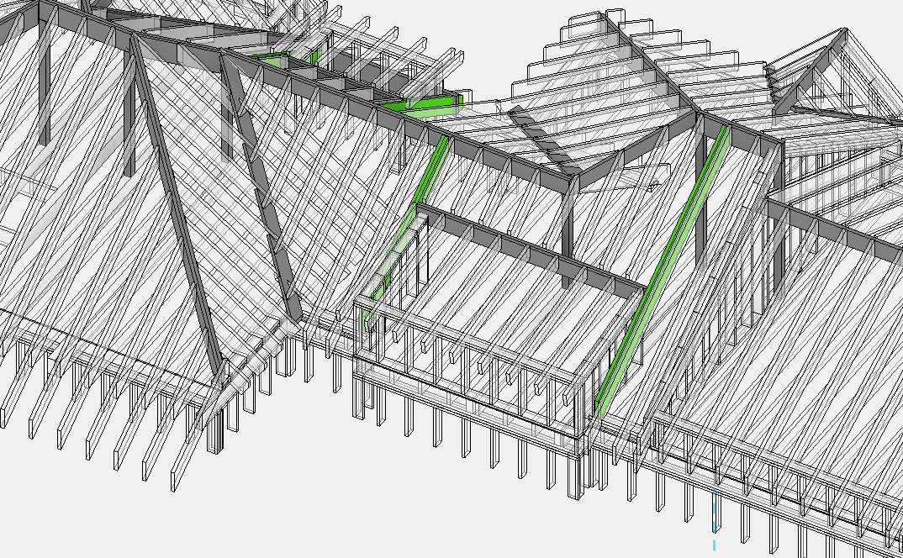
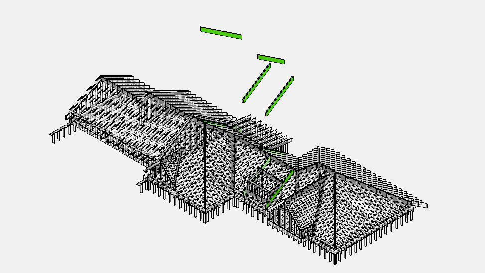

# Dbl / Trpl Rafters

<figure markdown>
  
  <figcaption markdown="span">Archive 3D view: doubled rafters at the sides of an opening and under a load are highlighted in green. They run parallel to the regular rafters from the ridge to the wall and are counted like a beam with plies.</figcaption>
</figure>

## What it is

Dbl and Trpl Rafters are doubled or tripled rafters: at the sides of a roof opening (they carry the [Roof Header](header.md)), under a dormer wall, under an equipment load. Any size: `2x12`, `(2) 2x10`, `(3) 1 3/4 x 11 7/8 LVL`. They bear on the [Ridge](ridge.md), a wall or the floor framing. Regular rafters at a spacing are a J Area, see the [Joist](../floor-framing/joist.md) page.

## Where to find it on the plans

| Sheet | What to take |
| --- | --- |
| Roof framing plan (S) | where rafters are doubled or tripled, mark, size |
| Sections, elevations | sloped length from the ridge to the support; do not take the length from the plan |
| Details | bearing on a ridge beam (hangers) or on a ridge board (no hangers), ties to the wall |
| Notes | "every other rafter doubled": count from the plan, do not average |

## How to measure in OurPlanCore

Beam tool (B) along the rafter on the roof framing sheet with the F dot. One pack = one point with `(n)` in the name. In the DFL column C counts every board: places x plies. The plan length is multiplied by the slope factor (6:12 gives 1.118, 8:12 gives 1.202; table on the [Hip](hip.md) page) or taken from the section. The app rounds the order length (up to 8' to the foot, longer to an even number).

Hangers are needed only when the rafters bear on a bearing ridge beam or the detail shows them directly: `LSSR`, `LRU` by pack width. No hangers at a ridge board. Roof hangers are written with no `Z` and no `Zmax` (`LSSR210`, `LSSR2.56`); the exception is the `LRU...Z` models (`LRU212Z`), where Z is part of the name.

<figure markdown>
  
  <figcaption markdown="span">Beam tool: two points along the member, the app rounds the length and puts it into the takeoff name.</figcaption>
</figure>

## Takeoff name and DFL row

Path: `framing/roof framing/beams/dbl rafters <size> <length>`.

| Takeoff name | A (Label) | B | C | D | E |
| --- | --- | --- | --- | --- | --- |
| `beams/dbl rafters 2x12 18` | `Dbl Rafters` | `2x12` | points x 2 | `18` | `S201` |
| `beams/trpl rafters (3) 1 3/4 x 11 7/8 LVL 28` | `Trpl Rafters (3)` | `1 3/4 x 11 7/8 LVL` | points x 3 | `28` | `R2 per S601` |
| `details/LSSR` | `Hangers` | `LSSR2.56`, `LRU212Z` | per connection | `pcs` | detail |

One rule for every built-up member (beams, posts, headers, rafters): C = places x plies. One skylight with reinforced rafters on both sides is 2 places and C = 4 for `Dbl Rafters`.

## Common mistakes

- Length taken from the plan without the slope.
- Pack written as one board: `(3)` lost, or the other way around, three points and `(3)` together.
- Hangers placed at a ridge board where there are none, or missed at a ridge beam.
- Hanger not matched to the pack width: `LSSR210` for one 2x instead of `LSSR210-2` for two.
- A roof hanger written with `Z` or `Zmax` (`LSSR2.56Z`): write `LSSR2.56`. `LRU212Z` stays as it is.
- C holds the points without multiplying by plies.
- Reinforced rafters from an "every other rafter doubled" detail averaged into regular rafters.
- [All roof mistakes](../../../start/common-mistakes.md#roof)

## Example

| A | B | C | D | E |
| --- | --- | --- | --- | --- |
| `Dbl Rafters` | `2x12` | 4 | 18 | `S201, skylight` |
| `Trpl Rafters (3)` | `1 3/4 x 11 7/8 LVL` | 3 | 28 | `R2` |
| `Hangers` | `LSSR210-2` | 2 | pcs | `rafters to ridge beam 7/S501` |

`Dbl Rafters`: 2 places at the skylight x 2 = 4. `Trpl Rafters (3)`: 1 place x 3 = 3. Hangers: the two `Dbl Rafters` packs hang on the ridge beam at the top end, one hanger per pack.

<figure markdown>
  
  <figcaption markdown="span">Doubled rafters up close: a two-board pack at the edge of the opening, the regular rafters between them are cut to the header.</figcaption>
</figure>

## See also

- [Ridge](ridge.md), [Roof Header](header.md), [Hip](hip.md), [Valley](valley.md)
- [Joist](../floor-framing/joist.md) - regular rafters via J Area, [Hangers](../../../reference/hangers.md)
