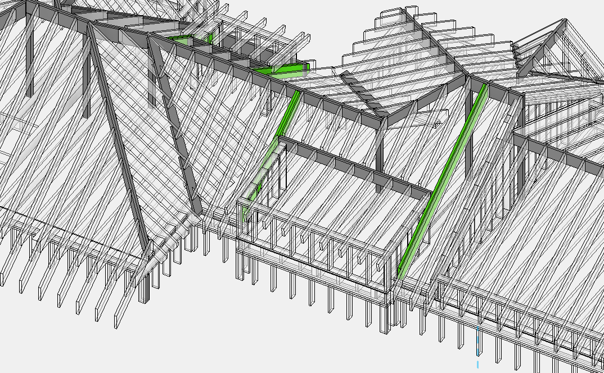
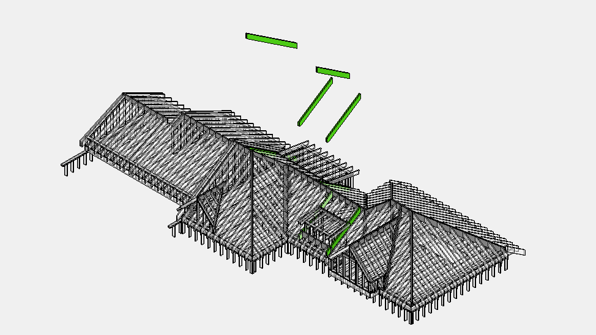

# Dbl / Trpl Rafters (усиленные стропила)

<figure markdown>
  
  <figcaption markdown="span">Архивный 3D-вид: зелёным выделены сдвоенные rafters по бокам проёма и под нагрузкой. Они идут параллельно обычным rafters от конька до стены и считаются как балка с plies.</figcaption>
</figure>

## Что это

Dbl и Trpl Rafters - сдвоенные или строенные rafters: по бокам проёма крыши (держат [Roof Header](header.md)), под стеной dormer, под нагрузкой от оборудования. Сечение любое: `2x12`, `(2) 2x10`, `(3) 1 3/4 x 11 7/8 LVL`. Опираются на [Ridge](ridge.md), стену или перекрытие. Обычные rafters с шагом - J Area на странице [Joist](../floor-framing/joist.md).

## Где искать на чертежах

| Лист | Что взять |
| --- | --- |
| Roof framing plan (S) | где rafters doubled или tripled, марка, сечение |
| Sections, elevations | наклонная длина от конька до опоры; с плана длину не брать |
| Details | опирание на ridge beam (hangers) или на ridge board (без hangers), ties к стене |
| Notes | "every other rafter doubled" - считать по плану, не усреднять |

## Как мерить в OurPlanCore

Инструмент Beam (B) вдоль rafter на листе roof framing с точкой F. Один пакет = одна точка с `(n)` в имени. Плановая длина умножается на коэффициент уклона (6:12 даёт 1.118, 8:12 даёт 1.202; таблица на странице [Hip](hip.md)) или берётся с разреза. Программа округляет заказную длину (до 8' до фута, длиннее до чётного).

Hangers нужны только когда rafters опираются на несущий ridge beam или деталь прямо их показывает: `LSSR`, `LRU` по ширине пакета. К ridge board hangers не ставятся.

<figure markdown>
  
  <figcaption markdown="span">Инструмент Beam: две точки по элементу, длина округляется программой и попадает в имя позиции.</figcaption>
</figure>

## Как назвать в дереве и строка DFL

Путь: `framing/roof framing/beams/dbl rafters <сечение> <длина>`.

| Имя в дереве | A (Label) | B | C | D | E |
| --- | --- | --- | --- | --- | --- |
| `beams/dbl rafters 2x12 18` | `Dbl Rafters` | `2x12` | точки x 2 | `18` | `S201` |
| `beams/trpl rafters (3) 1 3/4 x 11 7/8 LVL 28` | `Trpl Rafters` | `1 3/4 x 11 7/8 LVL` | точки x 3 | `28` | `R2 per S601` |
| `details/LSSR` | `Hangers` | `LSSR2.56Z`, `LRU212Z` | по узлам | `pcs` | деталь |

## Частые ошибки

- Длина взята с плана без уклона.
- Пакет записан как одна доска: `(3)` потерян, или наоборот три точки и `(3)` вместе.
- Hangers поставлены к ridge board, где их нет, или пропущены у ridge beam.
- Hanger не по ширине пакета: `LSSR2.56` под один 2x вместо `LSSR410` под два.
- Усиленные rafters по детали "every other rafter doubled" усреднены в обычные rafters.
- [Все ошибки по крыше](../../../start/common-mistakes.md#roof)

## Пример

| A | B | C | D | E |
| --- | --- | --- | --- | --- |
| `Dbl Rafters` | `2x12` | 4 | 18 | `S201, skylight` |
| `Trpl Rafters` | `1 3/4 x 11 7/8 LVL` | 3 | 28 | `R2` |
| `Hangers` | `LSSR2.56Z` | 2 | pcs | `rafters to ridge beam 7/S501` |

<figure markdown>
  
  <figcaption markdown="span">Сдвоенные rafters ближе: пакет из двух досок по краю проёма, обычные rafters между ними обрезаны на header.</figcaption>
</figure>

## См. также

- [Ridge](ridge.md), [Roof Header](header.md), [Hip](hip.md), [Valley](valley.md)
- [Joist](../floor-framing/joist.md) - обычные rafters через J Area, [Hangers](../../../reference/hangers.md)
