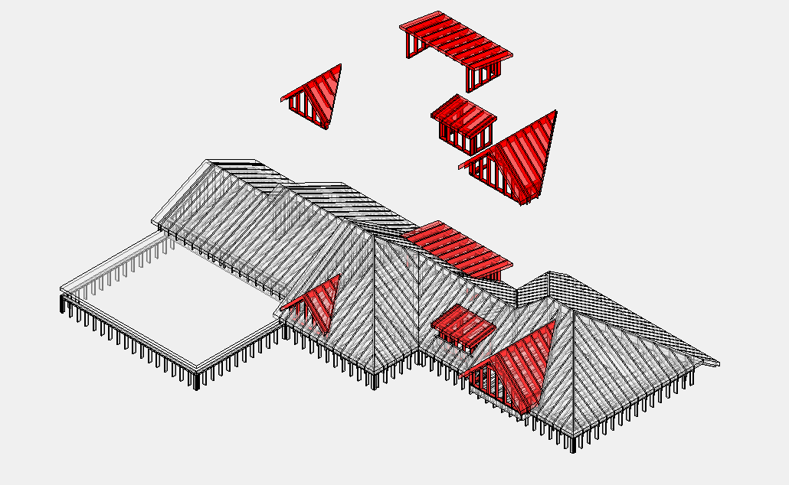
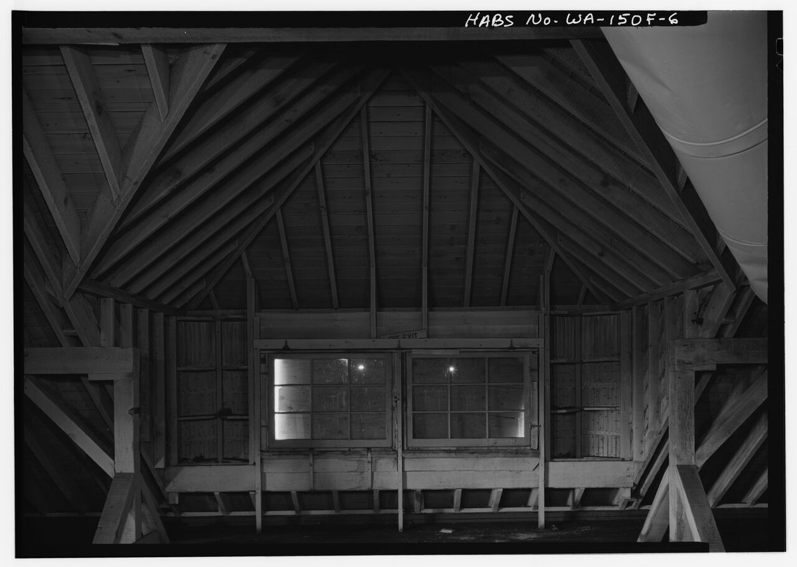

# Dormer

<figure markdown>
  
  <figcaption markdown="span">Archive 3D view: dormers highlighted in red and lifted out. A gable dormer has a triangular gable and its own gable roof; a shed dormer has a flat single slope. Each has its own walls, roof, opening and trim.</figcaption>
</figure>

<figure markdown>
  
  <figcaption markdown="span">Shed dormer from the inside: front wall with windows, dormer rafters at a lower pitch, triangular side walls. All four parts are counted separately. Photo: HABS, Library of Congress, Public domain, <a href="https://commons.wikimedia.org/wiki/File:ATTIC,_SHOWING_DORMER_FRAMING_%285%27x7%27_neg.%29_-_Fort_Lawton,_Double_Barracks,_Discovery_Park,_Seattle,_King_County,_WA_HABS_WASH,17-SEAT,1-F-6.tif">source</a>.</figcaption>
</figure>

## What it is

A dormer is a structure on a roof slope with its own roof and window. It combines four scopes: dormer walls, dormer roof, the opening in the main roof, trim. So a dormer does not hide in one item and does not dissolve into the main roof lines. Types: gable dormer (gable, two slopes, two valleys), shed dormer (one slope, below the ridge), eyebrow (rare, per detail).

## Where to find it on the plans

| Sheet | What to take |
| --- | --- |
| Roof plan (A), elevations | number of dormers, type, dormer roof pitch, wall height |
| Roof framing plan (S) | header in the main roof, reinforced rafters at the sides, dormer rafters, valleys |
| Sections through the dormer | dormer wall height, rafter size, dormer ridge |
| Window schedule | dormer window |
| Wall sections, details | sheathing, WRB, FRT of dormer walls, dormer fascia and soffit |

## How to measure in OurPlanCore

Each part with its own tool and in its own tree branch:

| Part | Tool | Branch and name |
| --- | --- | --- |
| Side and front walls | Line (L) | `walls/<floor> floor walls/ext 2x6 <height> dormer` |
| Gable dormer gable | Area (A) | `gables/gable stick/dormer` |
| Dormer roof | Area (A) | `sqfts/rf <pitch> dormer` |
| Dormer rafters | J Area (J) | `framing/roof framing/joists/dormer 2x8 16"` |
| Header and dbl rafters in the main roof | Beam (B) | `framing/roof framing/beams/...` |
| Dormer valley and ridge | Beam (B) | `framing/roof framing/beams/valley ...` |
| Window | Openings (O) | `openings/<floor>/3.0x4.0` |
| Dormer eave and rake | Line (L) | `eves rakes/eves/eve 12 dormer`, `rakes/rake 12 dormer` |

Dormer wall height comes from the section, not floor-to-floor. The dormer roof pitch often differs from the main roof.

## Takeoff name and DFL row

Dormer rows go in their own DFL sections (walls, roof sheathing, framing) with dormer marked in the Label or E.

| A (Label) | B | C | D | E |
| --- | --- | --- | --- | --- |
| `Studs 16" o.c.` | `2x6` | LFT x 1.1 | by height | `dormer walls per A301` |
| `Header (2)` | `2x12` | points | `8` | `dormer opening per S201` |
| `Dbl Rafters` | `2x12` | points | `18` | |
| `Rafters 16" o.c.` | `2x8` | from J Area | `10` | `dormer` |
| `Valley Rafters` | `2x12` | points | `12` | |
| `Fascia at Eves (dormer)` | `1x8` | LFT | `LFT` | |

## Common mistakes

- Dormer not counted: on the roof plan it shows as a small rectangle.
- Dormer walls left out of walls, their sheathing and WRB left out of the exterior sheathing.
- Header and reinforced rafters in the main roof missed.
- Dormer roof counted at the main roof pitch.
- Dormer eave added to the main `eve` without being split out, or not counted at all.
- Dormer window lost between floors in `openings`.
- [All roof mistakes](../../../start/common-mistakes.md#roof)

## Example

```text
walls/2nd floor walls/ext 2x6 6.5 dormer      Line, 2 dormers
gables/gable stick/dormer                     Area, 2 triangles
sqfts/rf 8 dormer                             Area
framing/roof framing/beams/rf header (2) 2x12 8     2 points
framing/roof framing/beams/valley 2x12 12           4 points
eves rakes/rakes/rake 12 dormer               Line
```

## See also

- [Roof Header](header.md), [Dbl / Trpl Rafters](dbl-trpl-rafters.md), [Valley](valley.md), [Overframes](overframes.md)
- [Exterior Walls](../../vertical/walls/exterior.md), [Gable](../../vertical/walls/gable.md), [Eve / Eave](../../sheathing-and-misc/eve.md), [Roof SQFT](../../sqfts/roof.md)
