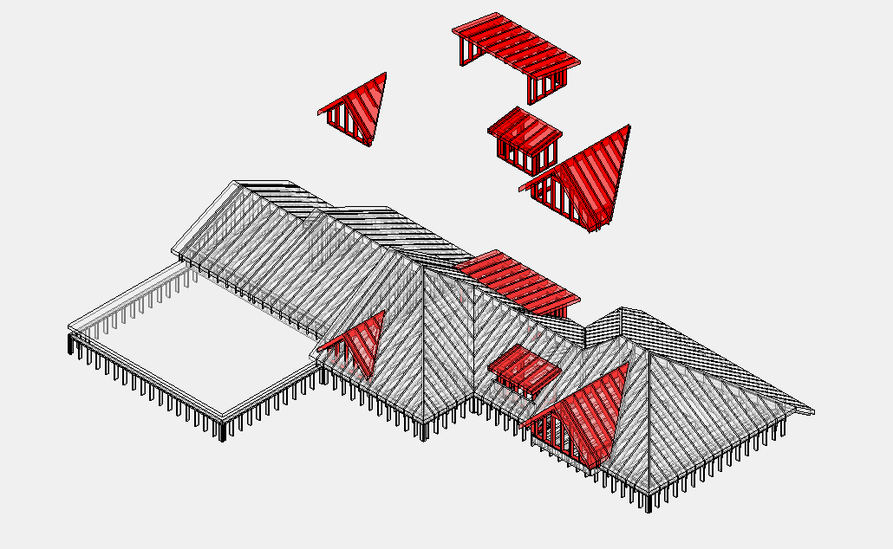
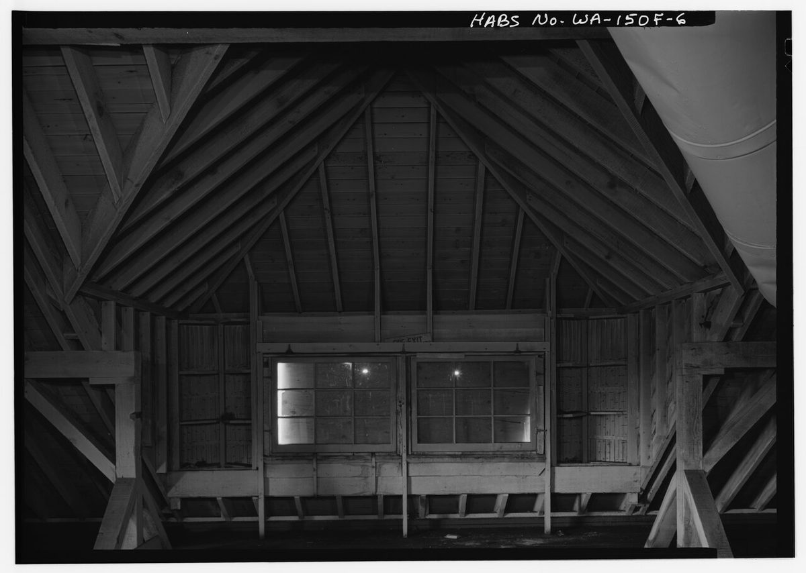

# Dormer (слуховое окно, надстройка на скате)

<figure markdown>
  
  <figcaption markdown="span">Архивный 3D-вид: красным выделены dormers, вынесены вверх. Gable dormer - треугольный фронтон и своя двускатная крыша; shed dormer - плоская односкатная. У каждого свои стены, крыша, проём и trim.</figcaption>
</figure>

<figure markdown>
  
  <figcaption markdown="span">Shed dormer изнутри: передняя стена с окнами, rafters dormer с меньшим уклоном, боковые стены-треугольники. Все четыре части считаются отдельно. Фото: HABS, Library of Congress, Public domain, <a href="https://commons.wikimedia.org/wiki/File:ATTIC,_SHOWING_DORMER_FRAMING_%285%27x7%27_neg.%29_-_Fort_Lawton,_Double_Barracks,_Discovery_Park,_Seattle,_King_County,_WA_HABS_WASH,17-SEAT,1-F-6.tif">источник</a>.</figcaption>
</figure>

## Что это

Dormer - надстройка на скате с собственной крышей и окном. Объединяет четыре scope: стены dormer, крыша dormer, проём в основной крыше, отделка. Поэтому dormer не прячется в один item и не растворяется в линиях main roof. Типы: gable dormer (фронтон, два ската, две valley), shed dormer (один скат, ниже конька), eyebrow (редко, по детали).

## Где искать на чертежах

| Лист | Что взять |
| --- | --- |
| Roof plan (A), elevations | число dormers, тип, уклон крыши dormer, высота стен |
| Roof framing plan (S) | header в основной крыше, усиленные rafters по бокам, rafters dormer, valley |
| Sections через dormer | высота стен dormer, сечение rafters, ridge dormer |
| Window schedule | окно dormer |
| Wall sections, details | sheathing, WRB, FRT стен dormer, fascia и soffit dormer |

## Как мерить в OurPlanCore

Каждая часть своим инструментом и в своей ветке дерева:

| Часть | Инструмент | Ветка и имя |
| --- | --- | --- |
| Боковые и передняя стены | Line (L) | `walls/<этаж> floor walls/ext 2x6 <высота> dormer` |
| Фронтон gable dormer | Area (A) | `gables/gable stick/dormer` |
| Крыша dormer | Area (A) | `sqfts/rf <уклон> dormer` |
| Rafters dormer | J Area (J) | `framing/roof framing/joists/dormer 2x8 16"` |
| Header и dbl rafters в основной крыше | Beam (B) | `framing/roof framing/beams/...` |
| Valley и ridge dormer | Beam (B) | `framing/roof framing/beams/valley ...` |
| Окно | Openings (O) | `openings/<этаж>/3.0x4.0` |
| Карниз и rake dormer | Line (L) | `eves rakes/eves/eve 12 dormer`, `rakes/rake 12 dormer` |

Высота стен dormer - с разреза, не floor-to-floor. Уклон крыши dormer часто отличается от основной.

## Как назвать в дереве и строка DFL

Строки dormer идут в своих секциях DFL (walls, roof sheathing, framing) с пометкой dormer в Label или E.

| A (Label) | B | C | D | E |
| --- | --- | --- | --- | --- |
| `Studs 16" o.c.` | `2x6` | LFT x 1.1 | по высоте | `dormer walls per A301` |
| `Header (2)` | `2x12` | точки | `8` | `dormer opening per S201` |
| `Dbl Rafters` | `2x12` | точки | `18` | |
| `Rafters 16" o.c.` | `2x8` | по J Area | `10` | `dormer` |
| `Valley Rafters` | `2x12` | точки | `12` | |
| `Fascia at Eves (dormer)` | `1x8` | LFT | `LFT` | |

## Частые ошибки

- Dormer не посчитан: на roof plan виден как маленький прямоугольник.
- Стены dormer не вошли в walls, их sheathing и WRB не вошли в наружную обшивку.
- Header и усиленные rafters в основной крыше пропущены.
- Крыша dormer посчитана с уклоном основной крыши.
- Карниз dormer добавлен в `eve` main и не выделен, или не посчитан вовсе.
- Окно dormer потеряно между этажами в `openings`.
- [Все ошибки по крыше](../../../start/common-mistakes.md#roof)

## Пример

```text
walls/2nd floor walls/ext 2x6 6.5 dormer      Line, 2 dormers
gables/gable stick/dormer                     Area, 2 треугольника
sqfts/rf 8 dormer                             Area
framing/roof framing/beams/rf header (2) 2x12 8     2 точки
framing/roof framing/beams/valley 2x12 12           4 точки
eves rakes/rakes/rake 12 dormer               Line
```

## См. также

- [Roof Header](header.md), [Dbl / Trpl Rafters](dbl-trpl-rafters.md), [Valley](valley.md), [Overframes](overframes.md)
- [Exterior Walls](../../vertical/walls/exterior.md), [Gable](../../vertical/walls/gable.md), [Eve / Eave](../../sheathing-and-misc/eve.md), [Roof SQFT](../../sqfts/roof.md)
