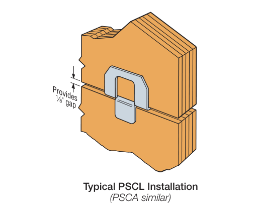
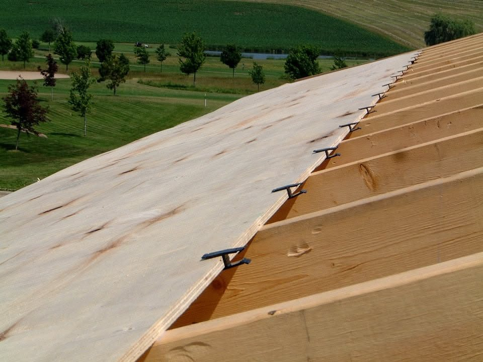

# H-clips

<figure markdown>
  { width="460" }
  <figcaption markdown="span">One clip per shared joint of two sheets between supports. Excerpt from the PSCL installation diagram: Simpson Strong-Tie, catalog C-C-2026, p. 340. We count joints, not edges.</figcaption>
</figure>

<figure markdown>
  
  <figcaption markdown="span">A row of H-clips on the free edge of the first roof sheathing sheet: one clip in each bay between rafters, the next sheet snaps into them. We count clips by sheet joints, not by edges. Photo: ggrhomeinspections.com, [source](https://ggrhomeinspections.com/h-clips/page/2), found via Pinterest.</figcaption>
</figure>

## What it is

An H-clip (panel sheathing clip, `PSCL`) is a metal clip between the edges
of two adjacent roof sheathing sheets. It keeps the free edges between
rafters/trusses in one plane and sets the `1/8"` gap. It is needed only on
square edge panels; on T&G the tongue and groove hold the edge by themselves. Clip size =
panel thickness (`PSCL 19/32`, `PSCL 5/8`).

| Edge | What it is | Decision |
| --- | --- | --- |
| **Square edge** | Straight edge, the sheets do not interlock | Clips per detail and support spacing |
| **T&G** (tongue and groove) | The tongue fits into the neighbor's groove | **No clips**, keep `T&G` in the material |

## Where to find it on the plans

| Sheet | What to take |
| --- | --- |
| Roof sheathing notes (S) | Thickness, span rating, edge type, `PSCL @16"` or `edge support` |
| Truss layout / framing plan | Support spacing in this particular zone: `24" o.c.`, `16" o.c.`; each building has its own |
| Roof details | Solid blocking at joints (blocked diaphragm): a clip does not replace it |

## How to count

1. Read the material, thickness, edge and support spacing of the zone. If both T&G and
   clips are specified, show the conflict in a Note; do not change the material.
2. Count the shared joint of two sheets between adjacent supports: an `8'` sheet at
   `24" o.c.` gives 4 bays, at `16" o.c.` 6 bays. Do not double it for the
   upper and lower sheet.
3. Clips per sheet at `1 clip/span`: `24" o.c.` = 4, `16" o.c.` = 6. For
   `PSCA` the manufacturer gives one clip up to a `28"` span, two beyond that: do not
   carry `1 clip/span` over to every roof.
4. Clips = sheets x clips per sheet, waste added once after the calculation. For small
   slopes and offcuts the quantity is preliminary.
5. Deck thicker than the spec threshold: no clips needed (check the panel table).

Sources: [Simpson C-C-2026, p. 340](https://ssttoolbox.widen.net/view/pdf/orplhjaqw1/C-C-2026.pdf?t.download=true#page=340),
[APA N335, sec. 3.6-3.7](https://stage.apawood.org/buildertips/pages/N335.html).

## DFL row

| Source | DFL row | Material | Unit | Formula |
| --- | --- | --- | --- | --- |
| `Roof Sheathing` sheets | `Clips` | `PSCL 19/32` (by thickness) | `pcs` | `=sheets * clips per sheet` |
| T&G | no row | `3/4" T&G` in the deck material | | |

Note in the roof block: `PSCL clips counted at 16" max per S203; 6 per 4x8
sheet allowed.`

## Common mistakes

- Clips with a T&G deck.
- Clips with a deck thicker than the threshold (`23/32"`): 11,000 extra pieces.
- "4 per sheet" at `16"` spacing (should be 6): 2540 instead of 3810.
- `24" OWJ` read as the support spacing, when it is the truss depth.
- Spacing of one building carried over to another (storage `24"`, main `16"`).
- Clip size not matched to the deck thickness.

All roof mistakes: [common-mistakes](../../../start/common-mistakes.md#roof).

## Example

```text
Roof Sheathing   19/32" Ply or OSB   206  4x8   S203
Clips            PSCL 19/32         1240  pcs   206 x 6 (16" o.c.)
```

## See also

- [Roof Sheathing](roof-sheathing.md), [Roof SQFT](../../sqfts/roof.md)
- [Tips and key rules, Sheathing](../../../reference/boss-feedback-rules.md#sheathing)
