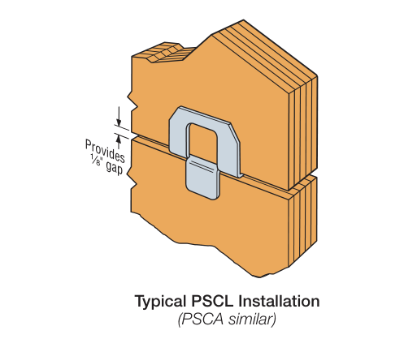
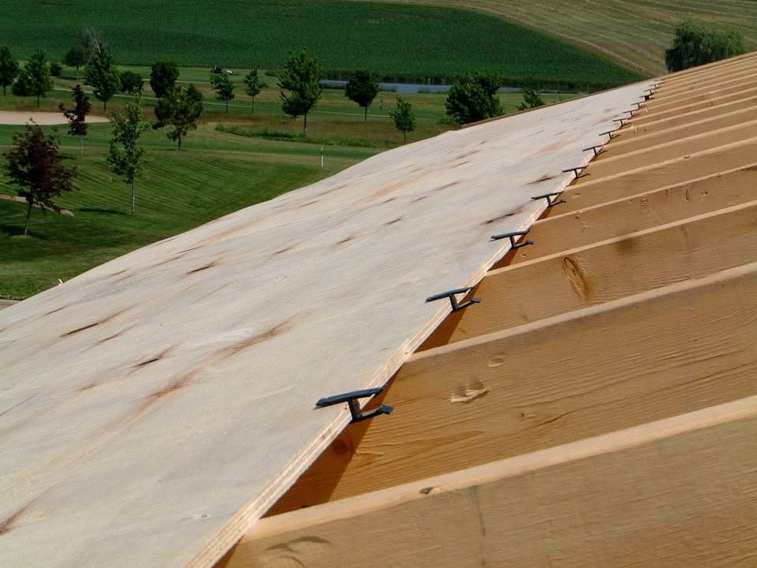

# H-clips (клипсы между листами кровли)

<figure markdown>
  { width="460" }
  <figcaption markdown="span">Одна клипса на общий стык двух листов между опорами. Фрагмент схемы установки PSCL: Simpson Strong-Tie, каталог C-C-2026, p. 340. Считаем стыки, не кромки.</figcaption>
</figure>

<figure markdown>
  
  <figcaption markdown="span">Ряд H-clips на свободной кромке первого листа roof sheathing: по одной клипсе в каждом пролёте между rafters, следующий лист защёлкнется в них. Считаем клипсы по стыкам листов, не по кромкам. Фото: ggrhomeinspections.com, [источник](https://ggrhomeinspections.com/h-clips/page/2), найдено через Pinterest.</figcaption>
</figure>

## Что это

H-clip (panel sheathing clip, `PSCL`) - металлическая клипса между кромками
двух соседних листов roof sheathing. Держит свободные кромки между
rafters/trusses в одной плоскости и задаёт зазор `1/8"`. Нужна только у
square edge панелей; у T&G шип и паз держат кромку сами. Размер клипсы = 
толщина панели (`PSCL 19/32`, `PSCL 5/8`).

| Кромка | Что это | Решение |
| --- | --- | --- |
| **Square edge** | Прямая кромка, листы не сцепляются | Clips по детали и шагу опор |
| **T&G** (tongue and groove) | Шип входит в паз соседа | **Clips не добавляем**, в материале оставляем `T&G` |

## Где искать на чертежах

| Лист | Что взять |
| --- | --- |
| Roof sheathing notes (S) | Толщина, span rating, тип кромки, `PSCL @16"` или `edge support` |
| Truss layout / framing plan | Шаг опор именно в этой зоне: `24" o.c.`, `16" o.c.`; у каждого корпуса свой |
| Roof details | Solid blocking на стыках (blocked diaphragm): клипса его не заменяет |

## Как считать

1. Прочитай материал, толщину, кромку и шаг опор зоны. Если указаны и T&G, и
   clips, покажи противоречие в Note; материал не меняй.
2. Считаем общий стык двух листов между соседними опорами: лист `8'` при
   `24" o.c.` даёт 4 пролёта, при `16" o.c.` 6 пролётов. Не удваивай за
   верхний и нижний лист.
3. Clips на лист при `1 clip/span`: `24" o.c.` = 4, `16" o.c.` = 6. Для
   `PSCA` производитель даёт одну клипсу до пролёта `28"`, дальше две: не
   переноси `1 clip/span` на любую крышу.
4. Clips = листы x clips на лист, запас один раз после расчёта. Для малых
   скатов и обрезков количество предварительное.
5. Настил толще порога спецификации: clips не нужны (проверь таблицу панели).

Источники: [Simpson C-C-2026, p. 340](https://ssttoolbox.widen.net/view/pdf/orplhjaqw1/C-C-2026.pdf?t.download=true#page=340),
[APA N335, п. 3.6-3.7](https://stage.apawood.org/buildertips/pages/N335.html).

## Строка DFL

| Источник | Строка DFL | Материал | Unit | Формула |
| --- | --- | --- | --- | --- |
| листы `Roof Sheathing` | `Clips` | `PSCL 19/32` (по толщине) | `pcs` | `=листы * clips на лист` |
| T&G | строки нет | `3/4" T&G` в материале настила | | |

Note в блоке кровли: `PSCL clips counted at 16" max per S203; 6 per 4x8
sheet allowed.`

## Частые ошибки

- Clips при T&G настиле.
- Clips при настиле толще порога (`23/32"`): 11 000 лишних штук.
- "4 на лист" при шаге `16"` (нужно 6): 2540 вместо 3810.
- `24" OWJ` прочитано как шаг опор, а это глубина фермы.
- Шаг одного корпуса перенесён на другой (storage `24"`, main `16"`).
- Размер клипсы не по толщине настила.

Все ошибки по кровле: [common-mistakes](../../../start/common-mistakes.md#roof).

## Пример

```text
Roof Sheathing   19/32" Ply or OSB   206  4x8   S203
Clips            PSCL 19/32         1240  pcs   206 x 6 (16" o.c.)
```

## См. также

- [Roof Sheathing](roof-sheathing.md), [Roof SQFT](../../sqfts/roof.md)
- [Советы и важные вещи, Sheathing](../../../reference/boss-feedback-rules.md#sheathing)
