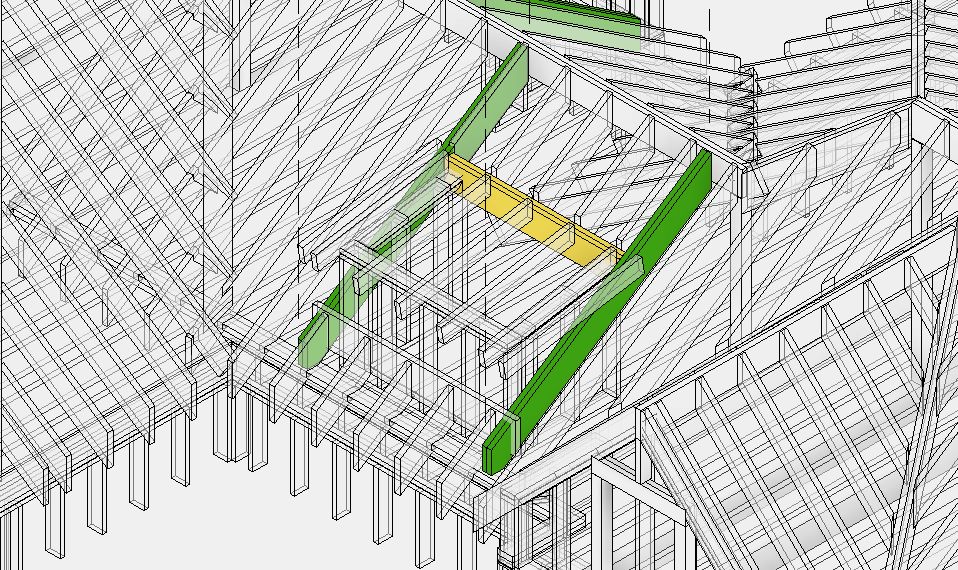
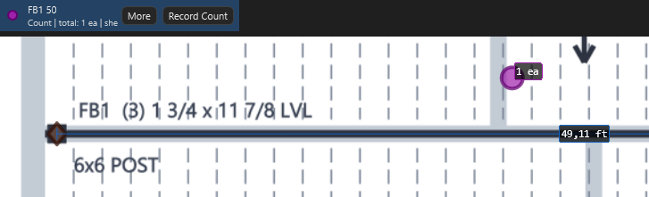
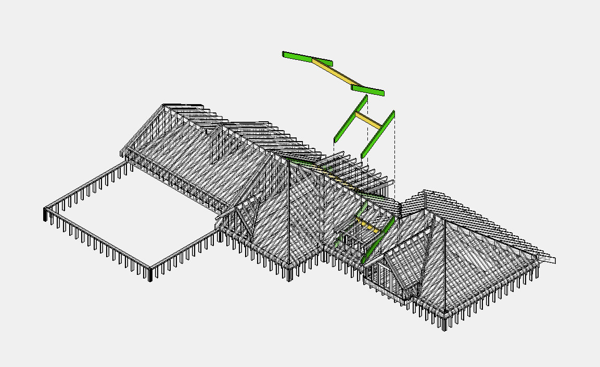
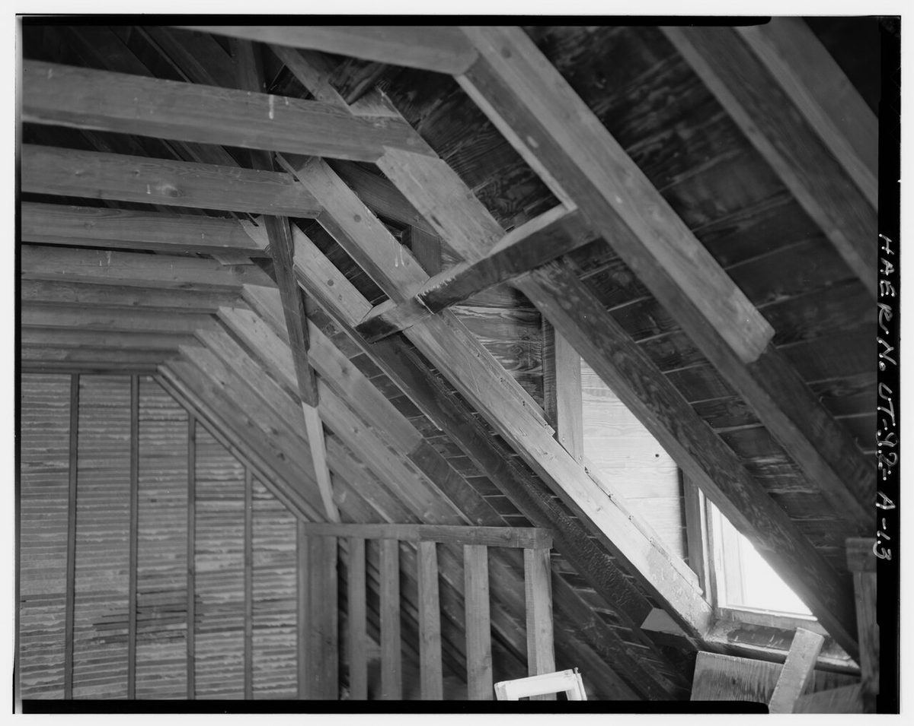

# Roof Header

<figure markdown>
  
  <figcaption markdown="span">Archive 3D view: the roof opening header is highlighted in yellow, the reinforced rafters at the sides it bears on in green. The header length runs between those rafters.</figcaption>
</figure>

## What it is

A roof header is a horizontal beam in a sloped roof that frames an opening (skylight, chimney, dormer, hatch) or carries rafters within the slope. It bears on [Dbl / Trpl Rafters](dbl-trpl-rafters.md) or [Posts](../floor-framing/post.md). It is not a header over a window: window and door headers are on [Headers](../../vertical/openings/headers.md).

## Where to find it on the plans

| Sheet | What to take |
| --- | --- |
| Roof framing plan (S) | roof openings, the header and the reinforced rafters next to it, mark |
| Roof plan (A), RCP | skylights, dormers, hatches and shafts through the roof |
| Details, sections | size, plies, hangers from header to rafters and from rafters to header |
| Beam schedule | size by mark |

## How to measure in OurPlanCore

Beam tool (B) between the reinforced rafters on the roof framing sheet with the F dot. One header = one point with `(n)` plies in the name; the app rounds the length (up to 8' to the foot, longer to an even number). In the DFL column C counts every board: points x plies.

1. Headers on both sides of the same opening (top and bottom of a skylight) are two points.
2. The reinforced rafters at the sides are their own takeoff, see [Dbl / Trpl Rafters](dbl-trpl-rafters.md).
3. Hangers: header to rafters and cut rafters to header, by built-up width and skew/slope condition. Roof hangers are written with no `Z` and no `Zmax` (`LSSR210`); the exception is the `LRU...Z` models.

<figure markdown>
  
  <figcaption markdown="span">Beam tool: two points along the member, the app rounds the length and puts it into the takeoff name.</figcaption>
</figure>

## Takeoff name and DFL row

Path: `framing/roof framing/beams/<header size length>`. Do not put them in `headers`: the HD button on the XL strip would move them into the wall block of the floor below.

In the DFL a roof header is a `Beam (n)` row in the Roof Frame list, by the same rule as the roof beams; the template row `Headers (n)` is not used. E holds the mark or the place (`skylight`).

| Takeoff name | A (Label) | B | C | D | E |
| --- | --- | --- | --- | --- | --- |
| `beams/rf header (2) 2x12 10` | `Beam (2)` | `2x12` | points x 2 | `10` | `S201 skylight` |
| `beams/rf header (3) 1 3/4 x 11 7/8 LVL 12` | `Beam (3)` | `1 3/4 x 11 7/8 LVL` | points x 3 | `12` | detail |
| `details/HU hdr` | `Hangers` | `LUS210-2`, `HU5.50/10` | per connection | `pcs` | detail |

## Common mistakes

- Roof header counted a second time as a window header, or the other way around.
- Header written, but the reinforced rafters at the sides and their hangers are missing.
- Header size taken from another part of the roof; sizes change by zone.
- Header in a panelized roof or in trusses by others counted as loose.
- Hanger chosen without skew and slope on the pitch: `ITS` does not exist on a slope.
- [All roof mistakes](../../../start/common-mistakes.md#roof)

## Example

| A | B | C | D | E |
| --- | --- | --- | --- | --- |
| `Beam (2)` | `2x12` | 4 | 10 | `skylight per S201` |
| `Dbl Rafters` | `2x12` | 4 | 18 | `S201` |
| `Hangers` | `LUS210-2` | 4 | pcs | `9/S501` |
| `Hangers` | `LSSR210` | 6 | pcs | `rafters to header` |

One skylight: 2 headers (top and bottom of the opening) x 2 plies = 4 boards; reinforced rafters on both sides of the opening, 2 places x 2 = 4. `LUS210-2`: 2 headers x 2 ends = 4. `LSSR210`: 6 cut rafters, one hanger per end at a header.

<figure markdown>
  
  <figcaption markdown="span">The same connection up close: the header sits between two reinforced rafters, the cut rafters frame into the header on hangers.</figcaption>
</figure>

<figure markdown>
  
  <figcaption markdown="span">Dormer opening seen from the attic: doubled rafters at the edges and a header between them that the cut rafters frame into. Photo: Joe C. Freeman, HAER, Library of Congress, Public domain, <a href="https://commons.wikimedia.org/wiki/File:INTERIOR_VIEW_OF_ROOF_FRAMING_AND_DORMER_OPENING_IN_ATTIC,_LOOKING_EAST._-_Dugway_Proving_Ground,_German-Japanese_Village,_German_Village,_South_of_Stark_Road,_in_WWII_HAER_UTAH,23-DUG,2A-13.tif">source</a>.</figcaption>
</figure>

## See also

- [Dbl / Trpl Rafters](dbl-trpl-rafters.md), [Ridge](ridge.md), [Dormer](dormer.md)
- [Headers over openings](../../vertical/openings/headers.md), [Hangers](../../../reference/hangers.md)
