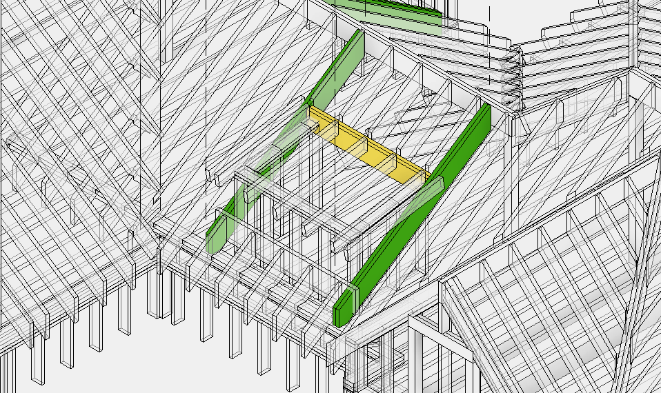
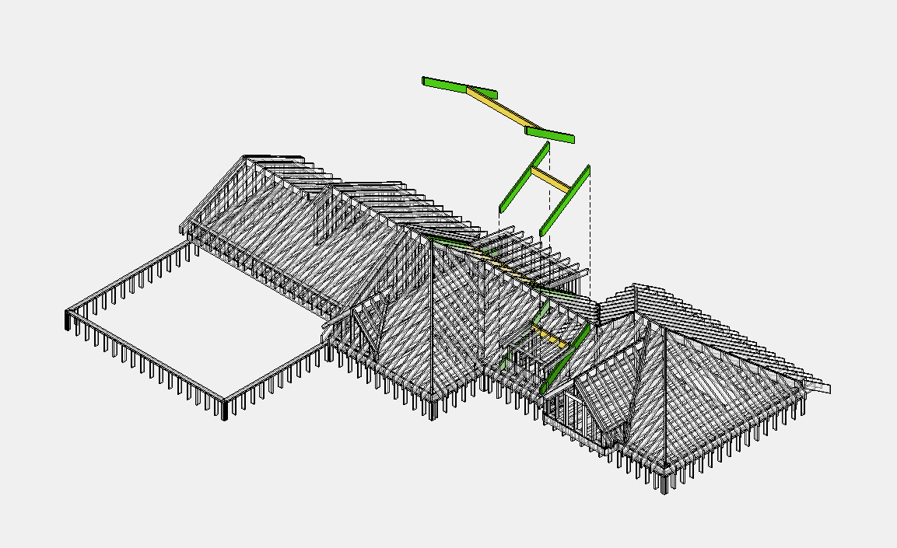
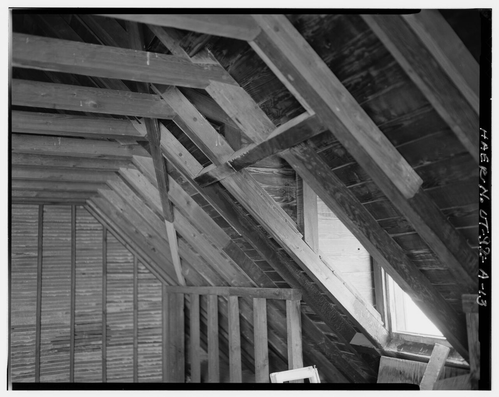

# Roof Header (балка проёма в крыше)

<figure markdown>
  
  <figcaption markdown="span">Архивный 3D-вид: жёлтым выделен header проёма крыши, зелёным усиленные rafters по бокам, на которые он опирается. Длина header - между этими rafters.</figcaption>
</figure>

## Что это

Roof header - горизонтальная балка в скатной крыше, которая обрамляет проём (skylight, chimney, dormer, люк) или держит rafters внутри ската. Опирается на [Dbl / Trpl Rafters](dbl-trpl-rafters.md) или [Posts](../floor-framing/post.md). Это не перемычка над окном: оконные и дверные хедеры - [Headers](../../vertical/openings/headers.md).

## Где искать на чертежах

| Лист | Что взять |
| --- | --- |
| Roof framing plan (S) | проёмы в крыше, header и усиленные rafters рядом, марка |
| Roof plan (A), RCP | skylights, dormers, люки и шахты через крышу |
| Details, sections | сечение, plies, hangers header к rafters и rafters к header |
| Beam schedule | сечение по марке |

## Как мерить в OurPlanCore

Инструмент Beam (B) между усиленными rafters на листе roof framing с точкой F. Один header = одна точка с `(n)` plies в имени; программа округляет длину (до 8' до фута, длиннее до чётного).

1. Header на одном и том же проёме с двух сторон (верх и низ skylight) - две точки.
2. Усиленные rafters по бокам - своя позиция на странице [Dbl / Trpl Rafters](dbl-trpl-rafters.md).
3. Hangers: header к rafters и обрезанные rafters к header, по ширине built-up и условию skew/slope.

<figure markdown>
  
  <figcaption markdown="span">Инструмент Beam: две точки по элементу, длина округляется программой и попадает в имя позиции.</figcaption>
</figure>

## Как назвать в дереве и строка DFL

Путь: `framing/roof framing/beams/<header сечение длина>`. В `headers` не кладём: кнопка HD полосы XL уносит их в блок стен этажа ниже.

| Имя в дереве | A (Label) | B | C | D | E |
| --- | --- | --- | --- | --- | --- |
| `beams/rf header (2) 2x12 10` | `Header (2)` | `2x12` | точки | `10` | `S201 skylight` |
| `beams/rf header (3) 1 3/4 x 11 7/8 LVL 12` | `Header (3)` | `1 3/4 x 11 7/8 LVL` | точки | `12` | деталь |
| `details/HU hdr` | `Hangers` | `LUS210-2`, `HU5.50/10` | по узлам | `pcs` | деталь |

## Частые ошибки

- Roof header посчитан второй раз как оконный header, или наоборот.
- Header записан, а усиленные rafters по бокам и их hangers нет.
- Размер header взят с другого участка крыши; сечения меняются по зонам.
- Header в панельной крыше или в trusses by others посчитан как loose.
- Hanger без учёта skew и slope на скате: `ITS` на наклоне не бывает.
- [Все ошибки по крыше](../../../start/common-mistakes.md#roof)

## Пример

| A | B | C | D | E |
| --- | --- | --- | --- | --- |
| `Header (2)` | `2x12` | 2 | 10 | `skylight per S201` |
| `Dbl Rafters` | `2x12` | 2 | 18 | `S201` |
| `Hangers` | `LUS210-2` | 2 | pcs | `9/S501` |
| `Hangers` | `LSSR210Z` | 6 | pcs | `rafters to header` |

<figure markdown>
  
  <figcaption markdown="span">Тот же узел ближе: header лежит между двумя усиленными rafters, обрезанные rafters упираются в header через hangers.</figcaption>
</figure>

<figure markdown>
  
  <figcaption markdown="span">Проём под dormer изнутри чердака: сдвоенные rafters по краям и header между ними, в который упираются обрезанные rafters. Фото: Joe C. Freeman, HAER, Library of Congress, Public domain, <a href="https://commons.wikimedia.org/wiki/File:INTERIOR_VIEW_OF_ROOF_FRAMING_AND_DORMER_OPENING_IN_ATTIC,_LOOKING_EAST._-_Dugway_Proving_Ground,_German-Japanese_Village,_German_Village,_South_of_Stark_Road,_in_WWII_HAER_UTAH,23-DUG,2A-13.tif">источник</a>.</figcaption>
</figure>

## См. также

- [Dbl / Trpl Rafters](dbl-trpl-rafters.md), [Ridge](ridge.md), [Dormer](dormer.md)
- [Headers над проёмами](../../vertical/openings/headers.md), [Hangers](../../../reference/hangers.md)
