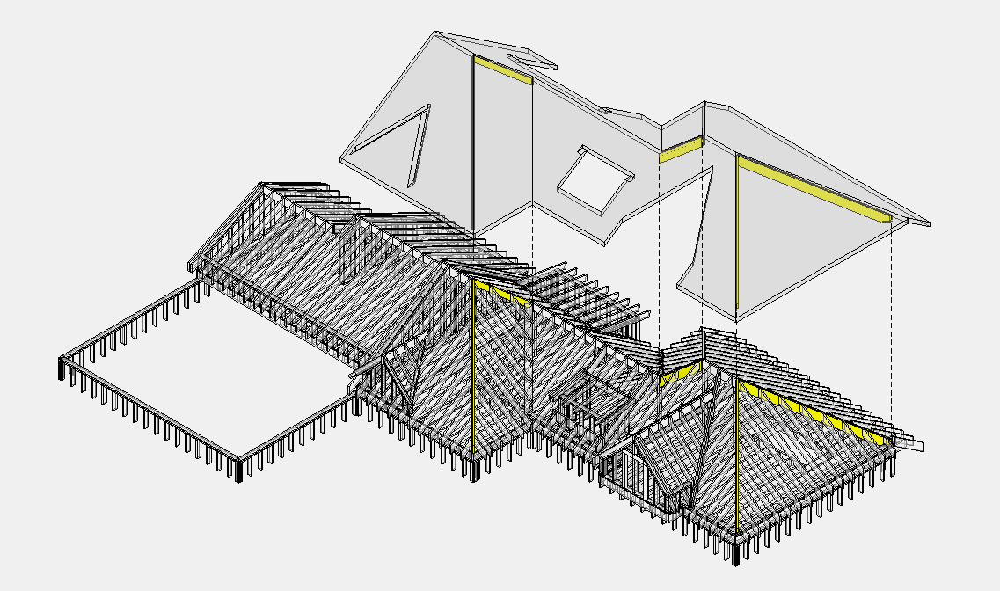
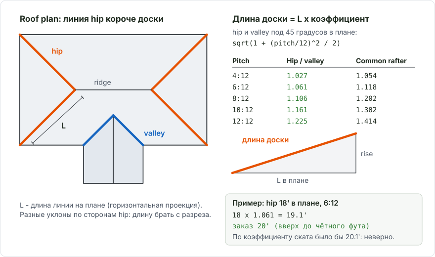

# Hip

<figure markdown>
  
  <figcaption markdown="span">Archive 3D view: hip rafters highlighted in yellow, the outside edges where two slopes meet at a convex corner. At the top, the same roof in plan: the hip line on the plan is shorter than the real board.</figcaption>
</figure>

<!-- TODO-PHOTO: hip rafter with jack rafters during roof framing, EN query "hip rafter jack rafters roof framing" -->

## What it is

A hip is the sloped outside edge where two slopes meet at a convex corner. The hip rafter runs from the wall corner to the ridge, it is longer and often deeper than a common rafter (`2x12` with `2x10` rafters), and the jack rafters frame into it. The inside edge is a [Valley](valley.md); the top is the [Ridge](ridge.md). On a truss roof the hip is built from hip trusses by others, and we count only the details around it.

## Where to find it on the plans

| Sheet | What to take |
| --- | --- |
| Roof plan (A) | where the hips are, pitch of the slopes on both sides |
| Roof framing plan (S) | hip rafter size, stick or trusses, mark |
| Sections, elevations | roof rise, sloped length |
| Details | hip bearing at the wall corner and at the ridge, hangers and ties |

## How to measure in OurPlanCore

Beam tool (B) along the hip line on the roof framing sheet with the F dot. The line on the plan is a horizontal projection; the real length is longer. Two ways:

1. Take the sloped length from a section or elevation where the hip shows in true length.
2. Multiply the plan length by the hip factor. For a hip at 45 degrees in plan (equal pitches on both sides): `sqrt(1 + (pitch/12)^2 / 2)`.

| Pitch | Common rafter factor | Hip and valley factor (45 degrees in plan) |
| --- | --- | --- |
| 4:12 | 1.054 | 1.027 |
| 6:12 | 1.118 | 1.061 |
| 8:12 | 1.202 | 1.106 |
| 10:12 | 1.302 | 1.161 |
| 12:12 | 1.414 | 1.225 |

Different pitches on the two sides of a hip: only from the section. The app rounds the result to an order length (up to 8' to the foot, longer to an even number).

<figure markdown>
  
  <figcaption markdown="span">Beam tool: two points along the member, the app rounds the length and puts it into the takeoff name.</figcaption>
</figure>

<figure markdown>
  
  <figcaption markdown="span">The plan length is multiplied by the slope factor: that gives the board length. With different slope pitches take the length from the section.</figcaption>
</figure>

## Takeoff name and DFL row

Path: `framing/roof framing/beams/hip <size> <length>`. In the DFL the hip is the `Hip plates` row: C is the number of boards, D is the even order length. A doubled hip is `Hip plates (2)`, C = points x 2.

| Takeoff name | A (Label) | B | C | D | E |
| --- | --- | --- | --- | --- | --- |
| `beams/hip 2x12 18` | `Hip plates` | `2x12` | points | `18` | `S201` |
| `beams/hip (2) 1 3/4 x 11 7/8 LVL 22` | `Hip plates (2)` | `1 3/4 x 11 7/8 LVL` | points x 2 | `22` | `HB1` |

## Common mistakes

- Hip counted on a truss roof: there the hip trusses are by others.
- Length taken from the plan without a factor, or with the common rafter factor (1.118 instead of 1.061).
- Jack rafters at the hip not counted separately, or counted as full common rafters.
- Hip and valley mixed up: outside corner and inside corner.
- Engineered hip beam written without the product and plies.
- [All roof mistakes](../../../start/common-mistakes.md#roof)

## Example

| A | B | C | D | E |
| --- | --- | --- | --- | --- |
| `Hip plates` | `2x12` | 4 | 18 | `S201, pitch 6:12` |
| `Rafters 16" o.c.` | `2x10` | 28 | 16 | `jack rafters at hips` |

## See also

- [Valley](valley.md), [Ridge](ridge.md), [Dbl / Trpl Rafters](dbl-trpl-rafters.md)
- [Ridge / Valley / Hip (overview)](../../sheathing-and-misc/ridgevalleyhip.md), [Roof SQFT](../../sqfts/roof.md), [Hangers](../../../reference/hangers.md)
