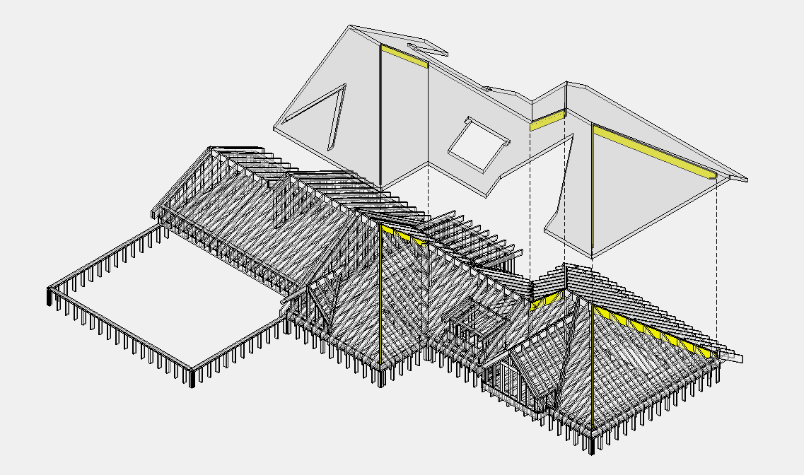

# Hip

**Hip** - наклонное **наружное** ребро, где два ската сходятся выпуклым углом.
Hip rafter длиннее и крупнее common rafter. Не путать с valley (внутренний угол).

## Что считать

- Hip rafters/beams и related connectors, когда scope включает roof framing.

## Проверить

- Confirm whether hips are stick-framed or truss by others.
- Engineered hip beams need exact product and length.
- Hip material держи отдельно от roof trim, если output pricing differs.

## See also

- [Valley](valley.md) , [Ridge](ridge.md) , [Ridge / Valley / Hip](../../sheathing-and-misc/ridgevalleyhip.md) , [Hangers](../../../reference/hangers.md)

<!-- confluence-gallery:start -->
## Визуальная проверка

Архивные иллюстрации помогают прочитать правило. Для своего takeoff сверь его с чертежами и scope текущего проекта.

??? info "Источник картинок"
    - Hip (балка примыкания крыши наружу): 1 карт. Confluence (архивный источник; ссылка не публикуется)

  
Скрыть 1 правил с иллюстрациями

  <figure class="kb-figure-row">
    <figcaption class="kb-figure-row__text">
      
Hip - визуальная проверка

      
Проверь outside roof intersection, length и beam/rafter material.

      
Hip не смешивай с Valley: это наружный угол roof planes.

    </figcaption>
    
  </figure>

<!-- confluence-gallery:end -->
