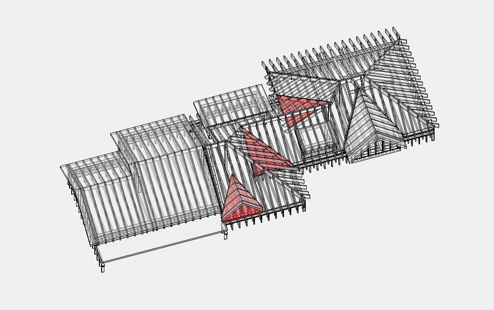
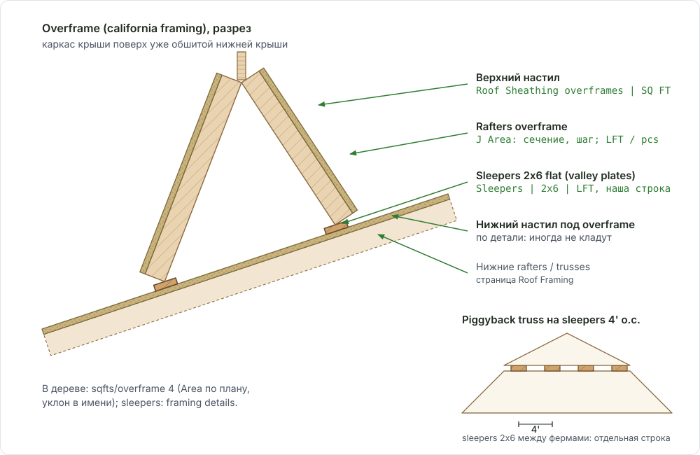
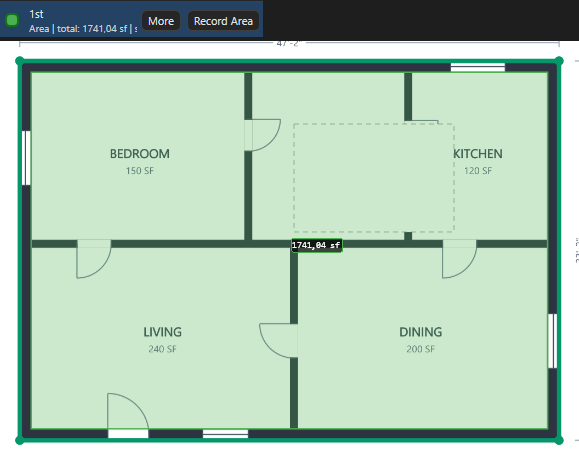
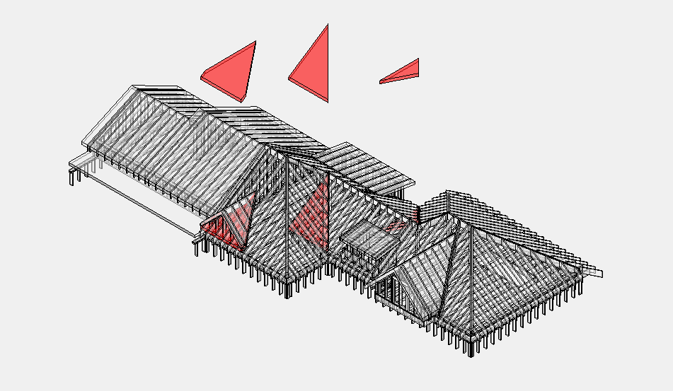

# Overframes

<figure markdown>
  
  <figcaption markdown="span">Archive 3D view: overframes highlighted in red, roof areas built on top of the lower roof. Under them runs the main roof deck, on top are their own rafters on sleepers.</figcaption>
</figure>

<figure markdown>
  
  <figcaption markdown="span">Section: the lower roof with its deck, 2x6 sleepers (valley plates) laid flat on it, the overframe rafters and their deck on top. Sleepers, rafters and the upper deck are our rows; the lower deck under the overframe per detail.</figcaption>
</figure>

## What it is

An overframe (California framing, framed-over roof) is roof framing built on top of an already sheathed lower roof: the rafters bear on 2x6 sleepers (valley plates) laid flat on the lower deck. Piggyback trusses are built the same way: the upper part of a tall truss sits on sleepers over the lower one. A lot of material hides in the details, not on the plan.

## Where to find it on the plans

| Sheet | What to take |
| --- | --- |
| Roof plan (A) | overframe outline, pitch, where it lands on the lower roof |
| Roof framing plan (S) | stick overframe or piggyback trusses, rafter size, spacing |
| Details, sections | sleepers (`2x6 flat`, `2x6 bearing plates 4' o.c.`), overframe ridge, deck under the overframe |
| Truss notes | piggyback: 2x6 sleepers and their spacing, cover board |

## How to measure in OurPlanCore

| Part | Tool | Branch and name |
| --- | --- | --- |
| Overframe area | Area (A) | `sqfts/overframe <pitch>` (`overframe 4`), its own pitch |
| Overframe rafters | J Area (J) | `framing/roof framing/joists/overframe 2x8 24"` |
| Sleepers | Line (L) along the lines where the rafters bear on the lower roof | `framing/roof framing/details/sleepers` |
| Overframe ridge | Beam (B) | `framing/roof framing/beams/ridge ...` |

The `overframe 4` area is counted separately from `rf 6` and goes into roof sheathing with its own slope factor (once). An overframe is never added automatically: its area and materials come only from this building's plans.

<figure markdown>
  
  <figcaption markdown="span">Area along the zone outline: the area goes into sqfts and from there into the sheet count.</figcaption>
</figure>

## Takeoff name and DFL row

| Takeoff name | A (Label) | B | C | D | E |
| --- | --- | --- | --- | --- | --- |
| `sqfts/overframe 4` | `Roof Sheathing (overframes)` | per roof spec | SQ FT x slope / 32 x 1.1 | `4x8` | sheet |
| `details/sleepers` | `Sleepers` | `2x6` | `=CEILING(G/D,1)` | `16` | detail |
| `joists/overframe 2x8 24"` | `Rafters 24" o.c.` | `2x8` | from J Area | lengths | |
| piggyback | `Sleepers` or `Bearing Plates` | `2x6` per detail | per truss detail: spacing (often 4' o.c.) over the area of the upper trusses | `16` | truss detail |

Piggyback is one assembly with two write-ups of the same thing: in [Tips](../../../reference/boss-feedback-rules.md#roof) it is written as `2x6` sleepers, in [COM](../../../work-types/com.md) as `2x6 bearing plates 4' o.c.`. Count it per the current building's truss detail on one row, not two.

## Common mistakes

- Overframe added "out of habit", or not added although the roof plan shows an addition over a slope.
- Overframe pitch taken from the main roof.
- Sleepers forgotten (about 400 2x6 boards at 16' on a big multifamily building).
- Lower roof deck under the overframe subtracted or counted twice without a detail.
- Cover board and layers over the overframe missed.
- [All roof mistakes](../../../start/common-mistakes.md#roof)

## Example

| A | B | C | D | E |
| --- | --- | --- | --- | --- |
| `Roof Sheathing (overframes)` | `19/32" OSB` | 14 | 4x8 | `overframe 4, 410 SF` |
| `Sleepers` | `2x6` | 12 | 16 | `4/S301` |
| `Rafters 24" o.c.` | `2x8` | 22 | 12 | `S201` |

<figure markdown>
  
  <figcaption markdown="span">A second overframe area up close: the addition's rafters lie on the slope of the lower roof, its deck is visible underneath.</figcaption>
</figure>

## See also

- [Valley](valley.md), [Ridge](ridge.md), [Dormer](dormer.md), [Roof SQFT](../../sqfts/roof.md)
- [Roof Sheathing](roof-sheathing.md), [COM](../../../work-types/com.md)
