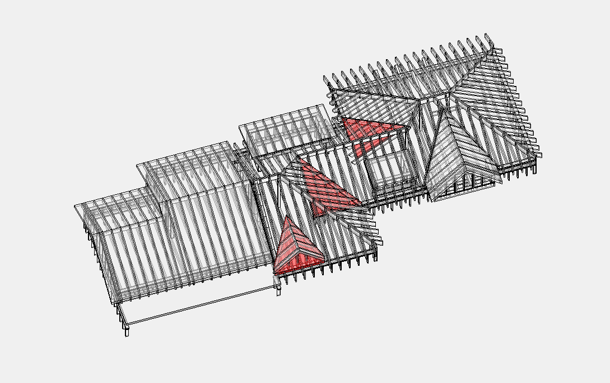
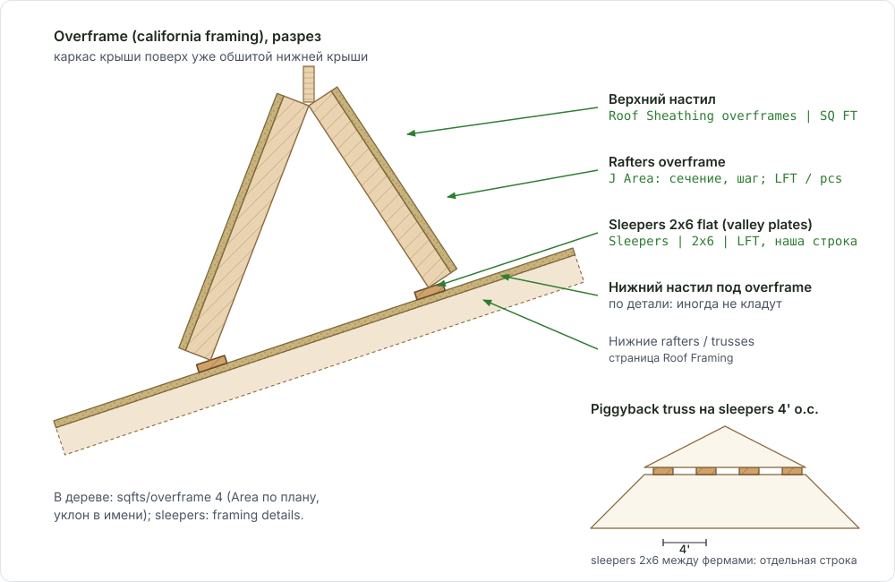
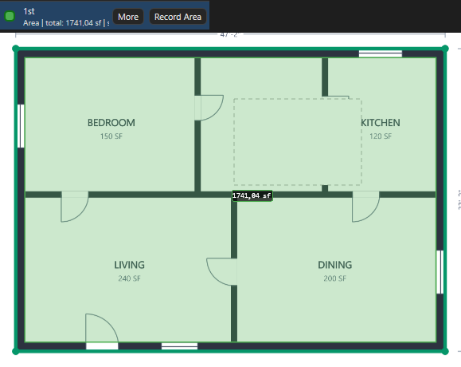
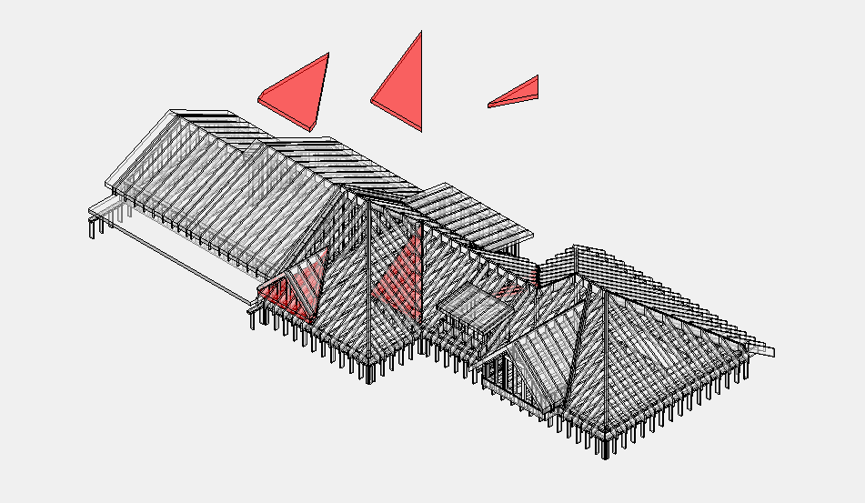

# Overframes (надстроенная крыша)

<figure markdown>
  
  <figcaption markdown="span">Архивный 3D-вид: красным выделены overframe - участки крыши, собранные поверх нижней крыши. Снизу под ними идёт настил основной крыши, сверху - свои rafters на sleepers.</figcaption>
</figure>

<figure markdown>
  
  <figcaption markdown="span">Разрез: нижняя крыша с настилом, на ней плашмя 2x6 sleepers (valley plates), на них rafters overframe и его настил. Sleepers, rafters и верхний настил - наши строки; нижний настил под overframe по детали.</figcaption>
</figure>

## Что это

Overframe (california framing, framed-over roof) - каркас крыши, построенный поверх уже обшитой нижней крыши: rafters опираются на 2x6 sleepers (valley plates), положенные плашмя на нижний настил. Так же собирают piggyback trusses: верхняя часть высокой фермы стоит на sleepers по нижней. Много материала прячется в деталях, а не на плане.

## Где искать на чертежах

| Лист | Что взять |
| --- | --- |
| Roof plan (A) | контур overframe, уклон, где он ложится на нижнюю крышу |
| Roof framing plan (S) | stick overframe или piggyback trusses, сечение rafters, шаг |
| Details, sections | sleepers (`2x6 flat`, `2x6 bearing plates 4' o.c.`), ridge overframe, настил под overframe |
| Truss notes | piggyback: sleepers 2x6 и их шаг, cover board |

## Как мерить в OurPlanCore

| Часть | Инструмент | Ветка и имя |
| --- | --- | --- |
| Площадь overframe | Area (A) | `sqfts/overframe <уклон>` (`overframe 4`), свой уклон |
| Rafters overframe | J Area (J) | `framing/roof framing/joists/overframe 2x8 24"` |
| Sleepers | Line (L) по линиям опирания rafters на нижнюю крышу | `framing/roof framing/details/sleepers` |
| Ridge overframe | Beam (B) | `framing/roof framing/beams/ridge ...` |

Площадь `overframe 4` считается отдельно от `rf 6` и уходит в roof sheathing со своим slope factor (один раз). Overframe не добавляется автоматически: его площадь и материалы только с чертежей этого дома.

<figure markdown>
  
  <figcaption markdown="span">Area по контуру зоны: площадь уходит в sqfts и дальше в расчёт листов.</figcaption>
</figure>

## Как назвать в дереве и строка DFL

| Имя в дереве | A (Label) | B | C | D | E |
| --- | --- | --- | --- | --- | --- |
| `sqfts/overframe 4` | `Roof Sheathing (overframes)` | по спецификации кровли | SQ FT x slope / 32 x 1.1 | `4x8` | лист |
| `details/sleepers` | `Sleepers` | `2x6` | `=ОКРВВЕРХ(G/D;1)` | `16` | деталь |
| `joists/overframe 2x8 24"` | `Rafters 24" o.c.` | `2x8` | по J Area | длины | |
| piggyback | `Sleepers` или `Bearing Plates` | `2x6` по детали | по truss detail: шаг (часто 4' o.c.) по площади верхних ферм | `16` | truss detail |

Piggyback - один узел, две записи одного и того же: в [Советах](../../../reference/boss-feedback-rules.md#roof) он записан как sleepers `2x6`, в [COM](../../../work-types/com.md) как `2x6 bearing plates 4' o.c.`. Считай по truss detail текущего дома одной строкой, не двумя.

## Частые ошибки

- Overframe добавлен "по привычке" или не добавлен, хотя на roof plan есть пристройка поверх ската.
- Уклон overframe взят от основной крыши.
- Sleepers забыты (около 400 досок 2x6 по 16' на большой многоэтажке).
- Настил нижней крыши под overframe вычтен или посчитан дважды без детали.
- Cover board и слои над overframe пропущены.
- [Все ошибки по крыше](../../../start/common-mistakes.md#roof)

## Пример

| A | B | C | D | E |
| --- | --- | --- | --- | --- |
| `Roof Sheathing (overframes)` | `19/32" OSB` | 14 | 4x8 | `overframe 4, 410 SF` |
| `Sleepers` | `2x6` | 12 | 16 | `4/S301` |
| `Rafters 24" o.c.` | `2x8` | 22 | 12 | `S201` |

<figure markdown>
  
  <figcaption markdown="span">Второй участок overframe ближе: rafters пристройки лежат на скате нижней крыши, под ними виден её настил.</figcaption>
</figure>

## См. также

- [Valley](valley.md), [Ridge](ridge.md), [Dormer](dormer.md), [Roof SQFT](../../sqfts/roof.md)
- [Roof Sheathing](roof-sheathing.md), [COM](../../../work-types/com.md)
