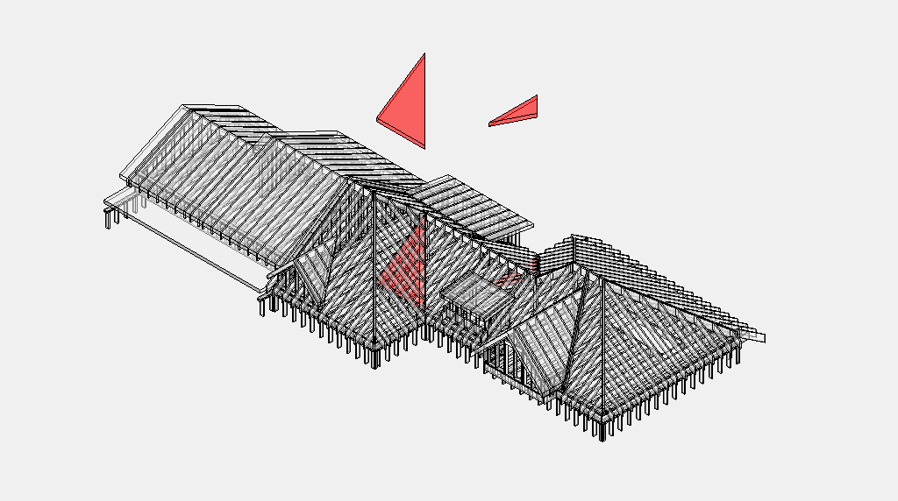

# Overframes

**Overframe** - каркас крыши, надстроенный поверх нижней (piggy-back / framed-over
roof). Много материала прячется в деталях, а не на плане: sleepers, sheathing
overlap.

## Что считать

- Overframing members, sleepers, sheathing, and attachment details.

## Правила

- Piggy trusses - split upper trusses; считай 2x6 sleepers between parts, когда
  shown.
- Overframes can hide a lot of material in details, not plan view.

## Проверить

- Roof too tall / split truss conditions.
- Sleeper spacing and length.
- Cover board and roof layers above overframed areas.

<!-- confluence-gallery:start -->
## Визуальная проверка

Архивные иллюстрации помогают прочитать правило. Для своего takeoff сверь его с чертежами и scope текущего проекта.

??? info "Источник картинок"
    - Overframes (скрытая части крыши): 3 карт. Confluence (архивный источник; ссылка не публикуется)

  
Скрыть 3 правил с иллюстрациями

  <figure class="kb-figure-row">
    <figcaption class="kb-figure-row__text">
      
Overframe - визуальная проверка 01

      
Проверь hidden/framed-over roof areas, sleeper condition и sheathing overlap.

      
Overframes легко пропустить, потому что они часто выглядят как второстепенная roof geometry.

    </figcaption>
    
  </figure>
  <figure class="kb-figure-row">
    <figcaption class="kb-figure-row__text">
      
Overframe - визуальная проверка 02

      
Проверь hidden/framed-over roof areas, sleeper condition и sheathing overlap.

      
Overframes легко пропустить, потому что они часто выглядят как второстепенная roof geometry.

    </figcaption>
    
  </figure>
  <figure class="kb-figure-row">
    <figcaption class="kb-figure-row__text">
      
Overframe - визуальная проверка 03

      
Проверь hidden/framed-over roof areas, sleeper condition и sheathing overlap.

      
Overframes легко пропустить, потому что они часто выглядят как второстепенная roof geometry.

    </figcaption>
    
  </figure>

<!-- confluence-gallery:end -->
