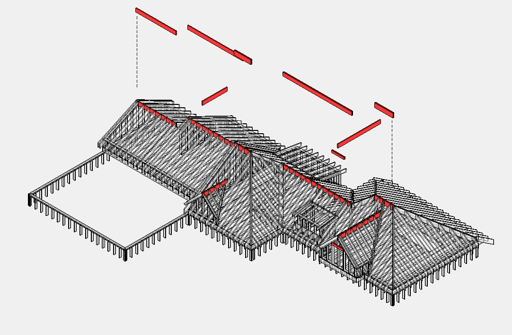

# Ridge

<figure markdown>
  
  <figcaption markdown="span">Archive 3D view: the ridges of all roof parts highlighted in red and lifted out by run. Each run has its own length from the outside face of the exterior wall to the intersection with another ridge or hip.</figcaption>
</figure>

## What it is

The ridge is the top horizontal member of a sloped roof that the rafters frame into: a ridge board (`2x12`, the rafters work in pairs) or a ridge beam (`(2) 1 3/4 x 11 7/8 LVL`, carries the rafters and bears on [Posts](../floor-framing/post.md) or gable walls). It is counted only on a stick-framed roof; with trusses the ridge is inside the truss, by others. The sloped edges are the [Hip](hip.md) and [Valley](valley.md); the beam between reinforced rafters is the [Roof Header](header.md).

## Where to find it on the plans

| Sheet | What to take |
| --- | --- |
| Roof framing plan (S) | ridge line, mark (`RB1`), size, plies, where the supports are |
| Roof plan (A) | ridge runs by roof part, where the ridge ends at a hip |
| Sections, details | ridge board or ridge beam, rafter hangers to the ridge beam, sub fascia |
| Beam schedule | size and material by mark |

## How to measure in OurPlanCore

Beam tool (B) along the ridge line on the roof framing sheet with the F dot. Length runs from the outside face of the exterior wall (not the inside face of the framing) to the end of the run. The app rounds the length: up to 8', up to the next foot; longer, to an even number.

1. One ridge run = one point; a built-up ridge beam is one point with `(2)` in the name. In the DFL column C counts every board: points x plies.
2. A ridge beam needs posts or walls under its ends: the posts are counted in `roof framing/posts`.
3. Rafters hang from the ridge beam on hangers (`LSSR`, `LRU`) per detail; no hangers at a ridge board. Roof hangers are written with no `Z` and no `Zmax` (`LSSR210`); the exception is the `LRU...Z` models, where Z is part of the name.
4. Sub fascia and ridge beam per detail are separate rows, even when the rafters are by others.

<figure markdown>
  
  <figcaption markdown="span">Beam tool: two points along the member, the app rounds the length and puts it into the takeoff name.</figcaption>
</figure>

## Takeoff name and DFL row

Path: `framing/roof framing/beams/<mark or size> <length>`. The ridge goes in `beams`, not in `headers`: the HD button on the XL strip moves `headers` into the wall block.

| Takeoff name | A (Label) | B | C | D | E |
| --- | --- | --- | --- | --- | --- |
| `beams/ridge 2x12 12` | `Ridge` | `2x12` | points | `12` | `S201` |
| `beams/RB1 (2) 1 3/4 x 11 7/8 LVL 20` | `Ridge (2)` | `1 3/4 x 11 7/8 LVL` | points x 2 | `20` | `RB1 per S601` |
| `details/LSSR` | `Hangers` | `LSSR210` | per rafter | `pcs` | detail |

Export: the BM button puts the roof beams into `Roof Frame List` (the worksheet is created as a copy of the nearest floor if it does not exist).

## Common mistakes

- Ridge counted on a truss roof: it is inside the trusses, by others.
- Length taken from the inside face of the wall or along a short line on the plan instead of to the outside face.
- Ridge beam without posts and without the rafter hangers from the detail.
- A roof hanger written with `Z` or `Zmax` (`LSSR210Z`): inside the roof write `LSSR210`.
- C of `Ridge (2)` holds the number of runs without the x 2.
- Several ridges at different heights written as one length.
- Rim and blocking at roof TJI forgotten: a TJI roof is counted like floor framing.
- [All roof mistakes](../../../start/common-mistakes.md#roof)

## Example

```text
framing/
  roof framing/
    beams/
      ridge 2x12 12                     2 points
      RB1 (2) 1 3/4 x 11 7/8 LVL 20     1 point
    posts/
      4x4 8.2                           2 points
```

| A | B | C | D | E |
| --- | --- | --- | --- | --- |
| `Ridge` | `2x12` | 2 | 12 | `S201` |
| `Ridge (2)` | `1 3/4 x 11 7/8 LVL` | 2 | 20 | `RB1` |
| `Posts` | `4x4` | 2 | 10 | `6/S501` |

`Ridge (2)`: 1 point x 2 plies = 2 LVL boards of 20'.

## See also

- [Hip](hip.md), [Valley](valley.md), [Roof Header](header.md), [Dbl / Trpl Rafters](dbl-trpl-rafters.md), [Post](../floor-framing/post.md)
- [Ridge / Valley / Hip (overview)](../../sheathing-and-misc/ridgevalleyhip.md), [Hangers](../../../reference/hangers.md)
