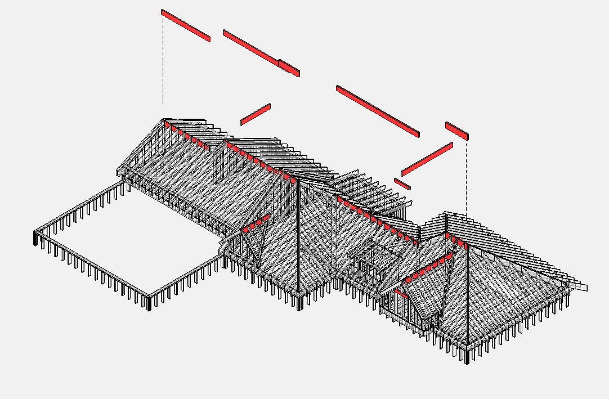

# Ridge (конёк)

<figure markdown>
  
  <figcaption markdown="span">Архивный 3D-вид: красным выделены ridge всех частей крыши, вынесены вверх по участкам. Каждый участок - своя длина от наружной грани наружной стены до пересечения с другим коньком или hip.</figcaption>
</figure>

## Что это

Ridge - верхний горизонтальный элемент скатной крыши, в который упираются rafters: ridge board (`2x12`, rafters работают парами) или ridge beam (`(2) 1 3/4 x 11 7/8 LVL`, несёт rafters и опирается на [Posts](../floor-framing/post.md) или gable-стены). Считается только при stick-framed крыше; у trusses конёк внутри фермы by others. Наклонные рёбра - [Hip](hip.md) и [Valley](valley.md); балка между усиленными rafters - [Roof Header](header.md).

## Где искать на чертежах

| Лист | Что взять |
| --- | --- |
| Roof framing plan (S) | линия ridge, марка (`RB1`), сечение, plies, где опоры |
| Roof plan (A) | участки конька по частям крыши, где конёк кончается у hip |
| Sections, details | ridge board или ridge beam, hangers rafters к ridge beam, sub fascia |
| Beam schedule | сечение и материал по марке |

## Как мерить в OurPlanCore

Инструмент Beam (B) по линии конька на листе roof framing с точкой F. Длина - от наружной грани наружной стены (не от внутренней грани каркаса) до конца участка. Программа округляет длину: до 8' вверх до фута, длиннее - до чётного.

1. Один участок конька = одна точка; built-up ridge beam - одна точка с `(2)` в имени.
2. Ridge beam требует посты или стены под концами: посты считаются в `roof framing/posts`.
3. Rafters к ridge beam висят на hangers (`LSSR`, `LRU`) по детали; к ridge board hangers не нужны.
4. Sub fascia и ridge beam по детали - отдельные строки, даже когда rafters by others.

<figure markdown>
  
  <figcaption markdown="span">Инструмент Beam: две точки по элементу, длина округляется программой и попадает в имя позиции.</figcaption>
</figure>

## Как назвать в дереве и строка DFL

Путь: `framing/roof framing/beams/<марка или сечение> <длина>`. Ridge лежит в `beams`, не в `headers`: кнопка HD полосы XL уносит `headers` в блок стен.

| Имя в дереве | A (Label) | B | C | D | E |
| --- | --- | --- | --- | --- | --- |
| `beams/ridge 2x12 12` | `Ridge` | `2x12` | точки | `12` | `S201` |
| `beams/RB1 (2) 1 3/4 x 11 7/8 LVL 20` | `Ridge (2)` | `1 3/4 x 11 7/8 LVL` | точки | `20` | `RB1 per S601` |
| `details/LSSR` | `Hangers` | `LSSR2.1Z` | по rafters | `pcs` | деталь |

Экспорт: кнопка BM кладёт балки крыши в `Roof Frame List` (лист создаётся копией ближайшего этажа, если его нет).

## Частые ошибки

- Ridge посчитан у truss-крыши: он внутри ферм by others.
- Длина от внутренней грани стены или по короткой линии на плане, а не до наружной грани.
- Ridge beam без постов и hangers rafters по детали.
- Несколько коньков разной высоты записаны одной длиной.
- Rim и blocking у roof TJI забыты: крыша из TJI считается как перекрытие.
- [Все ошибки по крыше](../../../start/common-mistakes.md#roof)

## Пример

```text
framing/
  roof framing/
    beams/
      ridge 2x12 12                     2 точки
      RB1 (2) 1 3/4 x 11 7/8 LVL 20     1 точка
    posts/
      4x4 8.2                           2 точки
```

| A | B | C | D | E |
| --- | --- | --- | --- | --- |
| `Ridge` | `2x12` | 2 | 12 | `S201` |
| `Ridge (2)` | `1 3/4 x 11 7/8 LVL` | 1 | 20 | `RB1` |
| `Posts` | `4x4` | 2 | 10 | `6/S501` |

## См. также

- [Hip](hip.md), [Valley](valley.md), [Roof Header](header.md), [Dbl / Trpl Rafters](dbl-trpl-rafters.md), [Post](../floor-framing/post.md)
- [Ridge / Valley / Hip (обзор)](../../sheathing-and-misc/ridgevalleyhip.md), [Hangers](../../../reference/hangers.md)
