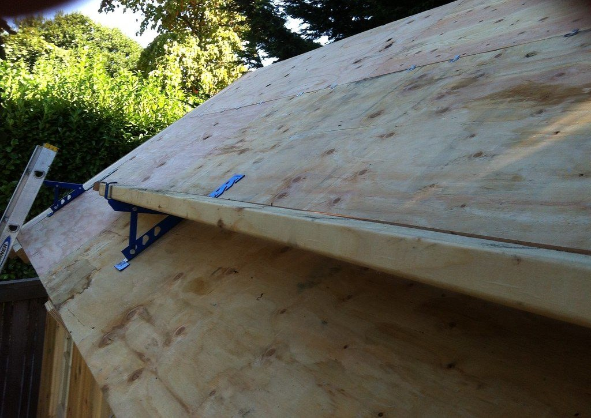
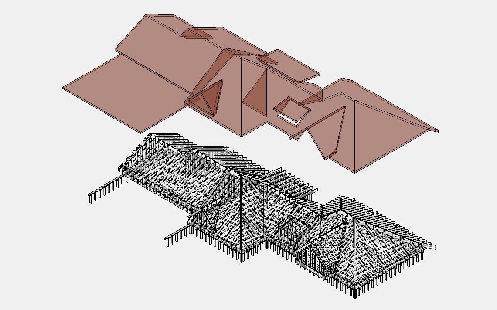

# Roof Sheathing

<figure markdown>
  
  <figcaption markdown="span">Plywood sheets on a slope: area = plan projection x slope factor, sheets = area / 32 x 1.1. Joints between supports are where H-clips go with square edge. Photo: Marshmallow, CC BY 2.0, <a href="https://www.flickr.com/photos/69487319@N00/10585957386">source</a>.</figcaption>
</figure>

## What it is

Roof sheathing is the deck over the trusses or rafters: OSB or plywood on the slopes,
`3/4"` on flat areas, ply under metal, a second layer at canopies. Each
roof type has its own product and its own area ([Roof Types](../../sheathing-and-misc/rooftype.md)).
The soffit underneath is not deck. Together with the deck, the DFL gets the eave framing:
sub fascia, blocking at eves, truss bracing, ties.

## Where to find it on the plans

| Sheet | What to take |
| --- | --- |
| Structural roof framing plan, notes (`s2xx rf`) | Product and thickness (roof table WRS-1 is separate from the wall table WS-1), span rating, fastening |
| Arch roof plan (`a105 rf`) | Slope outlines, pitches `6:12`, overframes, flat zones |
| Roof sections, details (`sec`, `d`) | T&G or square edge, clips, blocking, sub fascia, heel, flat roof layers |
| Truss package / layout | Truss spacing (`24" o.c.`), piggyback and sleepers, bracing |
| Roof assemblies (`ft`) | Flat: cover board (Densdeck, glass mat), rigid, tapered, XPS, EPDM |

## How to measure in OurPlanCore

1. The area comes from the `sqfts` branch: plan projection Area for each
   pitch and material: `rf 6`, `rf mtl 4`, `overframe 4`, `flat`, `ply flat`,
   `flat grge` ([Roof SQFT](../../sqfts/roof.md)). Garage, porch, storage have
   their own outlines and their own pitches.
2. Take the pitch from this building's sheet. The factor `sqrt(1+(rise/12)^2)`
   is applied once, in the Excel formula; the name `rf 6` does not change the geometry.
3. The spec lives in the template cells R3 main, R4 overframes, R5 metal, R6 flat,
   R7 shingles; S holds a bare sheet reference (`S203`, `2/S500`).
4. Arch vs structural conflict: a main Note with both sources and the value
   used, for example `Note: Roof sheathing differ, 19/32" per S612,
   15/32" per A4-03; counted 19/32"; verify`.
5. H-clips are counted separately by edge type, thickness and support spacing:
   [H-clips](h-clips.md). No clips with T&G.

## Takeoff name and DFL row

| Takeoff name | DFL row | Material | Unit | Formula |
| --- | --- | --- | --- | --- |
| `sqfts/rf 6` | `Roof Sheathing` | `19/32" Ply or OSB (40/20)` | `4x8` | `=CEILING(G*1.118/32*1.1,1)` |
| `sqfts/rf mtl 4` | `Roof Sheathing (metal)` | `1/2" Ply` under metal | `4x8` | the same with 1.054 |
| `sqfts/ply flat` | `Roof Sheathing at Flat Roofs` | `3/4" Ply` | `4x8` | no slope |
| `sqfts/flat` | `Rigid Insulation`, `Densdeck` / cover board | per assembly | `SQ FT` | the same area |
| `sqfts/rf 6` | `Clips` | `PSCL 19/32` | `pcs` | per [H-clips](h-clips.md) |

Eave framing in the same section, per this building's details:

| Row | Typical | Unit |
| --- | --- | --- |
| `Sub Fascia` | `2x6` / `2x8` | `LFT` along eave and rake |
| `Blocking at Eves` | `2x6` | `LFT` |
| `Bracing for Trusses` | default `2x6` every 10', otherwise per truss detail; over the full area under the roof, garage included | `LFT` |
| `Simpson Ties at Eves` | `H2.5A` without Zmax (under the sheathing), spacing = truss spacing, along all bearing lines | `pcs` |
| `Frame for Soffits` / `Frame for Rakes` | `2x4 24" o.c.` | `LFT` |

## Common mistakes

- Pitch not taken from the sheet, or applied twice (6:12 instead of 4:12 gave +3 sheets and +12 clips on a garage).
- Clips with T&G or with a deck thicker than the threshold; "4 per sheet" instead of by support spacing.
- `24" OWJ` read as the spacing, when it is the truss depth.
- On a flat roof, Densdeck / cover board and the second XPS layer missed.
- Piggyback sleepers and 1x3 strapping under the trusses missed.
- Ties not along all bearing lines; tie spacing not equal to truss spacing.
- Soffit underneath counted as deck area.

All roof mistakes: [common-mistakes](../../../start/common-mistakes.md#roof).

## Example

```text
Roof Frame list
Note: Roof uses 19/32" exterior-rated plywood per S203; PSCL size matches.
Roof Sheathing      19/32" Ply or OSB (40/20)   206   4x8    2/S500
Clips               PSCL 19/32                  1240  pcs
Sub Fascia          2x8                          310  LFT
Blocking at Eves    2x6                          236  LFT
Simpson Ties at Eves H2.5A                       236  pcs    S203
```

<figure markdown>
  
  <figcaption markdown="span">Deck area = the roof planes (on top); the truss framing under them is by others. Each slope and pitch is its own Area. Archive render.</figcaption>
</figure>

## See also

- [H-clips](h-clips.md), [Roof SQFT](../../sqfts/roof.md), [Roof Types](../../sheathing-and-misc/rooftype.md)
- [Eve / Eave](../../sheathing-and-misc/eve.md), [Truss Heel](../../vertical/sheathing/truss-heel.md), [Overframes](overframes.md)
- [Tips and key rules, Sheathing](../../../reference/boss-feedback-rules.md#sheathing)
