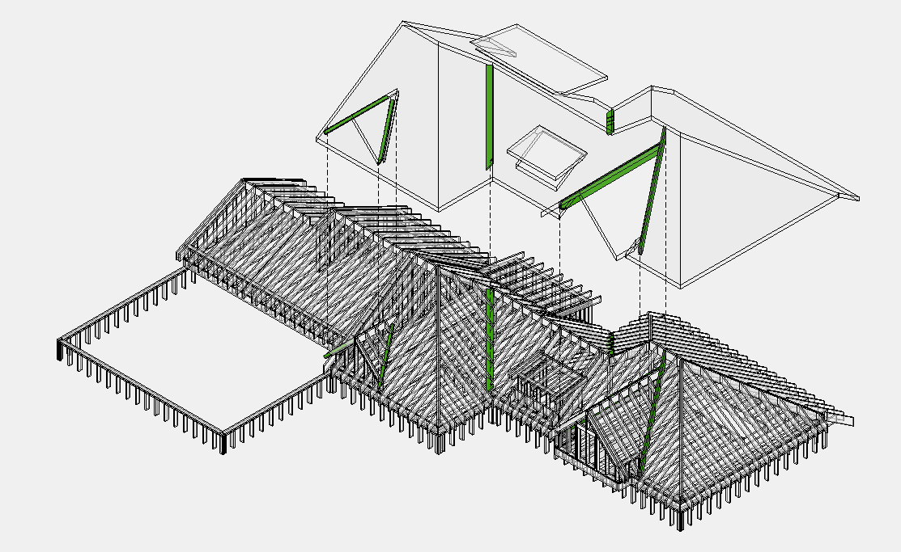
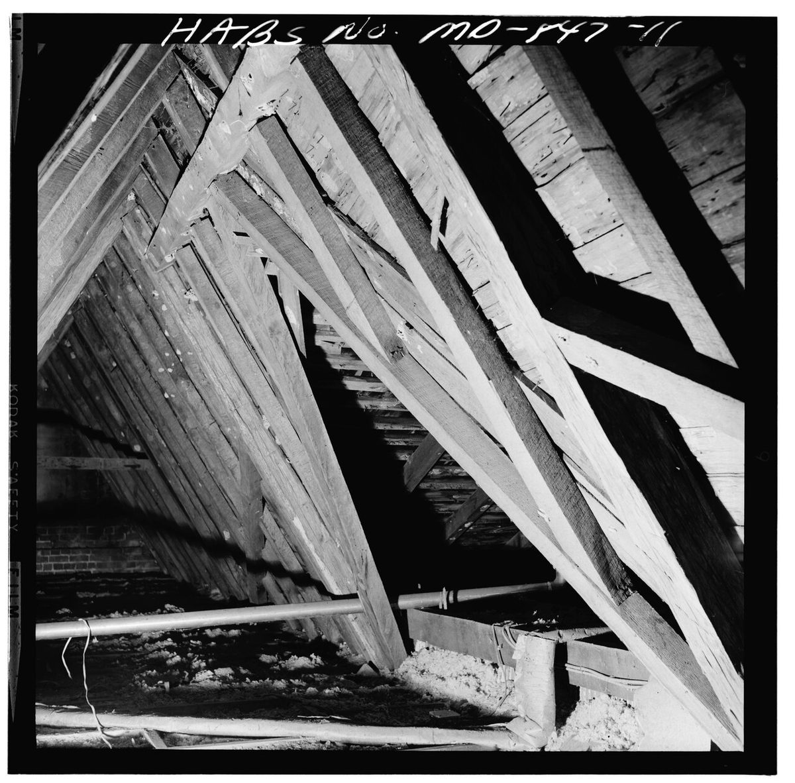

# Valley

<figure markdown>
  
  <figcaption markdown="span">Archive 3D view: valley rafters highlighted in green, the inside edges where two slopes meet at a concave corner. At the top, the roof in plan: the valley runs from the inside corner of the walls to the ridge.</figcaption>
</figure>

<figure markdown>
  
  <figcaption markdown="span">The valley rafter runs diagonally from the corner to the ridge, jack rafters frame into it from both sides. Photo: HABS, Library of Congress, Public domain, <a href="https://commons.wikimedia.org/wiki/File:ROOF_FRAME,_EAST_SLOPE,_DETAIL_SHOWING_VALLEY_RAFTERS_FOR_PORCH_TOWER_-_Cedar_Park,_Cumberstone_Road_on_West_River,_Cumberstone,_Anne_Arundel_County,_MD_HABS_MD,2-CUMB.V,1-19.tif">source</a>.</figcaption>
</figure>

## What it is

A valley is the sloped inside edge where two slopes meet at a concave corner (an addition, an L-shaped plan, a dormer). The valley rafter carries the jack rafters of both slopes, so it is deeper than a common rafter. The outside edge is a [Hip](hip.md). With an overframe, sleepers on the lower roof replace the valley rafter: [Overframes](overframes.md). On a truss roof the valley is a set of valley trusses by others.

## Where to find it on the plans

| Sheet | What to take |
| --- | --- |
| Roof plan (A) | valley lines, slope pitches, where a dormer or addition is |
| Roof framing plan (S) | stick valley rafter or overframe, size, mark |
| Sections | rise, sloped length, bearing at the bottom of the valley |
| Details | jack rafter hangers to the valley, ice and water in the valley (not our scope unless specified) |

## How to measure in OurPlanCore

Beam tool (B) along the valley line on the roof framing sheet with the F dot. The plan length is shorter than the real one: multiply by the factor from the table on the [Hip](hip.md) page (for 45 degrees in plan: 6:12 gives 1.061, 8:12 gives 1.106) or take the length from the section. The app rounds to an order length.

1. One valley = one point; a double valley (dormer on a large slope) gets `(2)` in the name.
2. A valley at an overframe is not drawn as a rafter: there it is a Line along the sleepers.
3. Lower roof sheathing under an addition: per detail, do not subtract or duplicate it automatically.

<figure markdown>
  
  <figcaption markdown="span">Beam tool: two points along the member, the app rounds the length and puts it into the takeoff name.</figcaption>
</figure>

## Takeoff name and DFL row

Path: `framing/roof framing/beams/valley <size> <length>`. The template's combined row `Ridge / Valley / Hip` in LFT when the job does not split them.

| Takeoff name | A (Label) | B | C | D | E |
| --- | --- | --- | --- | --- | --- |
| `beams/valley 2x12 16` | `Valley Rafters` | `2x12` | points | `16` | `S201` |
| `beams/valley (2) 2x12 14` | `Valley Rafters (2)` | `2x12` | points | `14` | dormer |
| `details/sleepers` | `Sleepers` | `2x6` | LFT / 16 | `16` | overframe |

## Common mistakes

- Valley counted as a rafter on a truss roof or at an overframe.
- Length taken from the plan without a factor.
- Jack rafters of both slopes at the valley not accounted for.
- Valley and hip mixed up.
- Valley flashing added with no scope: [Flashing](../../sheathing-and-misc/flashing.md).
- [All roof mistakes](../../../start/common-mistakes.md#roof)

## Example

| A | B | C | D | E |
| --- | --- | --- | --- | --- |
| `Valley Rafters` | `2x12` | 2 | 16 | `S201, pitch 8:12` |
| `Rafters 16" o.c.` | `2x10` | 18 | 12 | `jack rafters at valley` |

## See also

- [Hip](hip.md), [Ridge](ridge.md), [Overframes](overframes.md), [Dormer](dormer.md)
- [Ridge / Valley / Hip (overview)](../../sheathing-and-misc/ridgevalleyhip.md), [Hangers](../../../reference/hangers.md)
