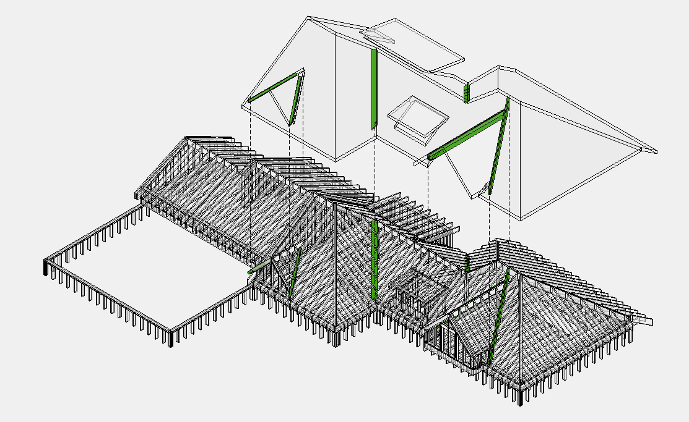

# Valley

**Valley** - наклонная **внутренняя** ендова, где два ската сходятся вогнутым
углом. Valley rafter обычно длиннее и крупнее common rafter. Не путать с hip
(наружный угол).

## Что считать

- Valley rafters/beams, valley framing, and connectors where shown.

## Проверить

- Valley framing can be part of overframe or truss package by others.
- Если stick-framed, проверь sheathing, blocking и roof finish interfaces.
- Engineered valley beams - точный product и length.

## See also

- [Hip](hip.md) , [Ridge](ridge.md) , [Ridge / Valley / Hip](../../sheathing-and-misc/ridgevalleyhip.md) , [Hangers](../../../reference/hangers.md)

<!-- confluence-gallery:start -->
## Визуальная проверка

Архивные иллюстрации помогают прочитать правило. Для своего takeoff сверь его с чертежами и scope текущего проекта.

??? info "Источник картинок"
    - Valley (балка примыкания крыши внутрь): 1 карт. Confluence (архивный источник; ссылка не публикуется)

  
Скрыть 1 правил с иллюстрациями

  <figure class="kb-figure-row">
    <figcaption class="kb-figure-row__text">
      
Valley - визуальная проверка

      
Проверь inside roof intersection, length и material callout.

      
Valley не смешивай с Hip: это внутреннее примыкание roof planes.

    </figcaption>
    
  </figure>

<!-- confluence-gallery:end -->
