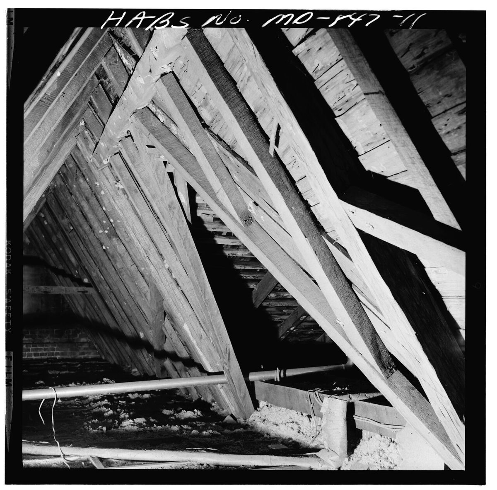
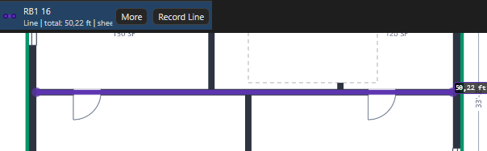

# Valley (ендова)

<figure markdown>
  
  <figcaption markdown="span">Архивный 3D-вид: зелёным выделены valley rafters, внутренние рёбра, где два ската сходятся вогнутым углом. Вверху крыша в плане: valley идёт от угла стыка стен к коньку.</figcaption>
</figure>

<figure markdown>
  
  <figcaption markdown="span">Valley rafter идёт по диагонали от угла к коньку, в него с двух сторон упираются jack rafters. Фото: HABS, Library of Congress, Public domain, <a href="https://commons.wikimedia.org/wiki/File:ROOF_FRAME,_EAST_SLOPE,_DETAIL_SHOWING_VALLEY_RAFTERS_FOR_PORCH_TOWER_-_Cedar_Park,_Cumberstone_Road_on_West_River,_Cumberstone,_Anne_Arundel_County,_MD_HABS_MD,2-CUMB.V,1-19.tif">источник</a>.</figcaption>
</figure>

## Что это

Valley - наклонное внутреннее ребро, где два ската сходятся вогнутым углом (пристройка, L-образный план, dormer). Valley rafter несёт jack rafters обоих скатов, поэтому глубже common rafter. Наружное ребро - [Hip](hip.md). При overframe вместо valley rafter идут sleepers по нижней крыше: [Overframes](overframes.md). У truss-крыши valley - набор valley trusses by others.

## Где искать на чертежах

| Лист | Что взять |
| --- | --- |
| Roof plan (A) | линии valley, уклоны скатов, где dormer или пристройка |
| Roof framing plan (S) | stick valley rafter или overframe, сечение, марка |
| Sections | подъём, наклонная длина, опирание низа valley |
| Details | hangers jack rafters к valley, ice and water в ендове (не наш scope, если не указано) |

## Как мерить в OurPlanCore

Инструмент Beam (B) по линии valley на листе roof framing с точкой F. Плановая длина короче настоящей: умножить на коэффициент из таблицы на странице [Hip](hip.md) (для 45 градусов в плане: 6:12 даёт 1.061, 8:12 даёт 1.106) или взять длину с разреза. Программа округляет до заказной длины.

1. Одна valley = одна точка; двойная valley (dormer на большом скате) - `(2)` в имени.
2. Valley у overframe не рисуется как rafter: там Line по sleepers.
3. Sheathing нижней крыши под пристройкой - по детали, не вычитать и не дублировать автоматически.

<figure markdown>
  
  <figcaption markdown="span">Инструмент Beam: две точки по элементу, длина округляется программой и попадает в имя позиции.</figcaption>
</figure>

## Как назвать в дереве и строка DFL

Путь: `framing/roof framing/beams/valley <сечение> <длина>`. Общая строка шаблона `Ridge / Valley / Hip` в LFT, когда проект не делит их.

| Имя в дереве | A (Label) | B | C | D | E |
| --- | --- | --- | --- | --- | --- |
| `beams/valley 2x12 16` | `Valley Rafters` | `2x12` | точки | `16` | `S201` |
| `beams/valley (2) 2x12 14` | `Valley Rafters (2)` | `2x12` | точки | `14` | dormer |
| `details/sleepers` | `Sleepers` | `2x6` | LFT / 16 | `16` | overframe |

## Частые ошибки

- Valley посчитан у truss-крыши или у overframe как rafter.
- Длина с плана без коэффициента.
- Jack rafters обоих скатов к valley не учтены.
- Valley и hip перепутаны.
- Flashing ендовы добавлен без scope: [Flashing](../../sheathing-and-misc/flashing.md).
- [Все ошибки по крыше](../../../start/common-mistakes.md#roof)

## Пример

| A | B | C | D | E |
| --- | --- | --- | --- | --- |
| `Valley Rafters` | `2x12` | 2 | 16 | `S201, pitch 8:12` |
| `Rafters 16" o.c.` | `2x10` | 18 | 12 | `jack rafters at valley` |

## См. также

- [Hip](hip.md), [Ridge](ridge.md), [Overframes](overframes.md), [Dormer](dormer.md)
- [Ridge / Valley / Hip (обзор)](../../sheathing-and-misc/ridgevalleyhip.md), [Hangers](../../../reference/hangers.md)
