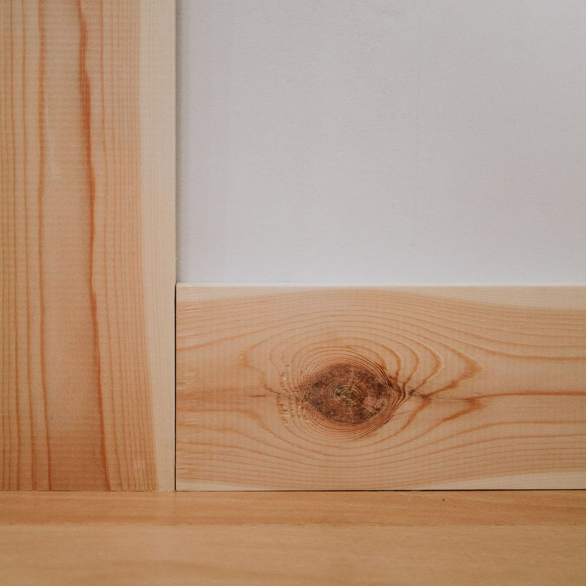
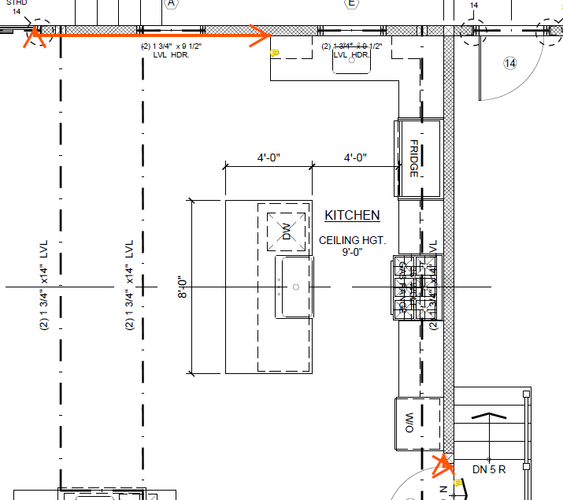
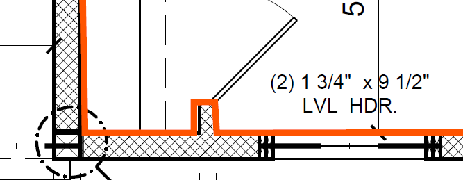
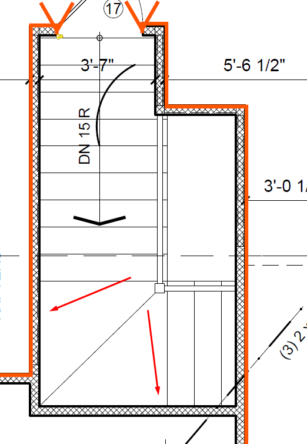
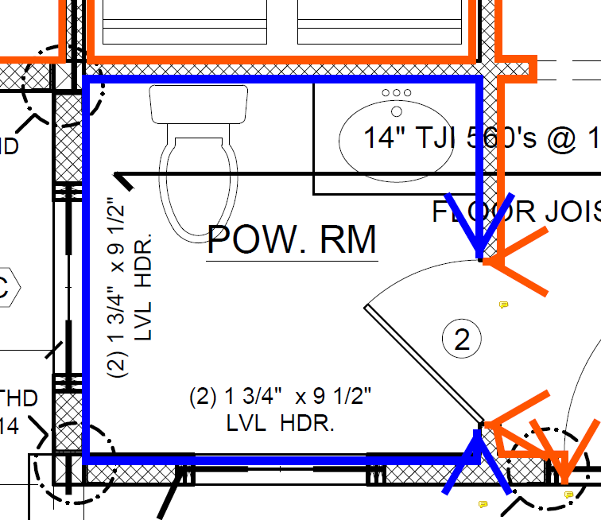
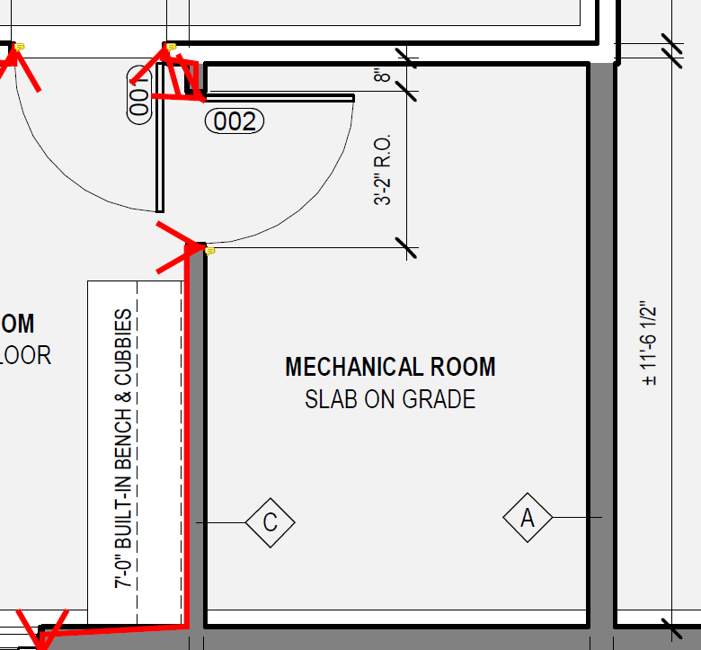
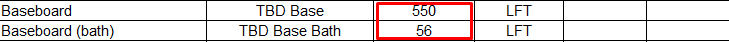

# Base

<figure markdown>
  { width="420" }
  <figcaption markdown="span">Wood baseboard along the bottom of the wall runs into the door casing: base is counted in LFT along the room perimeter, the door opening is deducted from the perimeter, casing is its own row. Photo: nadinestay.com, [source](https://nadinestay.com/blog/how-to-install-floor-trim-like-the-professionals), found via Pinterest.</figcaption>
</figure>

<figure markdown>
  
  <figcaption markdown="span">There is no baseboard behind kitchen cabinets: deduct the wall runs under the cabinets from the perimeter.</figcaption>
</figure>

## What it is

`Baseboard`: the board along the bottom of the wall in finished rooms. Counted in LFT along the
room perimeter. Wood base only where the room schedule says `Wd` or
`Wood`; tile, rubber, vinyl and metal base are a different material. Crown runs along the same
perimeter, but with its own exclusions: [Crown](crown.md).

## Where to find it on the plans

| Sheet | What to take |
| --- | --- |
| Room finish schedule | `Base` column: material per room, `TBD`, unfinished rooms |
| Floor plans | Room perimeter, kitchen cabinets, stairs, garage |
| Interior elevations, finish notes | Exclusions and material when the schedule is silent |

## How to measure in OurPlanCore

Line along the room perimeter on the plan with the W point, continuous from the entry
door, breaks only on purpose. One item per floor and zone: `baseboard 1st`,
`baseboard corridor`. Unit base separately from corridors, lobby and other
common areas, because they may have a different material. Bathrooms with tile
base can be traced as a separate item to check the exclusion.

## Rules

| Rule | What to check |
| --- | --- |
| No base behind kitchen cabinets | Deduct the walls under the cabinets in the formula |
| Base under windows stays | Do not skip the short runs under windows |
| Stair junction | Stop the base where the stair trim makes it unnecessary |
| Toilets and shower rooms | Count if the material is wood; do not count tile base as wood |
| Garage, mechanical, crawl space, unfinished | No base, do not run the perimeter through them |
| Material `TBD Base` | Leave the note `Base not specified in room schedule` instead of picking a product |

## Tree name and DFL row

| Tree name | DFL row | Unit | Formula |
| --- | --- | --- | --- |
| `trims/baseboard 1st` | `Baseboard` | LFT | `=CEILING(G*1.1,10)`; G holds the sum of the runs `=42+38+27+...`, every addend visible |
| `trims/baseboard corridor` | `Baseboard Corridor` | LFT | same formula, separate from units |
| | `Baseboard`, `TBD Base` in B | LFT | when the schedule gives no profile: a note, do not pick a product |

The 1.1 waste and the round-up to 10 are in the template formula; do not add them
by hand a second time. Every measured value goes into G as a sum: the checker must
see where the number came from, not just the total.

## Common mistakes

- Perimeter run through the kitchen cabinets and garage.
- Tile base counted as wood base.
- Units and corridors in one row with different materials.
- Total as a number without the addends.
- All Excel mistakes: [Excel DFL and notes](../../start/common-mistakes.md#excel).

## Example

```text
Takeoffs/Main/trims/baseboard 1st   Line   412 LFT (7 rooms)

Baseboard   Wd 1x6 Base   460  LFT   =CEILING(G*1.1,10)   G =58+44+71+39+66+52+82   A701
Baseboard   TBD Base      0    LFT   Note: Base not specified in room schedule

G = 412; 412 x 1.1 = 453.2, rounded up to 10 = 460 LFT
```

<details class="kb-figures kb-figures--rows">
  <summary>Show 5 archived cards with illustrations</summary>
  <figure class="kb-figure-row">
    <figcaption class="kb-figure-row__text">
      <div class="kb-figure-row__title">Base below windows</div>
      <div class="kb-figure-row__rule">Runs under windows stay unless the notes exclude them.</div>
    </figcaption>
    <a class="kb-figure-row__image" href="../../../assets/images/trims/int-trims-08.png" target="_blank" rel="noopener"></a>
  </figure>
  <figure class="kb-figure-row">
    <figcaption class="kb-figure-row__text">
      <div class="kb-figure-row__title">Stair / wall junction</div>
      <div class="kb-figure-row__rule">Base stops where the stair trim makes it unnecessary.</div>
    </figcaption>
    <a class="kb-figure-row__image" href="../../../assets/images/trims/int-trims-09.png" target="_blank" rel="noopener"></a>
  </figure>
  <figure class="kb-figure-row">
    <figcaption class="kb-figure-row__text">
      <div class="kb-figure-row__title">Toilets / shower rooms</div>
      <div class="kb-figure-row__rule">Check the material before excluding: wood is counted, tile is not.</div>
    </figcaption>
    <a class="kb-figure-row__image" href="../../../assets/images/trims/int-trims-10.png" target="_blank" rel="noopener"></a>
  </figure>
  <figure class="kb-figure-row">
    <figcaption class="kb-figure-row__text">
      <div class="kb-figure-row__title">Garage and unfinished rooms</div>
      <div class="kb-figure-row__rule">No base in garage, mechanical, crawl space, unfinished storage.</div>
    </figcaption>
    <a class="kb-figure-row__image" href="../../../assets/images/trims/int-trims-11.png" target="_blank" rel="noopener"></a>
  </figure>
  <figure class="kb-figure-row">
    <figcaption class="kb-figure-row__text">
      <div class="kb-figure-row__title">Excel formula</div>
      <div class="kb-figure-row__rule">All measured runs are visible in the formula; the total matches the material note.</div>
    </figcaption>
    <a class="kb-figure-row__image" href="../../../assets/images/trims/int-trims-12.png" target="_blank" rel="noopener"></a>
  </figure>
</details>

## See also

- [Interior Trims](overview.md), [Room Schedule](room-schedule.md), [Crown](crown.md), [Casing](casing.md)
- [Standard notes](../../reference/standard-notes.md)
