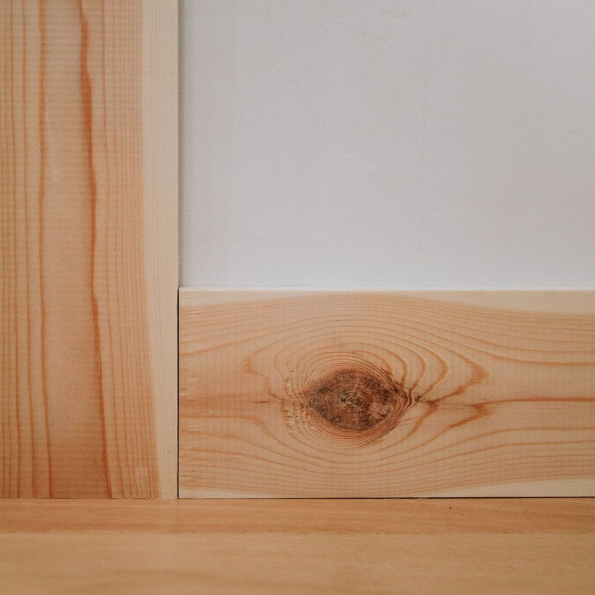
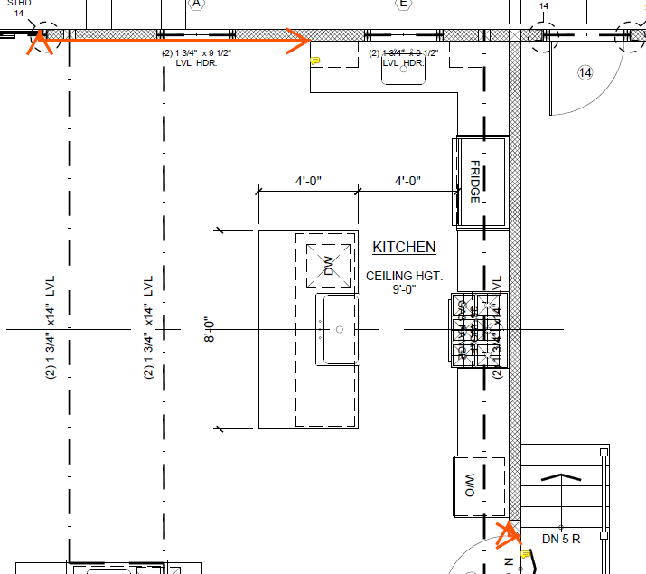
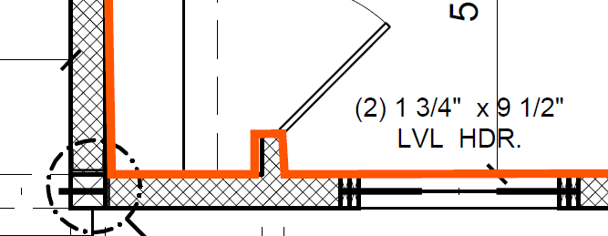
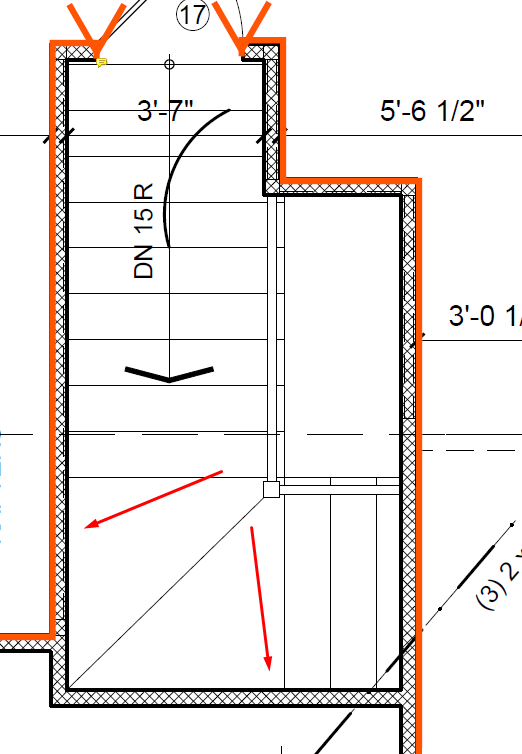
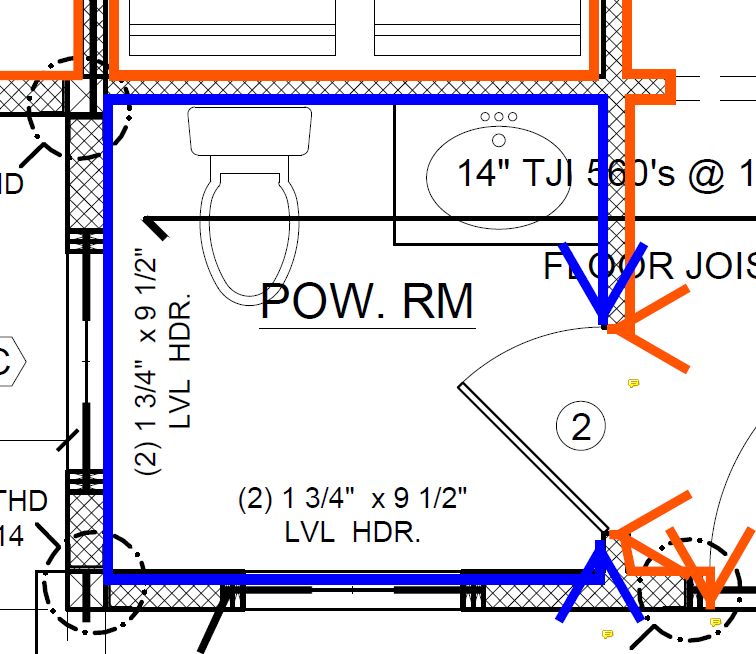
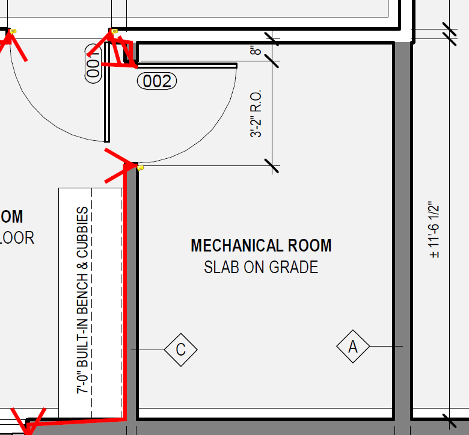
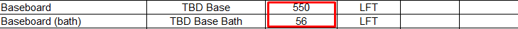

# Base (плинтус)

<figure markdown>
  { width="420" }
  <figcaption markdown="span">Wood baseboard по низу стены упирается в door casing: base считается LFT по периметру комнаты, проём двери из периметра вычитается, casing идёт своей строкой. Фото: nadinestay.com, [источник](https://nadinestay.com/blog/how-to-install-floor-trim-like-the-professionals), найдено через Pinterest.</figcaption>
</figure>

<figure markdown>
  
  <figcaption markdown="span">За кухонными шкафами baseboard нет: вычитай участки стен под шкафами из периметра.</figcaption>
</figure>

## Что это

`Baseboard`: доска по низу стены в комнатах с отделкой. Считается LFT по
периметру комнат. Wood base только там, где room schedule говорит `Wd` или
`Wood`; tile, rubber, vinyl и metal base это другой материал. Crown по тому
же периметру, но со своими исключениями: [Crown](crown.md).

## Где искать на чертежах

| Лист | Что взять |
| --- | --- |
| Room finish schedule | Колонка `Base`: материал по комнате, `TBD`, комнаты без отделки |
| Планы этажей | Периметр комнат, кухонные шкафы, лестницы, garage |
| Interior elevations, finish notes | Исключения и материал, когда schedule молчит |

## Как мерить в OurPlanCore

Line по периметру комнат на плане с точкой W, непрерывно от входной
двери, разрывы только намеренные. По итему на этаж и зону: `baseboard 1st`,
`baseboard corridor`. Unit base отдельно от corridors, lobby и других
common areas, потому что там может быть другой материал. Bathrooms с tile
base можно обвести отдельным итемом, чтобы проверить исключение.

## Правила

| Правило | Что проверить |
| --- | --- |
| За kitchen cabinets base нет | Вычесть стены под шкафами из формулы |
| Под окнами base есть | Короткие участки под окнами не пропускать |
| Стык с лестницей | Остановить base там, где stair trim делает его ненужным |
| Toilets и shower rooms | Считать, если материал wood; tile base не считать как wood |
| Garage, mechanical, crawl space, unfinished | Base нет, периметр через них не вести |
| Материал `TBD Base` | Оставить ноту `Base not specified in room schedule` вместо выбора продукта |

## Как назвать в дереве и строка DFL

| Имя в дереве | Строка DFL | Unit | Формула |
| --- | --- | --- | --- |
| `trims/baseboard 1st` | `Baseboard` | LFT | `=42+38+27+...` все измеренные участки видны |
| `trims/baseboard corridor` | `Baseboard corridor` | LFT | отдельно от units |
| | `Base` материал `TBD` | LFT | нота, если schedule не задаёт |

Все измеренные значения вписываются в формулу: проверяющий должен видеть,
откуда взялось число, а не только итог.

## Частые ошибки

- Периметр проведён через кухонные шкафы и garage.
- Tile base посчитан как wood base.
- Units и corridors в одной строке при разном материале.
- Итог числом без слагаемых.
- Все ошибки по Excel: [Excel DFL и ноты](../../start/common-mistakes.md#excel).

## Пример

```text
Takeoffs/Main/trims/baseboard 1st   Line   412 LFT (7 rooms)

Baseboard   Wd 1x6 (per schedule)   412  LFT   =58+44+71+39+66+52+82   A701
Baseboard   TBD                     0    LFT   Note: Base not specified in room schedule
```

<details class="kb-figures kb-figures--rows">
  <summary>Показать 5 архивных карточек с иллюстрациями</summary>
  <figure class="kb-figure-row">
    <figcaption class="kb-figure-row__text">
      <div class="kb-figure-row__title">Base below windows</div>
      <div class="kb-figure-row__rule">Участки под окнами остаются, если notes их не исключают.</div>
    </figcaption>
    <a class="kb-figure-row__image" href="../../../assets/images/trims/int-trims-08.png" target="_blank" rel="noopener"></a>
  </figure>
  <figure class="kb-figure-row">
    <figcaption class="kb-figure-row__text">
      <div class="kb-figure-row__title">Stair / wall junction</div>
      <div class="kb-figure-row__rule">Base останавливается там, где stair trim делает его ненужным.</div>
    </figcaption>
    <a class="kb-figure-row__image" href="../../../assets/images/trims/int-trims-09.png" target="_blank" rel="noopener"></a>
  </figure>
  <figure class="kb-figure-row">
    <figcaption class="kb-figure-row__text">
      <div class="kb-figure-row__title">Toilets / shower rooms</div>
      <div class="kb-figure-row__rule">Перед исключением проверь материал: wood считается, tile нет.</div>
    </figcaption>
    <a class="kb-figure-row__image" href="../../../assets/images/trims/int-trims-10.png" target="_blank" rel="noopener"></a>
  </figure>
  <figure class="kb-figure-row">
    <figcaption class="kb-figure-row__text">
      <div class="kb-figure-row__title">Garage и unfinished rooms</div>
      <div class="kb-figure-row__rule">Нет base в garage, mechanical, crawl space, unfinished storage.</div>
    </figcaption>
    <a class="kb-figure-row__image" href="../../../assets/images/trims/int-trims-11.png" target="_blank" rel="noopener"></a>
  </figure>
  <figure class="kb-figure-row">
    <figcaption class="kb-figure-row__text">
      <div class="kb-figure-row__title">Формула в Excel</div>
      <div class="kb-figure-row__rule">Все измеренные участки видны в формуле, итог совпадает с нотой о материале.</div>
    </figcaption>
    <a class="kb-figure-row__image" href="../../../assets/images/trims/int-trims-12.png" target="_blank" rel="noopener"></a>
  </figure>
</details>

## См. также

- [Interior Trims](overview.md), [Room Schedule](room-schedule.md), [Crown](crown.md), [Casing](casing.md)
- [Standard notes](../../reference/standard-notes.md)
